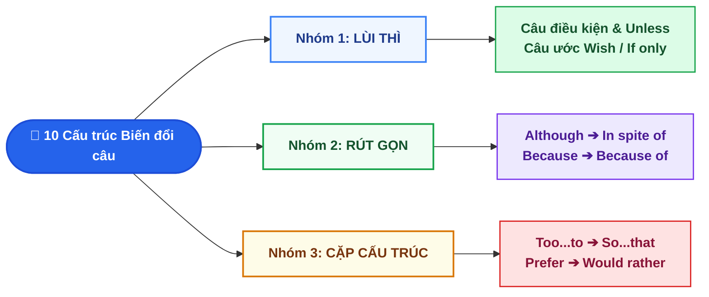

# Chuyên Đề 2: 10 Cấu Trúc Viết Lại Câu Trọng Tâm Ôn Thi Vào 10

::: info Kiến thức trọng tâm
Biến đổi câu (*Sentence Transformation*) là kỹ thuật **giữ nguyên 100% nghĩa gốc ** nhưng **thay đổi cấu trúc ngữ pháp ** theo từ gợi ý đầu câu. Điểm cần lưu ý nằm ở 2 thao tác: **Đổi từ loại (Mệnh đề ↔ Cụm danh từ/V-ing)** và **Lùi thì động từ**.
:::

---

## I. Sơ đồ tóm tắt các dạng viết lại câu

---

## II. NHÓM 1: CÂU ĐIỀU KIỆN (CONDITIONALS) & CÂU ƯỚC (WISH / IF ONLY)

### 1. Cấu trúc 1: Câu điều kiện (Type 1, 2, 3, Unless, Without / But for)

::: info CÔNG THỨC CỐT LÕI 3 LOẠI CÂU ĐIỀU KIỆN
- **Loại 1 (Có thật ở HT/TL):** `If + S + V(s/es), S + will/can/may + V-inf`
- **Loại 2 (Trái với Hiện tại):** `If + S + V2/ed (be -> were), S + would/could + V-inf`
- **Loại 3 (Trái với Quá khứ):** `If + S + had + V3/ed, S + would/could + have + V3/ed`
:::

| Dạng đề cho (Câu gốc) | Công thức viết lại tương đương | Ví dụ chuẩn (kèm IPA từ khóa) |
| :--- | :--- | :--- |
| **Mệnh lệnh + `or / otherwise`** | `If you don't + V-inf, S + will...` `Unless you + V(s/es), S + will...` | *Hurry up **or** you will be late.* ➔ ***Unless** you **hurry** up, you will be late.* |
| **Sự thật ở Hiện tại (`so` / `because`)** | **Điều kiện loại 2** (Lùi về `V2/ed`, đổi Khẳng định ↔ Phủ định) | *I **don't have** her number, **so** I **can't call** her.* ➔ *If I **had** her number, I **could call** her.* |
| **Sự thật ở Quá khứ (`V2/ed`)** | **Điều kiện loại 3** (Lùi về `had + V3/ed`, đổi Khẳng định ↔ Phủ định) | *He **was** sick, **so** he **didn't go** to school.* ➔ *If he **hadn't been** sick, he **would have gone** to school.* |
| **`If ... not`** | `Unless + S + V(khẳng định), Mệnh đề chính giữ nguyên` | ***If** it **doesn't rain**, we will go camping.* ➔ ***Unless** it **rains** (`/reɪnz/`), we will go camping.* |
| **`If it weren't for` / `If it hadn't been for`** | `Without / But for + Cụm N / V-ing, S + would (have)...` | *If you hadn't helped me, I would have failed.* ➔ ***But for / Without** your help, I would have failed.* |

::: danger LỖI THƯỜNG GẶP
Bản chất của `Unless` đã mang nghĩa phủ định (`= If ... not`), nên động từ đi ngay sau `Unless` **bắt buộc ở thể khẳng định**.
- ❌ **Sai:** *Unless you **don't study** hard, you will fail the exam.*
- ✅ **Đúng:** *Unless you **study** hard, you will fail the exam.*
:::

### 2. Cấu trúc 2: Câu ước (`Wish` / `If only`) ở 3 thì

::: tip MẸO NHỚ QUY TẮC "TRÁI DẤU & LÙI THÌ" KHI VIẾT CÂU `WISH`
- Câu gốc ở **Khẳng định (+)** ➔ Câu `Wish` đổi sang **Phủ định (-)** (và ngược lại).
- Câu gốc ở **Tương lai (`will`)** ➔ Lùi về `would/could + V-inf`.
- Câu gốc ở **Hiện tại (`V-s/es`)** ➔ Lùi về **Quá khứ đơn (`V2/ed` / `were`)**.
- Câu gốc ở **Quá khứ (`V2/ed`)** ➔ Lùi về **Quá khứ hoàn thành (`had + V3/ed`)**.
:::

| Loại câu ước | Dấu hiệu trong câu gốc | Công thức `S + wish(es) / If only` | Ví dụ luyện tập |
| :--- | :--- | :--- | :--- |
| **1. Ước ở Hiện tại** | `It's a pity / What a pity / I'm sorry + S + V(htđ)` | `S + wish(es) + S + V2/ed (were) / didn't V-inf` | *It's a pity I **don't know** how to swim.* ➔ *I **wish** I **knew** (`/njuː/`) how to swim.* |
| **2. Ước ở Tương lai** | Mong muốn thay đổi, phàn nàn hoặc có `tomorrow, next...` | `S + wish(es) + S + would / could + V-inf` | *It's a pity she **won't join** our trip tomorrow.* ➔ *I **wish** she **would join** our trip tomorrow.* |
| **3. Ước ở Quá khứ** | `regret + V-ing` hoặc sự việc đã xảy ra (`V2/ed`, `yesterday`) | `S + wish(es) + S + had (not) + V3/ed` | *I **regret telling** him my secret yesterday.* ➔ *I **wish** I **hadn't told** him my secret yesterday.* |

---

## III. NHÓM 2: CÂU BỊ ĐỘNG (PASSIVE VOICE) & CÂU TƯỜNG THUẬT (REPORTED SPEECH)

### 3. Cấu trúc 3: Câu bị động cơ bản, Bị động kép & Bị động nhờ vả

::: info Quy tắc chuyển sang câu bị động
Đưa Tân ngữ (`O`) lên làm Chủ ngữ mới, chia động từ `be` theo đúng thì của động từ chính, và biến động từ chính thành **`V3/ed`**:
`Chủ động: S + V + O` ➔ `Bị động: S(O) + BE + V3/ed + (Nơi chốn) + (by O) + (Thời gian)`
:::

| Dạng Bị động | Cấu trúc Chủ động (Active) | Cấu trúc Bị động (Passive) | Ví dụ minh họa |
| :--- | :--- | :--- | :--- |
| **Bị động Động từ khuyết thiếu** | `S + modal verb + V-inf + O` | `S(O) + modal verb + be + V3/ed` | *We **must protect** the environment.* ➔ *The environment **must be protected**.* |
| **Bị động Hiện tại hoàn thành** | `S + have/has + V3/ed + O` | `S(O) + have/has + been + V3/ed` | *They **have built** a new bridge here.* ➔ *A new bridge **has been built** here.* |
| **Bị động kép (Tường thuật khách quan)** | `People say/think/believe that + S2 + V2...` | **Cách 1:** `It is said/thought that + S2 + V2...` **Cách 2 (Cùng thì):** `S2 + am/is/are + said + to V-inf` **Cách 2 (Lệch thì QK):** `S2 + am/is/are + said + to have V3/ed` | *People say that he **is** very rich.* ➔ *He **is said to be** very rich.* *People say that he **stole** the car.* ➔ *He **is said to have stolen** the car.* |
| **Bị động Nhờ vả (Causative Form)** | `S + have + Ai + V-inf + Vật` `S + get + Ai + to-V + Vật` | `S + have / get + Vật + V3/ed + (by Ai)` | *I **had a technician repair** my laptop.* ➔ *I **had my laptop repaired** (by a technician).* |

### 4. Cấu trúc 4: Câu gián tiếp / Tường thuật (Reported Speech)

::: warning 3 BƯỚC CHUYỂN CÂU TRỰC TIẾP SANG GIÁN TIẾP
**Bước 1 (Đổi ngôi):** Nhất chủ - Nhì tân - Tam nguyên (`I/we` đổi theo người nói; `you` đổi theo người nghe; `he/she/they` giữ nguyên).
**Bước 2 (Lùi 1 thì):** `HTĐ ➔ QKĐ`, `HTTD ➔ QKTD`, `HTHT / QKĐ ➔ QKHT (had V3/ed)`, `will/can/may ➔ would/could/might`, `must ➔ had to`.
**Bước 3 (Đổi trạng từ):** `now ➔ then`, `today ➔ that day`, `tomorrow ➔ the next/following day`, `yesterday ➔ the previous day / the day before`, `ago ➔ before`, `this/these ➔ that/those`, `here ➔ there`.
:::

| Loại câu tường thuật | Công thức chuẩn | Ví dụ luyện tập |
| :--- | :--- | :--- |
| **1. Câu kể (Statements)** | `S + said (that) / told + O + (that) + S + V(lùi thì)` | *"I **am learning** Python **now**," Nam said.* ➔ *Nam said (that) he **was learning** Python **then**.* |
| **2. Câu hỏi Yes/No** | `S + asked + O / wanted to know + IF / WHETHER + S + V(lùi thì)` | *"Do you **like** coffee?" she asked me.* ➔ *She asked me **if/whether** I **liked** coffee.* |
| **3. Câu hỏi Wh-Questions** | `S + asked + O + Wh-word + S + V(lùi thì)` *(Bỏ đảo ngữ trợ động từ!)* | *"Where **did** you **go** yesterday?" Tom asked Mary.* ➔ *Tom asked Mary where she **had gone** the day before.* |
| **4. Câu mệnh lệnh / Yêu cầu** | `S + told / asked + O + (NOT) + to V-inf` | *"**Don't open** the door!" the mother said to her son.* ➔ *The mother told her son **not to open** the door.* |

::: danger LƯU Ý KHI LÀM BÀI THI VÀO 10 (GIỮ NGUYÊN ĐẢO NGỮ TRONG CÂU HỎI GIÁN TIẾP)
Khi đã chuyển sang câu tường thuật, câu hỏi biến thành mệnh đề phụ khẳng định nên **tuyệt đối không đảo `was/were/did` lên trước chủ ngữ**.
- ❌ **Sai:** *He asked me where **was I** going.*
- ✅ **Đúng:** *He asked me where **I was** going.*
:::

---

## IV. NHÓM 3: MỆNH ĐỀ KẾT QUẢ, NHƯỢNG BỘ & LÝ DO

### 5. Cấu trúc 5: Chỉ kết quả (`So...that` ↔ `Such...that` ↔ `Too...to` ↔ `Enough...to`)

| Cấu trúc | Công thức chuẩn xác | Ví dụ biến đổi đồng nghĩa cùng 1 câu |
| :--- | :--- | :--- |
| **`SO ... THAT`** | `S + be/V + SO + adj/adv + THAT + S + V` | *The box is **so heavy that** I can't lift it.* |
| **`SUCH ... THAT`** | `S + V + SUCH + (a/an) + adj + N + THAT + S + V` | ➔ *It is **such a heavy box that** I can't lift it.* |
| **`TOO ... TO`** *(Quá... đến nỗi không thể)* | `S + be/V + TOO + adj/adv + (for O) + TO V-inf` *(Bỏ tân ngữ lặp ở cuối!)* | ➔ *The box is **too heavy for me to lift**.* *(Bỏ `it` ở cuối!)* |
| **`ENOUGH ... TO`** *(Đủ... để có thể)* | `S + be/V + adj(ngược nghĩa) + ENOUGH + (for O) + TO V-inf` | ➔ *The box is **not light enough for me to lift**.* |

::: warning NGOẠI LỆ VỚI ĐỊNH LƯỢNG TỪ (`many, much, few, little`)
Dù đi kèm Danh từ (`N`), nhưng nếu có `many / much / few / little` đứng trước thì bắt buộc dùng **`SO`**, không dùng `SUCH`!
- Công thức: `S + V + SO + many/few + N(số nhiều) / much/little + N(không đếm được) + THAT + S + V`
- Ví dụ: *He has **so many books that** he can't read them all.*
:::

### 6. Cấu trúc 6 & 7: Nhượng bộ (`Although` ↔ `In spite of`) & Lý do (`Because` ↔ `Because of`)

::: info CÔNG THỨC CHUYỂN ĐỔI MỆNH ĐỀ (`S + V`) SANG CỤM TỪ (`N / V-ing`)
- **Nhượng bộ (Mặc dù):** `Although / Even though / Though + S + V` $\leftrightarrow$ `In spite of / Despite + Cụm N / V-ing / the fact that S + V`
- **Lý do (Bởi vì):** `Because / Since / As + S + V` $\leftrightarrow$ `Because of / Due to / Owing to + Cụm N / V-ing`
:::

::: tip 4 Quy tắc cơ bản RÚT GỌN MỆNH ĐỀ (`S + V`) THÀNH CỤM DANH TỪ (`NOUN PHRASE`)
1. **Hai vế cùng chủ ngữ (`S1 = S2`):** Bỏ chủ ngữ, đưa động từ về **`V-ing`**.
   *Ví dụ:* *Although **she felt** tired, she worked on.* ➔ *Despite **feeling** tired, she worked on.*
2. **`Đại từ nhân xưng (he/she/I/they) + be + Adj`:** Đổi thành **`Tính từ sở hữu (his/her/my/their) + N(từ adj)`**.
   *Ví dụ:* *Because **he was sick**, he stayed home.* ➔ *Because of **his sickness**, he stayed home.*
3. **`Danh từ (The weather / The traffic) + be + Adj`:** Đưa `Adj` lên trước `Danh từ` thành **`The + Adj + N`**.
   *Ví dụ:* *Although **the traffic was heavy**, we arrived on time.* ➔ *In spite of **the heavy traffic**, we arrived on time.*
4. **`It + be + Adj (thời tiết)` hoặc `S + V + Adv`:** Đổi thành **`The + Adj + weather`** hoặc **`Sở hữu + Adj + N`**.
   *Ví dụ:* *Because **he behaved badly**, he was punished.* ➔ *Because of **his bad behavior**, he was punished.*
:::

---

## V. NHÓM 4: CẤU TRÚC GỢI Ý, SO SÁNH, THỜI GIAN & SỞ THÍCH

### 8. Cấu trúc 8: Câu gợi ý với `Suggest` (Cực kỳ hay ra trong đề Quảng Ngãi)

::: info 2 CÔNG THỨC `SUGGEST` BẮT BUỘC THUỘC LÒNG
- **Cùng thực hiện chung (`Let's... / Why don't we... / Shall we... / How about...`):**
  `S + suggested + V-ing` *(hoặc `S + suggested that + we + (should) + V-inf`)*
- **Khuyên người khác làm gì (`Why don't you... / You should...`):**
  `S + suggested (that) + S2 + (should) + V-inf (nguyên mẫu không chia!)`
:::

::: danger LƯU Ý TUYỆT ĐỐI TRÁNH VỚI `SUGGEST`
Trong tiếng Anh chuẩn, **`SUGGEST` KHÔNG BAO GIỜ đi với `O + to-V`**!
- ❌ **Sai:** *He suggested **me to buy** that dictionary.*
- ✅ **Đúng:** *He suggested **that I (should) buy** that dictionary.*
:::

### 9. Cấu trúc 9: Chuyển đổi cấp độ So sánh (Comparison Transformation)

| Dạng câu gốc | Công thức biến đổi tương đương | Ví dụ luyện tập |
| :--- | :--- | :--- |
| **So sánh hơn ↔ So sánh không bằng** | `A + be + adj-er / more adj + than + B` ➔ `B + be + NOT + as/so + adj(nguyên gốc) + as + A` | *Da Nang is **bigger than** Quang Ngai.* ➔ *Quang Ngai is **not as big as** Da Nang.* |
| **So sánh hơn (Động từ thường)** | `A + V + adv-er / more adv + than + B` ➔ `B + don't/doesn't/didn't + V + as + adv + as + A` | *Lan **speaks** English **more fluently than** Mai.* ➔ *Mai **doesn't speak** English **as fluently as** Lan.* |
| **So sánh nhất ↔ Không ai bằng** | `S + be + the + superlative (nhất)...` ➔ `No one / Nothing / Nowhere ... + be + as + adj + as + S` | *Mount Everest is **the highest** mountain in the world.* ➔ ***No mountain** in the world is **as high as** Mount Everest.* |

### 10. Cấu trúc 10: Thời gian (`Spend` ↔ `It takes`) & Sở thích (`Prefer` ↔ `Would rather`)

| Nhóm nghĩa | Cấu trúc 1 | Cấu trúc 2 (Biến đổi tương đương) | Ví dụ chuẩn |
| :--- | :--- | :--- | :--- |
| **Mất bao lâu để làm gì** | `S + spend / spent + [Thời gian] + V-ing` | ➔ `It + takes / took + (O) + [Thời gian] + to V-inf` | *I **spent 2 hours fixing** the network error.* ➔ ***It took me 2 hours to fix** the network error.* |
| **Thích cái gì hơn cái gì** | `S + prefer + V-ing + TO + V-ing` `S + like + V-ing + better than + V-ing` | ➔ `S + would rather ('d rather) + V-inf + THAN + V-inf` ➔ `S + would prefer + to V-inf + rather than + V-inf` | *She **prefers reading** books **to watching** TV.* ➔ *She **would rather read** books **than watch** TV.* |

---

## VI. 10 CÂU BÀI TẬP LUYỆN TẬP (TRÍCH ĐỀ THI VÀO 10 SỞ GD QUẢNG NGÃI)

Viết lại các câu sau sao cho nghĩa không đổi, bắt đầu bằng từ gợi ý:

<QuizItem
  :number="1"
  type="transform"
  question="Keep silent or the teacher will punish you.
   *"
  targetPrompt="Unless you..."
  sampleAnswer="Unless you keep silent, the teacher will punish you."
  explanation="**Câu 1:** `Unless you keep silent, the teacher will punish you.` — Cấu trúc `Mệnh lệnh + or + S + will` chuyển thành `Unless + S + V(khẳng định)`."
/>

<QuizItem
  :number="2"
  type="transform"
  question="I don't have a spare laptop, so I can't lend you one.
   *"
  targetPrompt="If I..."
  sampleAnswer="If I had a spare laptop, I could (hoặc would) lend you one."
  explanation="**Câu 2:** `If I had a spare laptop, I could (hoặc would) lend you one.` — Sự thật ở hiện tại (`don't have`) chuyển sang câu điều kiện loại 2 (trái dấu + lùi về `had`)."
/>

<QuizItem
  :number="3"
  type="transform"
  question="What a pity! My brother cannot attend the workshop tomorrow.
   *"
  targetPrompt="I wish..."
  sampleAnswer="I wish my brother could attend the workshop tomorrow."
  explanation="**Câu 3:** `I wish my brother could attend the workshop tomorrow.` — Ước cho tương lai/khả năng (`cannot` lùi về `could` và bỏ phủ định)."
/>

<QuizItem
  :number="4"
  type="transform"
  question="The government has upgraded the local hospital recently.
   *"
  targetPrompt="The local hospital..."
  sampleAnswer="The local hospital has been upgraded (by the government) recently."
  explanation="**Câu 4:** `The local hospital has been upgraded (by the government) recently.` — Bị động thì Hiện tại hoàn thành: `has/have + been + V3/ed`."
/>

<QuizItem
  :number="5"
  type="transform"
  question="&quot;Where are you going to spend your holiday next month, Nam?&quot; asked Lan.
   *"
  targetPrompt="Lan asked Nam..."
  sampleAnswer="Lan asked Nam where he was going to spend his holiday the following month (hoặc the next month)."
  explanation="**Câu 5:** `Lan asked Nam where he was going to spend his holiday the following month (hoặc the next month).` — Đổi ngôi (`you -> he, your -> his`), lùi thì (`are going to -> was going to`), đổi trạng từ (`next month -> the following month`), không đảo ngữ."
/>

<QuizItem
  :number="6"
  type="transform"
  question="The coffee was so hot that my father couldn't drink it.
   *"
  targetPrompt="The coffee was too..."
  sampleAnswer="The coffee was too hot for my father to drink."
  explanation="**Câu 6:** `The coffee was too hot for my father to drink.` — Cấu trúc `so + adj + that + S + couldn't V` chuyển sang `too + adj + for O + to V-inf` (nhớ lược bỏ tân ngữ `it` ở cuối câu!)."
/>

<QuizItem
  :number="7"
  type="transform"
  question="Although he had a very good salary, he gave up his job.
   *"
  targetPrompt="In spite of..."
  sampleAnswer="In spite of having a very good salary (hoặc his very good salary), he gave up his job."
  explanation="**Câu 7:** `In spite of having a very good salary (hoặc his very good salary), he gave up his job.` — Hai vế cùng chủ ngữ `he`, rút gọn thành `In spite of + V-ing` (`having`)."
/>

<QuizItem
  :number="8"
  type="transform"
  question="Because the storm was severe, all flights were canceled.
   *"
  targetPrompt="Because of..."
  sampleAnswer="Because of the severe storm, all flights were canceled."
  explanation="**Câu 8:** `Because of the severe storm, all flights were canceled.` — Rút gọn mệnh đề `The + N + be + adj` thành cụm danh từ `The + adj + N` (`the severe storm`)."
/>

<QuizItem
  :number="9"
  type="transform"
  question="&quot;Why don't you install an antivirus program on your computer, Minh?&quot; said Hoa.
   *"
  targetPrompt="Hoa suggested that..."
  sampleAnswer="Hoa suggested that Minh (should) install an antivirus program on his computer."
  explanation="**Câu 9:** `Hoa suggested that Minh (should) install an antivirus program on his computer.` — Khuyên người khác (`Why don't you...`) dùng cấu trúc `suggest that + S + (should) + V-inf`."
/>

<QuizItem
  :number="10"
  type="transform"
  question="It took the engineers three days to deploy the new server system.
   *"
  targetPrompt="The engineers spent..."
  sampleAnswer="The engineers spent three days deploying the new server system."
  explanation="**Câu 10:** `The engineers spent three days deploying the new server system.` — Chuyển đổi `It took + O + TG + to-V` sang `S + spent + TG + V-ing` (`deploying`)."
/>

📖 Bấm để xem Bảng tổng hợp đáp án & Giải thích chi tiết nhanh

**Câu 1:** `Unless you keep silent, the teacher will punish you.` — Cấu trúc `Mệnh lệnh + or + S + will` chuyển thành `Unless + S + V(khẳng định)`.
**Câu 2:** `If I had a spare laptop, I could (hoặc would) lend you one.` — Sự thật ở hiện tại (`don't have`) chuyển sang câu điều kiện loại 2 (trái dấu + lùi về `had`).
**Câu 3:** `I wish my brother could attend the workshop tomorrow.` — Ước cho tương lai/khả năng (`cannot` lùi về `could` và bỏ phủ định).
**Câu 4:** `The local hospital has been upgraded (by the government) recently.` — Bị động thì Hiện tại hoàn thành: `has/have + been + V3/ed`.
**Câu 5:** `Lan asked Nam where he was going to spend his holiday the following month (hoặc the next month).` — Đổi ngôi (`you -> he, your -> his`), lùi thì (`are going to -> was going to`), đổi trạng từ (`next month -> the following month`), không đảo ngữ.
**Câu 6:** `The coffee was too hot for my father to drink.` — Cấu trúc `so + adj + that + S + couldn't V` chuyển sang `too + adj + for O + to V-inf` (nhớ lược bỏ tân ngữ `it` ở cuối câu!).
**Câu 7:** `In spite of having a very good salary (hoặc his very good salary), he gave up his job.` — Hai vế cùng chủ ngữ `he`, rút gọn thành `In spite of + V-ing` (`having`).
**Câu 8:** `Because of the severe storm, all flights were canceled.` — Rút gọn mệnh đề `The + N + be + adj` thành cụm danh từ `The + adj + N` (`the severe storm`).
**Câu 9:** `Hoa suggested that Minh (should) install an antivirus program on his computer.` — Khuyên người khác (`Why don't you...`) dùng cấu trúc `suggest that + S + (should) + V-inf`.
**Câu 10:** `The engineers spent three days deploying the new server system.` — Chuyển đổi `It took + O + TG + to-V` sang `S + spent + TG + V-ing` (`deploying`).

