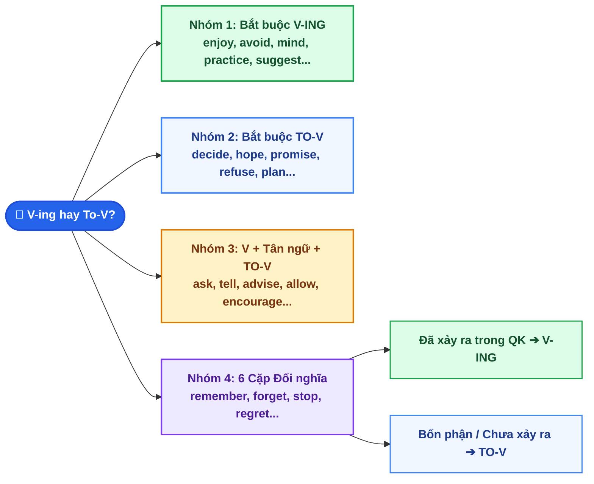

# Chuyên Đề 2: Danh Động Từ (V-ing) Và Động Từ Nguyên Mẫu (to-V)

::: info Kiến thức trọng tâm
Trong tiếng Anh, khi hai động từ đứng liền nhau, động từ thứ hai phải biến đổi hình thái theo bản chất logic của hành động:
- **`TO-V` (Infinitive):** Hướng về **Tương lai**, **Mục đích**, kế hoạch, hoặc hành động **chưa xảy ra**.
- **`V-ING` (Gerund):** Hướng về **Trải nghiệm**, **Sự thật**, thói quen, hoặc hành động **đã/đang diễn ra**.
:::

---

## I. Sơ đồ phân loại dạng động từ V-ing và To-V

---

## II. BẢNG TRA CỨU CÁC NHÓM ĐỘNG TỪ PHỔ BIẾN NHẤT TRONG ĐỀ THI VÀO 10

| Nhóm | Động từ tiêu biểu (Đi kèm ví dụ luyện tập) | Công thức chuẩn |
| :--- | :--- | :--- |
| **1. Bắt buộc đi với `V-ING`** | `avoid, admit, consider, deny, enjoy, finish, imagine, keep, mind, postpone, practice, suggest, miss, risk` | `S + V + V-ing` *Ví dụ:* *She **avoids meeting** (`avoid meet`) him at the party.* *We should **practice speaking** English every day.* |
| **2. Bắt buộc đi với `TO-V`** | `agree, afford, decide, expect, hope, learn, manage, offer, plan, promise, refuse, tend, want, wish` | `S + V + TO V-inf` *Ví dụ:* *They **decided to buy** (`decide buy`) a new apartment.* *He **refused to answer** my question.* |
| **3. Cấu trúc `V + O + TO-V`** | `advise, allow, ask, encourage, forbid, invite, order, remind, tell, warn` | `S + V + Tân ngữ (O) + TO V-inf` *Ví dụ:* *The doctor **advised me to take** a rest.* *My mother **reminded me to lock** the gate.* |
| **4. Đi với `V-ing` hay `To-V` đều KHÔNG đổi nghĩa** | `begin, start, continue, like, love, hate, prefer` | `S + V + V-ing / to V-inf` *Ví dụ:* *It **started raining** / **started to rain** 10 minutes ago.* |

---

## III. 6 Các cặp động từ đổi nghĩa cần lưu ý (CHIẾM 80% LƯU Ý KHI LÀM BÀI THI)

::: danger QUY TẮC "QUÁ KHỨ DÙNG V-ING, TƯƠNG LAI/BỔN PHẬN DÙNG TO-V"
Đây là dạng bài phân loại học sinh giỏi hay gặp nhất trong đề thi tuyển sinh lớp 10. Hãy đối chiếu thật kỹ nghĩa ngữ cảnh trước khi chọn:
:::

| Động từ | Đi với `TO V-inf` (Mục đích / Tương lai / Bổn phận) | Đi với `V-ING` (Trải nghiệm / Đã xảy ra trong quá khứ) |
| :--- | :--- | :--- |
| **1. `REMEMBER`** | **Nhớ phải làm gì** (Bổn phận chưa làm). *Remember **to turn off** the lights before leaving.* | **Nhớ đã từng làm gì** (Ký ức trong quá khứ). *I remember **meeting** her in Da Nang last summer.* |
| **2. `FORGET`** | **Quên phải làm gì** (Chưa kịp làm). *Don't forget **to submit** your assignment tomorrow.* | **Quên một việc đã làm** (Thường dùng với `can never forget`). *I will never forget **visiting** the Ba To museum.* |
| **3. `REGRET`** | **Rất tiếc phải báo tin** (Đi với *to say/tell/inform*). *We regret **to inform** you that the flight is delayed.* | **Hối hận vì đã lỡ làm gì** (Sự việc đã rồi). *He regrets **not studying** harder for the exam.* |
| **4. `STOP`** | **Dừng việc đang làm LẠI ĐỂ làm việc khác**. *On the way home, he stopped **to buy** some milk.* | **Dừng hẳn, từ bỏ dứt điểm** một thói quen/hành động. *My father decided to stop **smoking** for his health.* |
| **5. `TRY`** | **Cố gắng, nỗ lực hết sức** để vượt khó. *She is trying **to solve** this complex math problem.* | **Thử làm một việc gì** xem kết quả ra sao. *Try **pressing** this green button to restart the router.* |
| **6. `NEED`** | **Chủ động:** Ai đó cần phải làm gì (`S(người) + need + to-V`). *You need **to practice** listening more regularly.* | **Bị động:** Cái gì cần được làm (`S(vật) + need + V-ing = need to be V3`). *Your bicycle needs **repairing** (`= needs to be repaired`).* |

---

## IV. CÁC THÀNH NGỮ & CỤM TỪ CỐ ĐỊNH BẮT BUỘC ĐI VỚI `V-ING`

::: warning LƯU Ý GÀI ĐUÔI "TO" NHƯNG LẠI ĐI VỚI V-ING (CỰC KỲ NGUY HIỂM)
Nhiều bạn học sinh thấy chữ `to` là phản xạ chọn ngay động từ nguyên mẫu `V-inf`. Nhưng trong các cụm sau, `to` đóng vai trò là **Giới từ (Preposition)**, nên động từ theo sau **BẮT BUỘC Ở DẠNG `V-ING`**:
- **`look forward to + V-ing`**: Trông mong, háo hức (*I look forward to hearing from you*).
- **`be / get used to + V-ing`**: Đã quen với việc gì ở hiện tại (*He is used to getting up early*).
- **`object to / be opposed to + V-ing`**: Phản đối việc gì.
:::

::: tip CÁC CẤU TRÚC ĐẶC BIỆT KHÁC ĐI VỚI `V-ING`
- `can't help / can't stand / can't bear + V-ing`: Không thể nhịn được / Không thể chịu đựng nổi.
- `It's no use / It's no good / There's no point in + V-ing`: Thật vô ích khi làm gì.
- `be busy + V-ing`: Đang bận rộn làm gì.
- `be worth + V-ing`: Đáng để làm gì (*This documentary is worth watching*).
- `spend / waste + time/money + V-ing`: Dành / lãng phí thời gian, tiền bạc làm gì.
:::

---

## V. 10 CÂU LUYỆN TẬP (TRÍCH ĐỀ THI TUYỂN SINH VÀO 10 QUẢNG NGÃI)

<QuizItem
  :number="1"
  question="My parents always encourage me ______ English by watching foreign movies with subtitles."
  options="A. practice | B. to practice | C. practicing | D. practiced"
  correct="B"
  explanation=". Đáp án B (to practice):** Cấu trúc `encourage someone + TO V-inf` (khuyến khích ai làm gì)."
/>

<QuizItem
  :number="2"
  question="Don't forget ______ the front door before you go to bed tonight."
  options="A. lock | B. locking | C. to lock | D. to locking"
  correct="C"
  explanation=". Đáp án C (to lock):** `Don't forget + TO V-inf` biểu thị việc bổn phận phải nhớ làm trong tương lai (*nhớ khóa cửa*)."
/>

<QuizItem
  :number="3"
  question="We are really looking forward to ______ our grandparents in the countryside this weekend."
  options="A. visit | B. visiting | C. visited | D. to visit"
  correct="B"
  explanation=". Đáp án B (visiting):** Cụm từ cố định `look forward to + V-ING` (chữ `to` ở đây là giới từ)."
/>

<QuizItem
  :number="4"
  question="The grass in the garden is too tall; it urgently needs ______."
  options="A. cut | B. to cut | C. cutting | D. to cutting"
  correct="C"
  explanation=". Đáp án C (cutting):** Chủ ngữ chỉ vật `The grass`, mang nghĩa bị động: `need + V-ing` (= `need to be cut`)."
/>

<QuizItem
  :number="5"
  question="After walking along the coastal road for an hour, they stopped ______ some fresh coconut water."
  options="A. drink | B. drinking | C. drank | D. to drink"
  correct="D"
  explanation=". Đáp án D (to drink):** Ngữ cảnh dừng lại ĐỂ làm việc khác: `stop + TO V-inf` (dừng đi bộ lại để uống nước)."
/>

<QuizItem
  :number="6"
  question="Lan avoided ______ eye contact with the teacher because she hadn't prepared her homework."
  options="A. making | B. to make | C. make | D. made"
  correct="A"
  explanation=". Đáp án A (making):** Động từ `avoid` bắt buộc đi kèm với danh động từ `V-ing` (`avoid making eye contact` = tránh nhìn vào mắt)."
/>

<QuizItem
  :number="7"
  question="It's no use ______ about the bad weather; let's think of some indoor games."
  options="A. complain | B. complaining | C. to complain | D. complained"
  correct="B"
  explanation=". Đáp án B (complaining):** Cấu trúc `It's no use + V-ING` (thật vô ích khi phàn nàn)."
/>

<QuizItem
  :number="8"
  question="Did you remember ______ the letter for me this morning? — Oh, I'm sorry, I forgot!"
  options="A. post | B. posting | C. to post | D. posted"
  correct="C"
  explanation=". Đáp án C (to post):** `Remember + TO V-inf` hỏi về việc bổn phận đã nhớ thực hiện chưa (*câu trả lời: I forgot = quên chưa làm*)."
/>

<QuizItem
  :number="9"
  question="He promised ______ all his tasks before the deadline tomorrow afternoon."
  options="A. finish | B. to finish | C. finishing | D. finished"
  correct="B"
  explanation=". Đáp án B (to finish):** Động từ `promise` bắt buộc đi với `TO V-inf` (hứa làm gì)."
/>

<QuizItem
  :number="10"
  question="Although my brother tried ______ the heavy stone, he couldn't move it even an inch."
  options="A. lift | B. to lift | C. lifting | D. lifted"
  correct="B"
  explanation=". Đáp án B (to lift):** Ngữ cảnh nói về nỗ lực vượt qua khó khăn (*không thể nhấc nổi dù chỉ 1 inch*) ➔ `try + TO V-inf` (cố gắng nhấc)."
/>

📖 Bấm để xem Bảng tổng hợp đáp án & Giải thích chi tiết nhanh

**1. Đáp án B (to practice):** Cấu trúc `encourage someone + TO V-inf` (khuyến khích ai làm gì).
**2. Đáp án C (to lock):** `Don't forget + TO V-inf` biểu thị việc bổn phận phải nhớ làm trong tương lai (*nhớ khóa cửa*).
**3. Đáp án B (visiting):** Cụm từ cố định `look forward to + V-ING` (chữ `to` ở đây là giới từ).
**4. Đáp án C (cutting):** Chủ ngữ chỉ vật `The grass`, mang nghĩa bị động: `need + V-ing` (= `need to be cut`).
**5. Đáp án D (to drink):** Ngữ cảnh dừng lại ĐỂ làm việc khác: `stop + TO V-inf` (dừng đi bộ lại để uống nước).
**6. Đáp án A (making):** Động từ `avoid` bắt buộc đi kèm với danh động từ `V-ing` (`avoid making eye contact` = tránh nhìn vào mắt).
**7. Đáp án B (complaining):** Cấu trúc `It's no use + V-ING` (thật vô ích khi phàn nàn).
**8. Đáp án C (to post):** `Remember + TO V-inf` hỏi về việc bổn phận đã nhớ thực hiện chưa (*câu trả lời: I forgot = quên chưa làm*).
**9. Đáp án B (to finish):** Động từ `promise` bắt buộc đi với `TO V-inf` (hứa làm gì).
**10. Đáp án B (to lift):** Ngữ cảnh nói về nỗ lực vượt qua khó khăn (*không thể nhấc nổi dù chỉ 1 inch*) ➔ `try + TO V-inf` (cố gắng nhấc).

