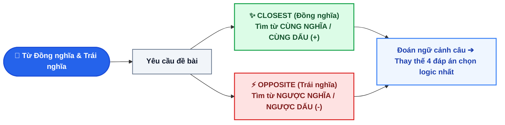

# CHUYÊN ĐỀ 3: CẨM NANG TỪ ĐỒNG NGHĨA & TRÁI NGHĨA (SYNONYMS & ANTONYMS MASTERY)

> [!BLUE] **BẢN CHẤT VÀ NGUYÊN TẮC CỐT LÕI:**
> Dạng bài tìm từ **Đồng nghĩa (`CLOSEST IN MEANING`)** và **Trái nghĩa (`OPPOSITE IN MEANING`)** chiếm ít nhất **4 câu (1.0 điểm)** trong đề thi tuyển sinh vào 10.
> Bạn không cần biết nghĩa của mọi từ vựng lạ trong đề; bí quyết nằm ở **Kỹ thuật đoán nghĩa theo ngữ cảnh (Context Clues)** kết hợp với việc kiểm tra các **Tiền tố phủ định (`un-, in-, dis-, im-`)** và tránh chiếc bẫy tâm lý *"Đọc nhầm yêu cầu đề bài"*.

---

## I. QUY TRÌNH 3 BƯỚC LÀM DẠNG BÀI ĐỒNG NGHĨA - TRÁI NGHĨA

---

## II. 4 CHIẾN THUẬT ĐOÁN NGHĨA TỪ MỚI QUA NGỮ CẢNH (CONTEXT CLUES)

> [!GREEN] **1. Dựa vào Liên từ tương phản (`but, however, although, while, whereas`):**
> Từ gạch chân sẽ có nghĩa **đối lập hoàn toàn** với vế còn lại.
> *Ví dụ:* *Although the mountain path was **perilous**, all hikers reached the peak safely.*
> ➔ Vế sau *"an toàn"* đi kèm *"mặc dù"* ➔ *perilous* chắc chắn mang nghĩa tiêu cực: *nguy hiểm* (`dangerous`).

> [!GREEN] **2. Dựa vào Liên từ tương đồng (`and, as well as, not only... but also`):**
> Từ gạch chân sẽ có **cùng sắc thái** với từ đã biết đứng cạnh.
> *Ví dụ:* *The local people were warm, generous and **hospitable**.*
> ➔ Đi cùng *ấm áp*, *hào phóng* ➔ *hospitable* chắc chắn là tính từ tích cực: *hiếu khách* (`friendly`).

> [!GREEN] **3. Dựa vào Từ chỉ nguyên nhân - kết quả (`because, so, therefore, as a result`):**
> *Ví dụ:* *Heavy rains continued for three days; **consequently**, the low-lying areas were submerged.*
> ➔ Mưa to kéo dài 3 ngày ➔ khu vực trũng bị *ngập lụt* (`flooded`).

> [!RED] **BẪY TÂM LÝ KINH ĐIỂN CỦA HỌC SINH (VIETLISH TRAP):**
> Đề bài yêu cầu tìm từ **TRÁI NGHĨA (`OPPOSITE`)**, nhưng người ra đề luôn cố tình đặt **TỪ ĐỒNG NGHĨA ở ngay Đáp án A**!
> Nhiều bạn nhìn thấy từ quen thuộc lập tức tô ngay Đáp án A mà quên mất đề đang hỏi từ TRÁI NGHĨA.
> - **Nguyên tắc sống còn:** Cầm bút chì gạch chân/khoanh tròn to chữ **`OPPOSITE`** hoặc **`CLOSEST`** ngay khi đọc đề!

---

## III. BẢNG 25 CẶP TỪ ĐỒNG NGHĨA TỦ XUẤT HIỆN NHIỀU NHẤT TRONG ĐỀ THI

| Từ khóa trong đề | Từ đồng nghĩa chuẩn (`CLOSEST`) | Phiên âm IPA | Dịch nghĩa & Ngữ cảnh |
| :--- | :--- | :--- | :--- |
| **polluted** | **contaminated** | `/pəˈluː.tɪd/ = /kənˈtæm.ɪ.neɪ.tɪd/` | Ô nhiễm (nguồn nước, không khí) |
| **famous** | **well-known / renowned** | `/ˈfeɪ.məs/ = /ˌwel ˈnəʊn/` | Nổi tiếng |
| **important** | **significant / crucial / vital** | `/ɪmˈpɔː.tənt/ = /sɪɡˈnɪf.ɪ.kənt/` | Quan trọng, cốt yếu |
| **beautiful** | **picturesque / scenic** | `/ˈbjuː.tɪ.fəl/ = /ˌpɪk.tʃərˈesk/` | Đẹp như tranh vẽ (phong cảnh) |
| **huge** | **enormous / gigantic / massive**| `/hjuːdʒ/ = /ɪˈnɔː.məs/` | Khổng lồ, to lớn |
| **tiny** | **minute / very small** | `/ˈtaɪ.ni/ = /maɪˈnjuːt/` | Nhỏ bé, tí hon |
| **rich** | **wealthy / well-off** | `/rɪtʃ/ = /ˈwel.θi/` | Giàu có, khá giả |
| **hardworking**| **diligent / industrious** | `/ˌhɑːdˈwɜː.kɪŋ/ = /ˈdɪl.ɪ.dʒənt/` | Chăm chỉ, siêng năng |
| **clever** | **smart / intelligent / brilliant** | `/ˈklev.ər/ = /ɪnˈtel.ɪ.dʒənt/` | Thông minh, sáng dạ |
| **dangerous** | **hazardous / risky** | `/ˈdeɪn.dʒər.əs/ = /ˈhæz.ə.dəs/` | Nguy hiểm, rủi ro |
| **destroy** | **demolish / ruin / devastate** | `/dɪˈstrɔɪ/ = /dɪˈmɒl.ɪʃ/` | Phá hủy, tàn phá |
| **preserve** | **conserve / protect / safeguard**| `/prɪˈzɜːv/ = /kənˈsɜːv/` | Bảo tồn, giữ gìn |
| **reduce** | **cut down on / decrease** | `/rɪˈdjuːs/ = /dɪˈkriːs/` | Cắt giảm, làm sụt giảm |
| **increase** | **boost / go up / rise** | `/ɪnˈkriːs/ = /buːst/` | Tăng lên, đẩy mạnh |
| **continue** | **go on / carry on / persist** | `/kənˈtɪn.juː/ = /ɡəʊ ɒn/` | Tiếp tục duy trì |
| **stop** | **cease / quit / give up** | `/stɒp/ = /siːs/` | Chấm dứt, ngừng lại |
| **solve** | **resolve / tackle / deal with** | `/sɒlv/ = /rɪˈzɒlv/` | Giải quyết (vấn đề) |
| **modern** | **state-of-the-art / cutting-edge**| `/ˈmɒd.ən/ = /ˌsteɪt.əv.ðiːˈɑːt/` | Tân tiến, hiện đại |
| **difficult** | **challenging / arduous** | `/ˈdɪf.ɪ.kəlt/ = /ˈtʃæl.ɪn.dʒɪŋ/` | Khó khăn, đầy thử thách |
| **quiet** | **peaceful / tranquil** | `/ˈkwaɪ.ət/ = /ˈpiːs.fəl/` | Yên tĩnh, thanh bình |

---

## IV. BẢNG 25 CẶP TỪ TRÁI NGHĨA TỦ XUẤT HIỆN NHIỀU NHẤT TRONG ĐỀ THI

| Từ gốc trong đề | Nghĩa tiếng Việt | Từ trái nghĩa chuẩn (`OPPOSITE`) | Nghĩa đối lập |
| :--- | :--- | :--- | :--- |
| **compulsory** | Bắt buộc (`= mandatory`) | **optional / voluntary** | Tự chọn, tự nguyện |
| **urban** | Thuộc về thành thị, đô thị | **rural** | Thuộc về nông thôn |
| **generous** | Hào phóng, rộng lượng | **mean / selfish / stingy** | Keo kiệt, ích kỷ |
| **polite** | Lịch sự, nhã nhặn | **impolite / rude / discourteous** | Vô lễ, thô lỗ |
| **permanent** | Lâu dài, vĩnh viễn | **temporary** | Tạm thời, nhất thời |
| **convenient** | Thuận tiện, tiện lợi | **inconvenient** | Bất tiện, phiền toái |
| **harmful** | Có hại, gây nguy hiểm | **harmless / beneficial** | Vô hại, có lợi |
| **accept** | Chấp nhận, đón nhận | **refuse / reject / turn down** | Từ chối, khước từ |
| **abundant** | Dồi dào, phong phú (`plentiful`)| **scarce / rare** | Khan hiếm, ít ỏi |
| **punish** | Trừng phạt, phạt | **reward / praise** | Thưởng, khen ngợi |
| **ancient** | Cổ xưa, lâu đời | **modern / contemporary** | Hiện đại, đương đại |
| **admit** | Thừa nhận, thú nhận | **deny** | Phủ nhận, chối |
| **success** | Sự thành công | **failure** | Sự thất bại |
| **expand** | Mở rộng quy mô | **shrink / narrow / contract** | Thu hẹp, co lại |
| **dangerous** | Nguy hiểm (`hazardous`) | **safe / secure** | An toàn, bảo đảm |
| **optimistic** | Lạc quan | **pessimistic** | Bi quan |
| **simple** | Đơn giản, dễ hiểu | **complicated / sophisticated** | Phức tạp, rắc rối |
| **advantage** | Lợi thế, ưu điểm | **disadvantage / drawback** | Bất lợi, nhược điểm |
| **peaceful** | Yên bình, thái bình | **noisy / chaotic** | Ồn ào, hỗn loạn |
| **proud** | Tự hào | **ashamed** | Xấu hổ |

---

## V. 10 CÂU THỰC CHIẾN (TRÍCH ĐỀ TUYỂN SINH VÀO 10 QUẢNG NGÃI)

### Phần A: Chọn từ đồng nghĩa (CLOSEST IN MEANING - 5 câu)
1. In rural areas of Quang Ngai, many scenic spots remain **untouched** by mass tourism.
   `A. damaged` | `B. pristine` | `C. polluted` | `D. crowded`
2. We must find alternative green energy to **cut down on** greenhouse gas emissions.
   `A. increase` | `B. reduce` | `C. produce` | `D. consume`
3. My elder sister is very **diligent**; she studies at least four hours every evening.
   `A. lazy` | `B. careless` | `C. hardworking` | `D. confident`
4. The local government has decided to **demolish** the old bridge and build a modern suspension one.
   `A. construct` | `B. preserve` | `C. destroy` | `D. renovate`
5. Hoi An ancient town is **renowned** for its lantern-lit streets and unique cultural heritage.
   `A. well-known` | `B. unknown` | `C. normal` | `D. modern`

### Phần B: Chọn từ trái nghĩa (OPPOSITE IN MEANING - 5 câu)
6. Wearing helmets when riding motorbikes is **compulsory** for all citizens in Vietnam.
   `A. required` | `B. mandatory` | `C. optional` | `D. strict`
7. It was very **generous** of Mr. Binh to donate one hundred million dong to the local orphanage.
   `A. kind` | `B. mean` | `C. hospitable` | `D. helpful`
8. Living in large metropolitan cities offers many modern amenities, but it can be very **stressful**.
   `A. relaxing` | `B. tiring` | `C. difficult` | `D. anxious`
9. Renewable energy from wind and sun is **abundant** and will never run out.
   `A. plentiful` | `B. scarce` | `C. available` | `D. sufficient`
10. The teacher **praised** Nam because he made remarkable progress in his English studies.
   `A. rewarded` | `B. criticized` | `C. encouraged` | `D. admired`

+++ 👉 BẤM ĐỂ XEM ĐÁP ÁN & GIẢI THÍCH CHI TIẾT
**1. Đáp án B (pristine):** `untouched` = còn nguyên sơ, chưa bị du lịch tàn phá (`pristine` = nguyên sơ, tinh khôi).
**2. Đáp án B (reduce):** `cut down on` = cắt giảm (`reduce`).
**3. Đáp án C (hardworking):** `diligent` = siêng năng, chăm chỉ (`hardworking`).
**4. Đáp án C (destroy):** `demolish` = phá hủy, dỡ bỏ công trình cũ (`destroy`).
**5. Đáp án A (well-known):** `renowned` = nổi tiếng (`well-known`).
**6. Đáp án C (optional):** Đề yêu cầu **OPPOSITE** (trái nghĩa). `compulsory` = bắt buộc ➔ Trái nghĩa là `optional` (tự chọn, không bắt buộc). *(Cẩn thận đừng chọn A hoặc B vì là từ đồng nghĩa!)*
**7. Đáp án B (mean):** `generous` = hào phóng, rộng lượng ➔ Trái nghĩa là `mean` (keo kiệt, bủn xỉn).
**8. Đáp án A (relaxing):** `stressful` = căng thẳng, áp lực ➔ Trái nghĩa là `relaxing` (thư giãn, thoải mái).
**9. Đáp án B (scarce):** `abundant` = dồi dào, phong phú ➔ Trái nghĩa là `scarce` (khan hiếm, ít ỏi).
**10. Đáp án B (criticized):** `praised` = khen ngợi ➔ Trái nghĩa là `criticized` (chỉ trích, phê bình).
+++
