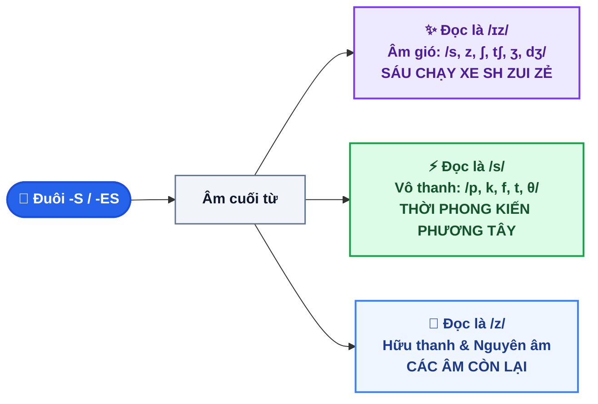

# CHUYÊN ĐỀ 1: CÁCH PHÁT ÂM ĐUÔI "S / ES" BẰNG CÂU THẦN CHÚ ÔN THI VÀO 10

::: info BẢN CHẤT VÀ NGUYÊN TẮC CỐT LÕI
Đuôi **`-s`** hoặc **`-es`** khi thêm vào danh từ số nhiều hoặc động từ ngôi thứ 3 số ít sẽ có 3 cách phát âm, hoàn toàn phụ thuộc vào **Âm thanh kết thúc (Ending Sound)** của từ gốc:
- **Âm gió (Sibilants):** Tạo ra tiếng xì, rít ➔ Phát âm là **/ɪz/** để dễ phát âm, không bị nghẹn hơi.
- **Âm vô thanh (Voiceless):** Không rung cổ họng ➔ Phát âm là **/s/** (vô thanh).
- **Âm hữu thanh (Voiced):** Có rung cổ họng ➔ Phát âm là **/z/** (hữu thanh).
:::

---

## I. SƠ ĐỒ THUẬT TOÁN 3 BƯỚC PHÂN LOẠI PHÁT ÂM ĐUÔI -S / -ES

---

## II. 3 QUY TẮC VÀNG KÈM MẸO GHI NHỚ BẰNG TIẾNG VIỆT

### 1. Quy tắc 1: Phát âm là `/s/` (Thần chú: "THỜI PHONG KIẾN PHƯƠNG TÂY")
- **Dấu hiệu:** Tận cùng là các âm vô thanh **/p, k, f, t, θ/** (Chữ cái thường gặp: *p, k, gh, ph, t, th*).
- **Mẹo ghi nhớ nhanh:**
  > 💡 **"THỜI PHONG KIẾN PHƯƠNG TÂY"**
  > (hoặc: **"Thảo Phải Khao Phở Thúy"**)
  >
  > - **Th**ời (`/θ/` - th): *months* `/mʌnθs/`, *myths* `/mɪθs/`, *baths* `/bɑːθs/`
  > - **P**hong (`/p/` - p): *stops* `/stɒps/`, *cups* `/kʌps/`, *hopes* `/həʊps/`
  > - **K**iến (`/k/` - k, c): *books* `/bʊks/`, *cooks* `/kʊks/`, *looks* `/lʊks/`
  > - **P**hương (`/f/` - f, ph, gh): *laughs* `/lɑːfs/`, *coughs* `/kɒfs/`, *cliffs* `/klɪfs/`
  > - **T**ây (`/t/` - t): *cats* `/kæts/`, *meets* `/miːts/`, *hats* `/hæts/`

---

### 2. Quy tắc 2: Phát âm là `/ɪz/` (Thần chú: "SÁU CHẠY XE SH ZUI ZẺ")
- **Dấu hiệu:** Tận cùng là các âm gió (sibilants) **/s, z, ʃ, tʃ, ʒ, dʒ/** (Chữ cái tận cùng: *s, ss, ch, sh, x, z, ge, ce*).
- **Mẹo ghi nhớ nhanh:**
  > 💡 **"SÁU CHẠY XE SH ZUI ZẺ"**
  > (hoặc: **"Sông Sáng Chói Sóng Xô Giáp Ghềnh"**)
  >
  > - **S**áu (`/s/` - s, ss): *kisses* /ˈkɪs.ɪz/, *misses* /ˈmɪs.ɪz/, *classes* /ˈklɑːs.ɪz/
  > - **C**hạy (`/tʃ/` - ch): *watches* /ˈwɒtʃ.ɪz/, *catches* /ˈkætʃ.ɪz/, *teaches* /ˈtiːtʃ.ɪz/
  > - **X**e (`/ks/` - x): *boxes* /ˈbɒks.ɪz/, *fixes* /ˈfɪks.ɪz/, *foxes* /ˈfɒks.ɪz/
  > - **Sh** (`/ʃ/` - sh): *wishes* /ˈwɪʃ.ɪz/, *washes* /ˈwɒʃ.ɪz/, *brushes* /ˈbrʌʃ.ɪz/
  > - **Z**ui (`/z/` - z): *buzzes* /ˈbʌz.ɪz/
  > - **Z**ẻ (`/dʒ/` - ge, `/s/` - ce): *changes* /ˈtʃeɪn.dʒɪz/, *oranges* /ˈɒr.ɪn.dʒɪz/, *sentences* /ˈsen.təns.ɪz/

---

### 3. Quy tắc 3: Phát âm là `/z/` (Các trường hợp còn lại)
- **Dấu hiệu:** Tận cùng là các âm hữu thanh còn lại (`/b, d, ɡ, v, ð, m, n, ŋ, l, r/`) và các nguyên âm.
- **Ví dụ chuẩn:**
  - *plays* `/pleɪz/`, *reads* `/riːdz/`, *opens* /ˈəʊ.pənz/, *pens* `/penz/`, *boys* `/bɔɪz/`.

---

## III. 3 BẪY NGOẠI LỆ KINH ĐIỂN CỦA ĐUÔI -S / -ES

::: danger BẪY 1: TỪ "HOUSES" (100% GÀI BẪY TRONG ĐỀ THI VÀO 10)
- Từ đơn lẻ: *house* kết thúc bằng âm `/s/` ➔ đọc là `/haʊs/`.
- Khi thêm -es: *houses* **BIẾN ĐỔI ÂM THÀNH `/z/` RỒI MỚI THÊM `/ɪz/`**:
  - ❌ *Sai:* /ˈhaʊ.sɪz/
  - ✅ **Đúng:** **/ˈhaʊ.zɪz/** *(đọc là /z/ + /ɪz/)*
:::

::: warning BẪY 2: PHÂN BIỆT ĐUÔI "-THS" TRONG TỪ VỰNG
- *months* `/mʌnθs/`: Âm /θ/ là vô thanh ➔ đuôi đọc là **/s/**.
- *clothes* /kləʊðz/ (hoặc /kləʊz/): Âm /ð/ là hữu thanh ➔ đuôi đọc là **/z/**.
:::

::: tip BẪY 3: ĐỘNG TỪ BẤT QUY TẮC "DOES" VÀ "GOES"
- *does* `/dʌz/` ➔ kết thúc bằng âm **/z/**.
- *goes* `/ɡəʊz/` ➔ kết thúc bằng âm **/z/**.
- *says* `/sez/` ➔ đọc là nguyên âm /e/ kết hợp âm **/z/**.
:::

---

## IV. 10 CÂU THỰC CHIẾN (TRÍCH ĐỀ THI TUYỂN SINH VÀO 10 QUẢNG NGÃI)

Chọn từ có phần gạch chân phát âm khác với các từ còn lại:

<QuizItem
  :number="1"
  question=""
  options="A. book**s** | B. cat**s** | C. dog**s** | D. map**s**"
  correct="C"
  explanation=". Đáp án C (dogs):** `dogs` phát âm là `/z/`, các từ còn lại kết thúc bằng /k, t, p/ nên phát âm là `/s/` (Thần chú THỜI PHONG KIẾN PHƯƠNG TÂY)."
/>

<QuizItem
  :number="2"
  question=""
  options="A. watch**es** | B. wash**es** | C. chang**es** | D. liv**es**"
  correct="D"
  explanation=". Đáp án D (lives):** `lives` phát âm là `/z/`, các từ còn lại kết thúc bằng ch, sh, ge nên phát âm là `/ɪz/` (Thần chú SÁU CHẠY XE SH ZUI ZẺ)."
/>

<QuizItem
  :number="3"
  question=""
  options="A. month**s** | B. laugh**s** | C. friend**s** | D. plant**s**"
  correct="C"
  explanation=". Đáp án C (friends):** `friends` kết thúc bằng âm /d/ (hữu thanh) nên phát âm là `/z/`, các từ còn lại phát âm là `/s/`."
/>

<QuizItem
  :number="4"
  question=""
  options="A. box**es** | B. class**es** | C. tabl**es** | D. brush**es**"
  correct="C"
  explanation=". Đáp án C (tables):** `tables` phát âm là `/z/`, các từ còn lại kết thúc bằng x, ss, sh nên phát âm là `/ɪz/`."
/>

<QuizItem
  :number="5"
  question=""
  options="A. hous**es** | B. hors**es** | C. voic**es** | D. plac**es**"
  correct="A"
  explanation=". Đáp án A (houses):** `houses` phát âm đặc biệt là `/ˈhaʊ.zɪz/` (âm /z/), các từ còn lại phát âm là `/ɪz/` sau âm vô thanh /s/."
/>

<QuizItem
  :number="6"
  question=""
  options="A. laugh**s** | B. drop**s** | C. clean**s** | D. look**s**"
  correct="C"
  explanation=". Đáp án C (cleans):** `cleans` phát âm là `/z/`, các từ còn lại kết thúc bằng gh (/f/), p, k nên phát âm là `/s/`."
/>

<QuizItem
  :number="7"
  question=""
  options="A. match**es** | B. guid**es** | C. teach**es** | D. kiss**es**"
  correct="B"
  explanation=". Đáp án B (guides):** `guides` phát âm là `/z/`, các từ còn lại phát âm là `/ɪz/`."
/>

<QuizItem
  :number="8"
  question=""
  options="A. cloth**es** | B. breath**s** | C. path**s** | D. my**ths**"
  correct="A"
  explanation=". Đáp án A (clothes):** `clothes` phát âm là `/kləʊðz/` (âm /z/), các từ còn lại kết thúc bằng /θ/ nên phát âm là `/s/`."
/>

<QuizItem
  :number="9"
  question=""
  options="A. pen**s** | B. boy**s** | C. room**s** | D. hat**s**"
  correct="D"
  explanation=". Đáp án D (hats):** `hats` kết thúc bằng /t/ nên phát âm là `/s/`, các từ còn lại phát âm là `/z/`."
/>

<QuizItem
  :number="10"
  question=""
  options="A. danc**es** | B. hop**es** | C. mak**es** | D. tak**es**"
  correct="A"
  explanation=". Đáp án A (dances):** `dances` kết thúc bằng âm /s/ (chữ ce) nên phát âm là `/ɪz/` (`/ˈdɑːn.sɪz/`), các từ còn lại phát âm là `/s/`."
/>

📖 Bấm để xem Bảng tổng hợp đáp án & Giải thích chi tiết nhanh

**1. Đáp án C (dogs):** `dogs` phát âm là `/z/`, các từ còn lại kết thúc bằng /k, t, p/ nên phát âm là `/s/` (Thần chú THỜI PHONG KIẾN PHƯƠNG TÂY).
**2. Đáp án D (lives):** `lives` phát âm là `/z/`, các từ còn lại kết thúc bằng ch, sh, ge nên phát âm là `/ɪz/` (Thần chú SÁU CHẠY XE SH ZUI ZẺ).
**3. Đáp án C (friends):** `friends` kết thúc bằng âm /d/ (hữu thanh) nên phát âm là `/z/`, các từ còn lại phát âm là `/s/`.
**4. Đáp án C (tables):** `tables` phát âm là `/z/`, các từ còn lại kết thúc bằng x, ss, sh nên phát âm là `/ɪz/`.
**5. Đáp án A (houses):** `houses` phát âm đặc biệt là `/ˈhaʊ.zɪz/` (âm /z/), các từ còn lại phát âm là `/ɪz/` sau âm vô thanh /s/.
**6. Đáp án C (cleans):** `cleans` phát âm là `/z/`, các từ còn lại kết thúc bằng gh (/f/), p, k nên phát âm là `/s/`.
**7. Đáp án B (guides):** `guides` phát âm là `/z/`, các từ còn lại phát âm là `/ɪz/`.
**8. Đáp án A (clothes):** `clothes` phát âm là `/kləʊðz/` (âm /z/), các từ còn lại kết thúc bằng /θ/ nên phát âm là `/s/`.
**9. Đáp án D (hats):** `hats` kết thúc bằng /t/ nên phát âm là `/s/`, các từ còn lại phát âm là `/z/`.
**10. Đáp án A (dances):** `dances` kết thúc bằng âm /s/ (chữ ce) nên phát âm là `/ɪz/` (`/ˈdɑːn.sɪz/`), các từ còn lại phát âm là `/s/`.

