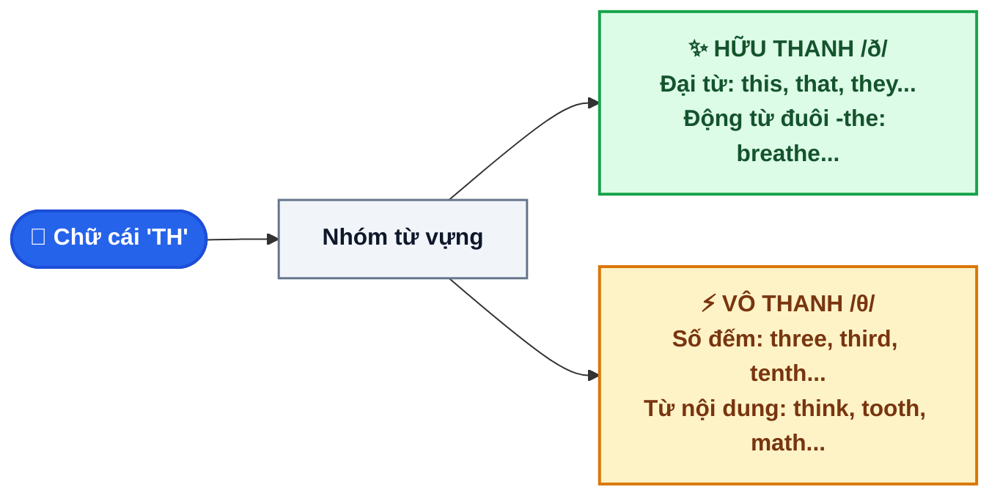

# CHUYÊN ĐỀ 1: CÁCH PHÁT ÂM "TH" CHUẨN XÁC (/θ/ VS. /ð/) ÔN THI VÀO 10

> [!BLUE] **BẢN CHẤT VÀ NGUYÊN TẮC CỐT LÕI:**
> Cặp âm `"th"` là nỗi ám ảnh lớn nhất của học sinh Việt Nam vì tiếng Việt **hoàn toàn không có âm kẹp lưỡi**. Cả hai âm đều có cùng vị trí phát âm: **Đặt đầu lưỡi giữa hai hàm răng và đẩy luồng hơi ra ngoài qua kẽ răng**:
> - **Âm vô thanh `/θ/`:** Dây thanh quản **KHÔNG RUNG** (Chỉ có luồng gió thổi xì ra).
> - **Âm hữu thanh `/ð/`:** Dây thanh quản **RUNG MẠNH** (Có tiếng rung "dừ... dừ...").

---

## I. SƠ ĐỒ THUẬT TOÁN PHÂN LOẠI PHÁT ÂM "TH" TRONG 3 GIÂY

---

## II. BẢNG ĐỐI CHIẾU 2 NHÓM PHÁT ÂM CỦA "TH" KÈM MẸO NHẬN DIỆN

| Nhóm âm | Cách tạo âm | Dấu hiệu từ vựng & Mẹo nhớ | Ví dụ chuẩn (kèm IPA) |
| :--- | :--- | :--- | :--- |
| **1. Vô thanh `/θ/`** (Không rung) | Đầu lưỡi thè nhẹ giữa 2 răng, thổi hơi gió ra, cổ họng êm ru | **Hầu hết các Danh từ, Tính từ, Động từ và Số thứ tự**:  • Đứng đầu từ (*th-*): *thank, thin, think, thick, throw, thumb, theater*. • Đứng cuối từ (*-th*): *breath, bath, mouth, teeth, cloth, earth, south*. • Số thứ tự & Từ chỉ sức khỏe: *third, fourth, fifth, youth, health, wealth*. | • *think* `/θɪŋk/` • *theater* /ˈθɪə.tər/ • *breath* `/breθ/` *(hơi thở)* • *healthy* /ˈhel.θi/ • *earth* `/ɜːθ/` |
| **2. Hữu thanh `/ð/`** (Rung cổ họng) | Giữ nguyên khẩu hình lưỡi kẹp răng, nhưng phát ra âm rung từ cổ họng | **4 Nhóm từ đặc trưng bắt buộc thuộc lòng**: 1. **Đại từ & Từ chỉ định:** *this, that, these, those, they, them, their, theirs*. 2. **Trạng từ & Liên từ:** *there, then, than, thus, though, although*. 3. **Giới từ:** *with* `/wɪð/` (hoặc `/wɪθ/`), *within, without*. 4. **Từ có đuôi `-the` hoặc kẹp giữa 2 nguyên âm:** *breathe, clothe, father, mother, brother, weather, together, leather*. | • *this* `/ðɪs/` • *breathe* `/briːð/` *(thở)* • *weather* /ˈweð.ər/ • *although* /ɔːlˈðəʊ/ • *together* /təˈɡeð.ər/ |

---

## III. 3 LƯU Ý KHI LÀM BÀI THI TUYỂN SINH VÀO 10 CẦN TRÁNH (VIETLISH TRAPS)

> [!RED] **BẪY 1: CẶP TỪ DANH TỪ (/θ/) VS. ĐỘNG TỪ (/ð/)**
> Đề thi rất hay gài bẫy các cặp từ có chữ cái tương tự nhau nhưng đuôi danh từ đọc là `/θ/`, còn đuôi động từ đọc là `/ð/`:
> - Danh từ: **breath** `/breθ/` *(hơi thở - âm /θ/)* $\leftrightarrow$ Động từ: **breathe** `/briːð/` *(hít thở - âm /ð/)*.
> - Danh từ: **bath** `/bɑːθ/` *(bồn tắm - âm /θ/)* $\leftrightarrow$ Động từ: **bathe** `/beɪð/` *(tắm rửa - âm /ð/)*.
> - Danh từ: **cloth** `/klɒθ/` *(vải vụn - âm /θ/)* $\leftrightarrow$ Động từ: **clothe** `/kləʊð/` *(mặc quần áo - âm /ð/)*.

> [!YELLOW] **BẪY 2: NHẦM ÂM /θ/ THÀNH ÂM /t/ HOẶC /s/**
> Người Việt có thói quen đọc âm `/θ/` thành âm *"thờ"* trong tiếng Việt (hoặc *"tờ"*, *"sờ"*):
> - *three* `/θriː/` (số 3) đọc nhầm thành *tree* `/triː/` (cái cây) hoặc *free* `/friː/` (miễn phí).
> - *thin* `/θɪn/` (gầy gò) đọc nhầm thành *tin* `/tɪn/` (hộp thiếc) hoặc *sin* `/sɪn/` (tội lỗi).

> [!GREEN] **BẪY 3: TỪ NGOẠI LỆ ĐẶC BIỆT (CHỮ "TH" KHÔNG ĐỌC LÀ /θ/ HOẶC /ð/)**
> - **Thailand** /ˈtaɪ.lænd/ *(chữ "th" phát âm là `/t/`)*.
> - **Thames** /temz/ *(sông Thames - phát âm là `/t/`)*.
> - **Thomas** /ˈtɒm.əs/ *(tên riêng - phát âm là `/t/`)*.

---

## IV. 10 CÂU THỰC CHIẾN (TRÍCH ĐỀ THI TUYỂN SINH VÀO 10 QUẢNG NGÃI)

Chọn từ có phần gạch chân phát âm khác với các từ còn lại:

<QuizItem
  :number="1"
  question=""
  options="A. **th**ink | B. **th**ank | C. **th**is | D. **th**in"
  correct="C"
  explanation=". Đáp án C (this):** `this` phát âm là `/ð/`, các từ còn lại phát âm là `/θ/`."
/>

<QuizItem
  :number="2"
  question=""
  options="A. bro**th**er | B. brea**th**e | C. fea**th**er | D. heal**th**y"
  correct="D"
  explanation=". Đáp án D (healthy):** `healthy` phát âm là `/θ/`, các từ còn lại phát âm là `/ð/`."
/>

<QuizItem
  :number="3"
  question=""
  options="A. ba**th** | B. clo**th** | C. sou**th** | D. ba**th**e"
  correct="D"
  explanation=". Đáp án D (bathe):** `bathe` là động từ phát âm là `/ð/` (`/beɪð/`), các danh từ còn lại phát âm là `/θ/`."
/>

<QuizItem
  :number="4"
  question=""
  options="A. **th**ere | B. **th**umb | C. **th**eater | D. **th**ursday"
  correct="A"
  explanation=". Đáp án A (there):** `there` phát âm là `/ð/`, các từ còn lại phát âm là `/θ/`."
/>

<QuizItem
  :number="5"
  question=""
  options="A. clo**th**es | B. no**th**ing | C. wea**th**er | D. toge**th**er"
  correct="B"
  explanation=". Đáp án B (nothing):** `nothing` phát âm là `/θ/` (`/ˈnʌθ.ɪŋ/`), các từ còn lại phát âm là `/ð/`."
/>

<QuizItem
  :number="6"
  question=""
  options="A. sou**th** | B. sou**th**ern | C. **th**eory | D. au**th**or"
  correct="B"
  explanation=". Đáp án B (southern):** `southern` phát âm là `/ð/` (`/ˈsʌð.ən/`), trong khi `south` và các từ còn lại phát âm là `/θ/`."
/>

<QuizItem
  :number="7"
  question=""
  options="A. wi**th**out | B. brea**th** | C. **th**roat | D. tee**th**"
  correct="A"
  explanation=". Đáp án A (without):** `without` phát âm là `/ð/`, các từ còn lại phát âm là `/θ/`."
/>

<QuizItem
  :number="8"
  question=""
  options="A. fa**th**er | B. **th**rough | C. al**th**ough | D. lea**th**er"
  correct="B"
  explanation=". Đáp án B (through):** `through` phát âm là `/θ/`, các từ còn lại phát âm là `/ð/`."
/>

<QuizItem
  :number="9"
  question=""
  options="A. epen**th**esis | B. smoo**th** | C. **th**eme | D. ear**th**"
  correct="B"
  explanation=". Đáp án B (smooth):** `smooth` phát âm là `/ð/` (`/smuːð/`), các từ còn lại phát âm là `/θ/`."
/>

<QuizItem
  :number="10"
  question=""
  options="A. **Th**ailand | B. **th**ankful | C. **th**oughtful | D. **th**orough"
  correct="A"
  explanation=". Đáp án A (Thailand):** `Thailand` là ngoại lệ tên riêng phát âm là `/t/` (`/ˈtaɪ.lænd/`), các từ còn lại phát âm là `/θ/`."
/>

📖 Bấm để xem Bảng tổng hợp đáp án & Giải thích chi tiết nhanh

**1. Đáp án C (this):** `this` phát âm là `/ð/`, các từ còn lại phát âm là `/θ/`.
**2. Đáp án D (healthy):** `healthy` phát âm là `/θ/`, các từ còn lại phát âm là `/ð/`.
**3. Đáp án D (bathe):** `bathe` là động từ phát âm là `/ð/` (`/beɪð/`), các danh từ còn lại phát âm là `/θ/`.
**4. Đáp án A (there):** `there` phát âm là `/ð/`, các từ còn lại phát âm là `/θ/`.
**5. Đáp án B (nothing):** `nothing` phát âm là `/θ/` (`/ˈnʌθ.ɪŋ/`), các từ còn lại phát âm là `/ð/`.
**6. Đáp án B (southern):** `southern` phát âm là `/ð/` (`/ˈsʌð.ən/`), trong khi `south` và các từ còn lại phát âm là `/θ/`.
**7. Đáp án A (without):** `without` phát âm là `/ð/`, các từ còn lại phát âm là `/θ/`.
**8. Đáp án B (through):** `through` phát âm là `/θ/`, các từ còn lại phát âm là `/ð/`.
**9. Đáp án B (smooth):** `smooth` phát âm là `/ð/` (`/smuːð/`), các từ còn lại phát âm là `/θ/`.
**10. Đáp án A (Thailand):** `Thailand` là ngoại lệ tên riêng phát âm là `/t/` (`/ˈtaɪ.lænd/`), các từ còn lại phát âm là `/θ/`.

