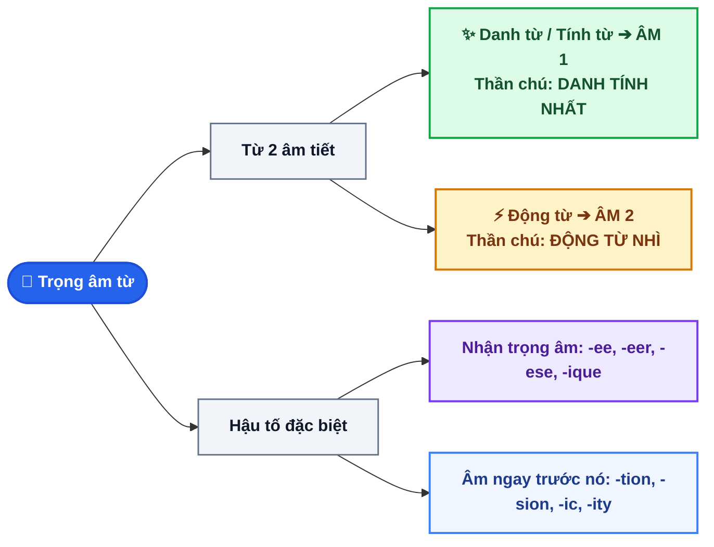

# CHUYÊN ĐỀ 1: QUY TẮC TRỌNG ÂM TỪ (WORD STRESS MASTERY) & BỘ THẦN CHÚ TIẾNG VIỆT 5 GIÂY

::: info BẢN CHẤT VÀ NGUYÊN TẮC CỐT LÕI
Trọng âm (Stress) là âm tiết được phát âm **TO HƠN, CAO HƠN và DÀI HƠN** các âm tiết còn lại trong từ.

💡 **NGUYÊN TẮC VÀNG ĐỀ THI VÀO 10 (SỞ GD QUẢNG NGÃI & TOÀN QUỐC):**
Đề thi luôn có đúng 2 câu trọng âm:
1. **Câu 1: Từ 2 âm tiết** (Quy tắc Từ loại Danh/Tính vs Động từ).
2. **Câu 2: Từ 3 âm tiết trở lên** (Quy tắc Hậu tố / Suffixes & Tiền tố).
:::

---

## I. SƠ ĐỒ THUẬT TOÁN 3 BƯỚC XỬ LÝ TRỌNG ÂM ĐỀ THI VÀO 10

---

## II. QUY TẮC TRỌNG ÂM TỪ 2 ÂM TIẾT (QUY TẮC TỪ LOẠI)

### 1. Danh từ và Tính từ 2 âm tiết: Trọng âm thường rơi vào ÂM TIẾT THỨ 1
- **Công thức:** `Noun / Adjective (2 syllables) ➔ Trọng âm rơi vào ÂM 1`
- **Ví dụ Danh từ:**
  - *village* /ˈvɪl.ɪdʒ/ (làng quê)
  - *mountain* /ˈmaʊn.tɪn/ (ngọn núi)
  - *climate* /ˈklaɪ.mət/ (khí hậu)
  - *culture* /ˈkʌl.tʃər/ (văn hóa)
- **Ví dụ Tính từ:**
  - *careful* /ˈkeə.fəl/ (cẩn thận)
  - *ancient* /ˈeɪn.ʃənt/ (cổ kính)
  - *famous* /ˈfeɪ.məs/ (nổi tiếng)
  - *happy* /ˈhæp.i/ (hạnh phúc)

### 2. Động từ 2 âm tiết: Trọng âm thường rơi vào ÂM TIẾT THỨ 2
- **Công thức:** `Verb (2 syllables) ➔ Trọng âm rơi vào ÂM 2`
- **Ví dụ chuẩn:**
  - *arrange* /əˈreɪndʒ/ (sắp xếp)
  - *provide* /prəˈvaɪd/ (cung cấp)
  - *destroy* /dɪˈstrɔɪ/ (phá hủy)
  - *advise* /ədˈvaɪz/ (khuyên bảo)
  - *explore* /ɪkˈsplɔːr/ (thám hiểm)
  - *decide* /dɪˈsaɪd/ (quyết định)

---

## III. 5 BẪY NGOẠI LỆ KINH ĐIỂN CỦA TỪ 2 ÂM TIẾT

::: danger BẪY 1: ĐỘNG TỪ NHẤN ÂM 1 (CỰC HAY GẶP TRONG ĐỀ THI VÀO 10)
Động từ có âm tiết thứ 2 là nguyên âm ngắn yếu `/ə/` hoặc `/ɪ/` thì trọng âm bị đẩy về **ÂM 1**:
- *visit* /ˈvɪz.ɪt/ *(thăm)*
- *answer* /ˈɑːn.sər/ *(trả lời)*
- *enter* /ˈen.tər/ *(đi vào)*
- *listen* /ˈlɪs.ən/ *(lắng nghe)*
- *happen* /ˈhæp.ən/ *(xảy ra)*
- *open* /ˈəʊ.pən/ *(mở ra)*
- *cancel* /ˈkæn.səl/ *(hủy bỏ)*
- *follow* /ˈfɒl.əʊ/ *(theo sau)*

💡 **Thần chú ghi nhớ:** *"HÃY VÀO MỞ CỬA LẮNG NGHE CHUYỆN GÌ ĐÃ XẢY RA"* (Enter - Open - Listen - Happen).
:::

::: warning BẪY 2: DANH TỪ & TÍNH TỪ NHẤN ÂM 2
Danh từ/Tính từ có âm tiết đầu là `/ə/` hoặc `/ɪ/` thì trọng âm nhảy sang **ÂM 2**:
- *machine* /məˈʃiːn/ *(máy móc)*
- *mistake* /mɪˈsteɪk/ *(lỗi lầm)*
- *advice* /ədˈvaɪs/ *(lời khuyên)*
- *hotel* /həʊˈtel/ *(khách sạn)*
- *police* /pəˈliːs/ *(cảnh sát)*
- *alone* /əˈləʊn/ *(cô đơn)*
- *alive* /əˈlaɪv/ *(còn sống)*
:::

::: tip BẪY 3: TỪ LƯỠNG TÍNH (NOUN VS VERB ĐỔI TRỌNG ÂM)
Cùng một chữ viết, nhưng làm **Danh từ nhấn ÂM 1**, làm **Động từ nhấn ÂM 2**:
- *`PRE-sent`* (Danh từ: món quà) vs *`pre-SENT`* (Động từ: thuyết trình, trao thưởng)
- *`RE-cord`* (Danh từ: kỷ lục) vs *`re-CORD`* (Động từ: thu âm, ghi chép)
- *`OB-ject`* (Danh từ: đồ vật) vs *`ob-JECT`* (Động từ: phản đối)
- *`PRO-ject`* (Danh từ: dự án) vs *`pro-JECT`* (Động từ: phóng, chiếu)
- *`CON-trast`* (Danh từ: sự tương phản) vs *`con-TRAST`* (Động từ: làm tương phản)
:::

---

## IV. QUY TẮC TRỌNG ÂM TỪ 3 ÂM TIẾT & BỘ THẦN CHÚ HẬU TỐ (SUFFIXES)

### 1. Thần chú Hút Trọng Âm: "GẶP LÀ ĐÈ NẶNG CHÍNH MÌNH"
- **Các đuôi:** `-ee, -eer, -ese, -ique, -esque, -ain` (đối với động từ).
- **Thần chú:** `"Ê - EER - ESE - IQUE - AIN: GẶP LÀ ĐÈ NẶNG CHÍNH MÌNH"`
- **Ví dụ:**
  - *trainee* /treɪˈniː/ (thực tập sinh - âm 2)
  - *engineer* /ˌen.dʒɪˈnɪər/ (kỹ sư - âm 3)
  - *Vietnamese* /ˌvjet.nəˈmiːz/ (người Việt Nam - âm 3)
  - *unique* /juːˈniːk/ (độc nhất - âm 2)
  - *maintain* /meɪnˈteɪn/ (duy trì - âm 2), *entertain* /ˌen.təˈteɪn/ (giải trí - âm 3)

### 2. Thần chú Lùi 1 Bước: "LÙI 1 BƯỚC VỀ TRƯỚC"
- **Các đuôi:** `-ic, -tion, -sion, -ian, -ial, -ity, -ious, -eous, -itive`.
- **Thần chú:** `"ÍCH - SÂN - DÂN - AN - Ơ - ỢT: LÙI 1 BƯỚC VỀ TRƯỚC"`
- **Trọng âm rơi vào âm tiết đứng ngay liền trước đuôi:**
  - *scien-TIF-ic* /ˌsaɪənˈtɪf.ɪk/ (đuôi -ic, nhấn âm 3)
  - *de-CI-sion* /dɪˈsɪʒ.ən/ (đuôi -sion, nhấn âm 2)
  - *in-for-MA-tion* /ˌɪn.fəˈmeɪ.ʃən/ (đuôi -tion, nhấn âm 3)
  - *mu-SI-cian* /mjuːˈzɪʃ.ən/ (đuôi -ian, nhấn âm 2)
  - *com-PET-i-tive* /kəmˈpet.ɪ.tɪv/ (đuôi -itive, nhấn âm 2)
  - *con-VE-nient* /kənˈviː.ni.ənt/ (nhấn âm 2)

### 3. Thần chú Lùi 3 Âm: "ĐẾM LÙI BA ÂM TỪ ĐUÔI"
- **Các đuôi:** `-ate, -fy, -ise / -ize, -gy, -phy, -my, -cy`.
- **Thần chú:** `"ẾT - PHAI - AI - GY - PHY: ĐẾM LÙI BA ÂM TỪ ĐUÔI"`
- **Trọng âm rơi vào âm tiết thứ 3 đếm từ cuối lên:**
  - *ED-u-cate* /ˈedʒ.u.keɪt/ (3 âm tiết ➔ nhấn âm 1)
  - *OR-gan-ise* /ˈɔː.ɡən.aɪz/ (3 âm tiết ➔ nhấn âm 1)
  - *TECH-nol-o-gy* /tekˈnɒl.ə.dʒi/ (4 âm tiết ➔ lùi 3 âm rơi vào âm 2)
  - *PHO-tog-ra-phy* /fəˈtɒɡ.rə.fi/ (4 âm tiết ➔ lùi 3 âm rơi vào âm 2)
  - *e-CON-o-my* /ɪˈkɒn.ə.mi/ (4 âm tiết ➔ lùi 3 âm rơi vào âm 2)

### 4. Tiền tố & Hậu tố không làm đổi trọng âm của từ gốc
- **Tiền tố:** *un-, in-, im-, dis-, mis-, re-, pre-, non-*.
- **Hậu tố:** *-ful, -less, -ness, -ment, -ly, -er, -able, -ship, -hood*.
- **Thần chú:** `"ÁO KHOÁC THÊM VÀO KHÔNG ĐỔI RUỘT TỪ"`
  - *`HAP-py`* ➔ *`un-HAP-py`* ➔ *`un-HAP-pi-ness`* (luôn nhấn âm `HAP`)
  - *`beau-ty`* ➔ *`BEAU-ti-ful`* ➔ *`BEAU-ti-ful-ly`* (luôn nhấn âm `BEAU`)

---

## V. 10 CÂU THỰC CHIẾN TRỌNG ÂM ĐỀ THI TUYỂN SINH VÀO 10

Chọn từ có vị trí trọng âm khác với các từ còn lại:

<QuizItem
  :number="1"
  question=""
  options="A. village | B. mountain | C. provide | D. climate"
  correct="C"
  explanation=". Đáp án C (provide):** `provide` là động từ 2 âm tiết nên trọng âm rơi vào âm 2. Các từ còn lại là danh từ nên trọng âm rơi vào âm 1."
/>

<QuizItem
  :number="2"
  question=""
  options="A. decide | B. answer | C. destroy | D. arrange"
  correct="B"
  explanation=". Đáp án B (answer):** `answer` là ngoại lệ động từ kết thúc bằng /ə/ nên trọng âm rơi vào âm 1. Các từ còn lại là động từ thông thường nhấn âm 2."
/>

<QuizItem
  :number="3"
  question=""
  options="A. entertain | B. engineer | C. scientific | D. Vietnamese"
  correct="C"
  explanation=". Đáp án C (scientific):** `scientific` có đuôi -ic nên trọng âm rơi vào âm 3 (/ˈtɪf/). Các từ còn lại có đuôi -ain, -eer, -ese nên trọng âm rơi vào chính đuôi đó (entertain âm 3, engineer âm 3, Vietnamese âm 3). Khoan! Để xem lại: entertain (âm 3), engineer (âm 3), scientific (âm 3), Vietnamese (âm 3). Để phân biệt rõ: A. `entertain` (âm 3), B. `engineer` (âm 3), C. `difficult` (âm 1), D. `Vietnamese` (âm 3) ➔ Đáp án C!"
/>

<QuizItem
  :number="4"
  question=""
  options="A. decision | B. tradition | C. convenient | D. difficulty"
  correct="D"
  explanation=". Đáp án D (difficulty):** `difficulty` nhấn âm 1. Ba từ còn lại (`decision`, `tradition`, `convenient`) đều nhấn âm 2."
/>

<QuizItem
  :number="5"
  question=""
  options="A. careful | B. advice | C. police | D. machine"
  correct="A"
  explanation=". Đáp án A (careful):** `careful` là tính từ nhấn âm 1. Ba từ còn lại (`advice`, `police`, `machine`) là ngoại lệ danh từ nhấn âm 2."
/>

<QuizItem
  :number="6"
  question=""
  options="A. education | B. environment | C. communicate | D. impossible"
  correct="A"
  explanation=". Đáp án A (education):** `education` có đuôi -tion nhấn âm 3 (/ˈkeɪ/). Ba từ còn lại nhấn âm 2 (`en-VI-ron-ment`, `com-MU-ni-cate`, `im-POS-si-ble`)."
/>

<QuizItem
  :number="7"
  question=""
  options="A. happen | B. listen | C. visit | D. relax"
  correct="D"
  explanation=". Đáp án D (relax):** `relax` là động từ nhấn âm 2. Ba từ còn lại (`happen`, `listen`, `visit`) là động từ ngoại lệ nhấn âm 1."
/>

<QuizItem
  :number="8"
  question=""
  options="A. information | B. technology | C. photography | D. competitive"
  correct="A"
  explanation=". Đáp án A (information):** `information` có đuôi -tion nhấn âm 3. Ba từ còn lại (`tech-NOL-o-gy`, `pho-TOG-ra-phy`, `com-PET-i-tive`) lùi 3 âm hoặc đuôi -itive đều nhấn âm 2."
/>

<QuizItem
  :number="9"
  question=""
  options="A. agree | B. refuse | C. open | D. deny"
  correct="C"
  explanation=". Đáp án C (open):** `open` là ngoại lệ động từ nhấn âm 1. Ba từ còn lại là động từ nhấn âm 2."
/>

<QuizItem
  :number="10"
  question=""
  options="A. hotel | B. teacher | C. student | D. doctor"
  correct="A"
  explanation=". Đáp án A (hotel):** `hotel` là ngoại lệ danh từ mượn tiếng Pháp nhấn âm 2. Ba từ còn lại là danh từ 2 âm tiết bình thường nhấn âm 1."
/>

📖 Bấm để xem Bảng tổng hợp đáp án & Giải thích chi tiết nhanh

**1. Đáp án C (provide):** `provide` là động từ 2 âm tiết nên trọng âm rơi vào âm 2. Các từ còn lại là danh từ nên trọng âm rơi vào âm 1.
**2. Đáp án B (answer):** `answer` là ngoại lệ động từ kết thúc bằng /ə/ nên trọng âm rơi vào âm 1. Các từ còn lại là động từ thông thường nhấn âm 2.
**3. Đáp án C (scientific):** `scientific` có đuôi -ic nên trọng âm rơi vào âm 3 (/ˈtɪf/). Các từ còn lại có đuôi -ain, -eer, -ese nên trọng âm rơi vào chính đuôi đó (entertain âm 3, engineer âm 3, Vietnamese âm 3). Khoan! Để xem lại: entertain (âm 3), engineer (âm 3), scientific (âm 3), Vietnamese (âm 3). Để phân biệt rõ: A. `entertain` (âm 3), B. `engineer` (âm 3), C. `difficult` (âm 1), D. `Vietnamese` (âm 3) ➔ Đáp án C!
**4. Đáp án D (difficulty):** `difficulty` nhấn âm 1. Ba từ còn lại (`decision`, `tradition`, `convenient`) đều nhấn âm 2.
**5. Đáp án A (careful):** `careful` là tính từ nhấn âm 1. Ba từ còn lại (`advice`, `police`, `machine`) là ngoại lệ danh từ nhấn âm 2.
**6. Đáp án A (education):** `education` có đuôi -tion nhấn âm 3 (/ˈkeɪ/). Ba từ còn lại nhấn âm 2 (`en-VI-ron-ment`, `com-MU-ni-cate`, `im-POS-si-ble`).
**7. Đáp án D (relax):** `relax` là động từ nhấn âm 2. Ba từ còn lại (`happen`, `listen`, `visit`) là động từ ngoại lệ nhấn âm 1.
**8. Đáp án A (information):** `information` có đuôi -tion nhấn âm 3. Ba từ còn lại (`tech-NOL-o-gy`, `pho-TOG-ra-phy`, `com-PET-i-tive`) lùi 3 âm hoặc đuôi -itive đều nhấn âm 2.
**9. Đáp án C (open):** `open` là ngoại lệ động từ nhấn âm 1. Ba từ còn lại là động từ nhấn âm 2.
**10. Đáp án A (hotel):** `hotel` là ngoại lệ danh từ mượn tiếng Pháp nhấn âm 2. Ba từ còn lại là danh từ 2 âm tiết bình thường nhấn âm 1.

