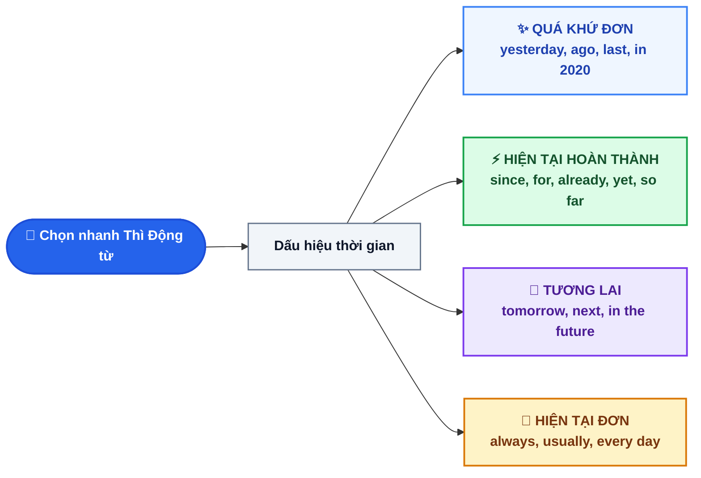

# CHUYÊN ĐỀ 2: HỆ THỐNG 12 THÌ, MA TRẬN SO SÁNH & PHỐI HỢP THÌ TRỌNG TÂM ÔN THI VÀO 10

> [!BLUE] **BẢN CHẤT VÀ NGUYÊN TẮC CỐT LÕI:**
> Tiếng Việt dùng từ chỉ thời gian (*đã, đang, sẽ*) đặt trước động từ nguyên thể, còn tiếng Anh **biến đổi trực tiếp hình thái của động từ (V)** theo 2 trục: **Thời gian (Time)** (Quá khứ - Hiện tại - Tương lai) và **Tính chất hành động (Aspect)** (Đơn - Tiếp diễn - Hoàn thành).

---

## I. SƠ ĐỒ TRỤC THỜI GIAN (ASCII TIMELINE) & PHÂN NHÁNH CHỌN THÌ TRONG 3 GIÂY

### 1. Trục thời gian trực quan (ASCII Timeline)

```text
QUÁ KHỨ (PAST)                        HIỆN TẠI (PRESENT)                     TƯƠNG LAI (FUTURE)
──────┼───────────────────────┼───────────────────────┼───────────────────────┼──────►
  [QK Hoàn Thành]          [Quá Khứ Đơn]           [Hiện Tại Đơn]          [Tương Lai Đơn]
  (had + V3/ed)              (V2/ed)                 (V-s/es)               (will + V-inf)
  Xảy ra TRƯỚC 1 mốc QK    Đã chấm dứt hoàn toàn   Sự thật / Thói quen     Quyết định tức thời
                           
                           ├──────────────────────►
                             [Hiện Tại Hoàn Thành]
                               (have/has + V3/ed)
                             Bắt đầu ở QK -> Kéo dài hoặc để lại KẾT QUẢ ở HT
```

### 2. Sơ đồ thuật toán chọn nhanh Thì trong đề thi (Mermaid Flowchart)



---

## II. BẢNG TỔNG HỢP CÔNG THỨC & DẤU HIỆU 12 THÌ TIẾNG ANH

> [!GREEN] **MẸO NHỚ CÔNG THỨC GỐC CHO MỌI THÌ:**
> - Hễ có chữ **Tiếp diễn (Continuous)** $\rightarrow$ Chắc chắn có `be + V-ing`.
> - Hễ có chữ **Hoàn thành (Perfect)** $\rightarrow$ Chắc chắn có `have/has/had + V3/ed`.
> - Hễ có chữ **Hoàn thành Tiếp diễn** $\rightarrow$ Ghép lại thành `have/has/had + been + V-ing`.

| Tên Thì (Tense) | Công thức Khẳng định (+) / Phủ định (-) / Nghi vấn (?) | Bản chất cốt lõi | Dấu hiệu nhận biết (Signal Words) |
| :--- | :--- | :--- | :--- |
| **1. Hiện tại đơn (Present Simple)** | (+) `S + V(s/es)` / `S + am/is/are`<br>(-) `S + do/does not + V-inf`<br>(?) `Do/Does + S + V-inf?` | Thói quen lặp lại, chân lý hiển nhiên, **lịch trình tàu xe/máy bay/phim ảnh**. | `always, usually, often, sometimes, seldom, rarely, never, every day, once/twice a week` |
| **2. Hiện tại tiếp diễn (Present Continuous)** | (+) `S + am/is/are + V-ing`<br>(-) `S + am/is/are not + V-ing`<br>(?) `Am/Is/Are + S + V-ing?` | Đang diễn ra ngay lúc nói; kế hoạch đã chốt chắc chắn; phàn nàn (đi với `always`). | `now, right now, at the moment, at present, Look!, Listen!, Watch out!, Be quiet!` |
| **3. Hiện tại hoàn thành (Present Perfect)** | (+) `S + have/has + V3/ed`<br>(-) `S + have/has not + V3/ed`<br>(?) `Have/Has + S + V3/ed?` | Việc bắt đầu trong QK còn kéo dài đến HT; việc đã xảy ra **không rõ thời điểm** hoặc **còn kết quả ở HT**. | `since + mốc TG, for + khoảng TG, just, already, yet, ever, never, recently, lately, so far, up to now, this is the first time` |
| **4. Hiện tại hoàn thành tiếp diễn** | (+) `S + have/has + been + V-ing` | Nhấn mạnh **tính liên tục không nghỉ** của hành động từ QK đến HT (thường để lại dấu hiệu bề mặt: mệt, ướt, bẩn). | `all day, all morning, the whole week, how long, since, for` |
| **5. Quá khứ đơn (Past Simple)** | (+) `S + V2/ed` / `S + was/were`<br>(-) `S + did not + V-inf`<br>(?) `Did + S + V-inf?` | Hành động **đã xảy ra và chấm dứt hoàn toàn** tại một thời điểm xác định trong quá khứ. | `yesterday, ... ago, last (week/month/year), in + năm QK (in 2015), when I was young` |
| **6. Quá khứ tiếp diễn (Past Continuous)** | (+) `S + was/were + V-ing`<br>(-) `S + was/were not + V-ing`<br>(?) `Was/Were + S + V-ing?` | Đang diễn ra tại **1 giờ cụ thể trong QK**; hoặc đang diễn ra thì hành động khác cắt ngang; 2 hành động song song ở QK. | `at + giờ + thời gian QK (at 8 p.m. last night), at this time yesterday, when, while, as` |
| **7. Quá khứ hoàn thành (Past Perfect)** | (+) `S + had + V3/ed`<br>(-) `S + had not + V3/ed`<br>(?) `Had + S + V3/ed?` | Hành động xảy ra **TRƯỚC một hành động khác** hoặc **trước một mốc thời gian** trong quá khứ. | `before, after, by the time + S + V2/ed, prior to, as soon as, until then` |
| **8. Quá khứ hoàn thành tiếp diễn** | (+) `S + had + been + V-ing` | Nhấn mạnh quá trình kéo dài liên tục của 1 việc xảy ra trước 1 việc khác trong QK. | `for + khoảng TG + before S + V2/ed, until then` |
| **9. Tương lai đơn (Future Simple)** | (+) `S + will + V-inf`<br>(-) `S + won't + V-inf`<br>(?) `Will + S + V-inf?` | Quyết định nảy sinh **ngay lúc nói**; dự đoán không căn cứ; lời hứa, đề nghị, đe dọa. | `tomorrow, next..., soon, in + TG nữa (in 5 minutes), I think, I promise, perhaps, probably` |
| **10. Tương lai gần (Near Future)** | (+) `S + am/is/are + going to + V-inf` | Kế hoạch/dự định **đã có từ trước lúc nói**; dự đoán **có dẫn chứng cụ thể** trước mắt. | `Look at those black clouds!, đã lên kế hoạch trước` |
| **11. Tương lai tiếp diễn (Future Continuous)** | (+) `S + will + be + V-ing` | Đang diễn ra tại **một thời điểm xác định cụ thể** trong tương lai. | `at + giờ + tomorrow, at this time next week/year` |
| **12. Tương lai hoàn thành (Future Perfect)** | (+) `S + will + have + V3/ed` | Hoàn tất **trước một thời điểm** hoặc **trước một hành động khác** trong tương lai. | `by + mốc tương lai (by tomorrow, by 2030), by the end of next month, by the time + S + V(htđ)` |

---

## III. MA TRẬN SO SÁNH 3 CẶP THÌ HAY GÀI BẪY NHẤT TRONG ĐỀ THI VÀO 10

### 1. Hiện tại hoàn thành (`have/has + V3/ed`) vs. Quá khứ đơn (`V2/ed`)

| Tiêu chí đối chiếu | Hiện tại hoàn thành (`have/has + V3/ed`) | Quá khứ đơn (`V2/ed`) |
| :--- | :--- | :--- |
| **Thời điểm xảy ra** | **Không xác định rõ** (Không quan trọng bằng kết quả). | **Xác định rõ ràng** (`yesterday, in 2020, 3 days ago`). |
| **Liên hệ với Hiện tại** | **Còn liên hệ** (Vừa mới xong, hoặc kéo dài đến nay). | **Đã cắt đứt hoàn toàn** với hiện tại. |
| **Ví dụ đối chiếu 1** | *I **have lost** my key.* (Giờ vẫn chưa tìm thấy, không vào nhà được). | *I **lost** my key yesterday.* (Kể lại sự việc hôm qua; giờ có thể đã làm chìa mới). |
| **Ví dụ đối chiếu 2** | *She **has lived** in Quang Ngai **for 10 years**.* (Hiện tại cô ấy vẫn đang sống ở Quảng Ngãi). | *She **lived** in Quang Ngai **for 10 years**.* (Giờ cô ấy đã chuyển đi nơi khác sống). |

> [!RED] **BẪY NGƯỜI VIỆT HAY SAI (VIETLISH TRAP):**
> Người Việt thấy chữ *"đã"* là phản xạ chia Quá khứ đơn. Nhưng trong tiếng Anh:
> - ❌ **Sai:** *I **saw** that movie three times.* (Báo số lần tính đến nay mà chia QKĐ là sai).
> - ✅ **Đúng:** *I **have seen** that movie three times.* (Trải nghiệm tính đến hiện tại phải dùng **Hiện tại hoàn thành**).

### 2. Sự phối hợp thì giữa Quá khứ đơn (`V2/ed`) và Quá khứ tiếp diễn (`was/were + V-ing`)

> [!BLUE] **3 CÔNG THỨC PHỐI HỢP VỚI `WHEN` & `WHILE`:**
> - **Hành động đang diễn ra (dài) thì hành động khác cắt ngang (ngắn):**
>   `When + S + V2/ed (cắt ngang), S + was/were + V-ing (đang diễn ra)`
>   `While + S + was/were + V-ing (đang diễn ra), S + V2/ed (cắt ngang)`
> - **Hai hành động diễn ra song song cùng lúc trong quá khứ:**
>   `While + S1 + was/were + V-ing, S2 + was/were + V-ing`

- **Ví dụ 1 (Cắt ngang):** *When the teacher **came** (`/keɪm/`) in, the students **were talking** (`/wɜː ˈtɔːkɪŋ/`) noisily.*
- **Ví dụ 2 (Song song):** *Last night, while my mother **was cooking** dinner, my father **was reading** a newspaper.*

### 3. Quy tắc Phối hợp thì với Liên từ chỉ Thời gian (`By the time`, `Since`, `After`, `Before`)

> [!YELLOW] **LUẬT BẤT DI BẤT DỊCH TRONG MỆNH ĐỀ THỜI GIAN:**
> **TUYỆT ĐỐI KHÔNG dùng `will` (Tương lai) ngay sau các liên từ thời gian** (`when, while, as soon as, before, after, until, till, by the time`). Để diễn tả tương lai, mệnh đề sau liên từ thời gian phải lùi về **Hiện tại đơn** hoặc **Hiện tại hoàn thành**!

| Cấu trúc Liên từ | Công thức chuẩn xác (100% ra thi) | Ví dụ chuẩn |
| :--- | :--- | :--- |
| **`SINCE` (Kể từ khi)** | `S + have/has + V3/ed + SINCE + S + V2/ed` | *We **haven't met** each other **since** we **left** school.* |
| **`BY THE TIME` (QK)** | `By the time + S + V2/ed, S + had + V3/ed` | ***By the time** the police **arrived**, the thief **had escaped**.* |
| **`BY THE TIME` (TL)** | `By the time + S + V(s/es), S + will have + V3/ed` | ***By the time** you **get** home tomorrow, I **will have finished** the report.* |
| **`BEFORE / AFTER` (QK)** | `After + S + had + V3/ed, S + V2/ed`<br>`Before + S + V2/ed, S + had + V3/ed` | ***After** he **had done** his homework, he **went** to bed.* |
| **`AS SOON AS` (TL)** | `S + will + V-inf + as soon as + S + V(s/es)` | *I **will call** you **as soon as** I **arrive** at the station.* |

---

## IV. CẨM NANG BIẾN ĐỔI CÂU (SENTENCE TRANSFORMATION) QKĐ <-> HTHT

> [!PURPLE] **4 CÔNG THỨC VIẾT LẠI CÂU LẤY ĐIỂM TUYỆT ĐỐI ĐỀ THI VÀO 10:**
> Đây là dạng câu tự luận bắt buộc trong đề thi tuyển sinh 10 của Sở GD Quảng Ngãi. Học sinh chỉ cần nắm vững 4 cặp biến đổi tương đương dưới đây:

| Dạng biến đổi | Câu gốc (Quá khứ đơn - `V2/ed`) | Câu viết lại tương đương (Hiện tại hoàn thành - `have/has + V3/ed`) |
| :--- | :--- | :--- |
| **Dạng 1: Bắt đầu làm gì $\rightarrow$ Đã làm được bao lâu** | `S + started / began + V-ing / to-V + [khoảng TG] + ago`<br>*(hoặc `in / when + mốc TG`)* | $\rightarrow$ `S + have/has + V3/ed / been V-ing + FOR + [khoảng TG]`<br>*(hoặc `SINCE + mốc TG`)* |
| **Dạng 2: Lần cuối làm gì $\rightarrow$ Đã bao lâu không làm** | `S + last + V2/ed + [khoảng TG] + ago`<br>`The last time + S + V2/ed + was + [TG] ago` | $\rightarrow$ `S + haven't / hasn't + V3/ed + FOR + [khoảng TG]`<br>$\rightarrow$ `It is / has been + [khoảng TG] + SINCE + S + (last) + V2/ed` |
| **Dạng 3: Chưa từng làm trước đây $\rightarrow$ Lần đầu tiên** | `S + have/has + never + V3/ed + (such)... + before` | $\rightarrow$ `This / It is the first time + S + have/has + (ever) + V3/ed` |
| **Dạng 4: Khi nào? $\rightarrow$ Bao lâu?** | `When + did + S + start/begin + V-ing / to-V?` | $\rightarrow$ `How long + have/has + S + V3/ed / been V-ing?` |

- **Ví dụ mẫu Dạng 1:** *She started learning English 5 years ago.* $\rightarrow$ *She **has learned / has been learning** English **for 5 years**.*
- **Ví dụ mẫu Dạng 2:** *The last time I saw him was in 2023.* $\rightarrow$ *I **haven't seen** him **since 2023**.*
- **Ví dụ mẫu Dạng 3:** *I have never eaten such delicious My Quang before.* $\rightarrow$ *This is the first time I **have ever eaten** such delicious My Quang.*

---

## V. 10 CÂU BÀI TẬP THỰC CHIẾN (TRÍCH ĐỀ THI VÀO 10 SỞ GD QUẢNG NGÃI)

<QuizItem
  :number="1"
  question="Look! The bus ________ (come). Run faster or we will miss it!"
  options="A. comes | B. is coming | C. came | D. has come"
  correct="B"
  explanation="**Câu 1:** Chọn **B (`is coming`)** — Có dấu hiệu cảm thán `Look!` ở đầu câu chỉ hành động đang diễn ra ngay trước mắt lúc nói."
/>

<QuizItem
  :number="2"
  question="My family ________ in Quang Ngai City since I was born."
  options="A. lived | B. lives | C. has lived | D. was living"
  correct="C"
  explanation="**Câu 2:** Chọn **C (`has lived`)** — Cấu trúc thông dụng: `S + have/has + V3/ed + since + S + V2/ed` (`since I was born`)."
/>

<QuizItem
  :number="3"
  question="While we ________ dinner last night, the electricity suddenly went out."
  options="A. had | B. were having | C. have had | D. had had"
  correct="B"
  explanation="**Câu 3:** Chọn **B (`were having`)** — Hành động đang diễn ra trong quá khứ (`While we were having dinner`) thì hành động khác cắt ngang (`went out`)."
/>

<QuizItem
  :number="4"
  question="The train to Da Nang ________ at 7:30 a.m. tomorrow morning according to the schedule."
  options="A. leaves | B. is leaving | C. will leave | D. has left"
  correct="A"
  explanation="**Câu 4:** Chọn **A (`leaves`)** — Lưu ý khi làm bài thi! Dù có `tomorrow morning`, nhưng lịch trình tàu xe/máy bay cố định (`schedule`) luôn chia **Hiện tại đơn**."
/>

<QuizItem
  :number="5"
  question="By the time the firefighters arrived, the fire ________ three warehouses."
  options="A. destroyed | B. was destroying | C. has destroyed | D. had destroyed"
  correct="D"
  explanation="**Câu 5:** Chọn **D (`had destroyed`)** — Công thức `By the time + S + V2/ed (arrived), S + had + V3/ed` (việc cháy rụi xảy ra trước khi lính cứu hỏa tới)."
/>

<QuizItem
  :number="6"
  question="I will send you the configuration file as soon as I ________ to the office."
  options="A. will get | B. got | C. get | D. am getting"
  correct="C"
  explanation="**Câu 6:** Chọn **C (`get`)** — Sau liên từ chỉ thời gian `as soon as`, tuyệt đối không dùng `will`, phải lùi về **Hiện tại đơn** (`get`)."
/>

<QuizItem
  :number="7"
  type="transform"
  question="Nam began working as a systems administrator three years ago.
   *"
  targetPrompt="Nam has..."
  sampleAnswer="Nam has worked (hoặc has been working) as a systems administrator for three years."
  explanation="**Câu 7:** `Nam has worked (hoặc has been working) as a systems administrator for three years.` (Đổi `began + V-ing ... ago` $\rightarrow$ `has + V3/ed + for ...`)."
/>

<QuizItem
  :number="8"
  type="transform"
  question="The last time we visited Ly Son Island was last summer.
   *"
  targetPrompt="We haven't..."
  sampleAnswer="We haven't visited Ly Son Island since last summer."
  explanation="**Câu 8:** `We haven't visited Ly Son Island since last summer.` (Đổi `The last time ... was` $\rightarrow$ `haven't + V3/ed + since + mốc thời gian`)."
/>

<QuizItem
  :number="9"
  type="transform"
  question="I have never used such a fast automation tool before.
   *"
  targetPrompt="This is the first time..."
  sampleAnswer="This is the first time I have (ever) used such a fast automation tool."
  explanation="**Câu 9:** `This is the first time I have (ever) used such a fast automation tool.` (Đổi `never ... before` $\rightarrow$ `This is the first time + HTHT`)."
/>

<QuizItem
  :number="10"
  type="transform"
  question="It's two months since she last wrote to me.
   *"
  targetPrompt="She hasn't..."
  sampleAnswer="She hasn't written to me for two months."
  explanation="**Câu 10:** `She hasn't written to me for two months.` (Đổi `It's + khoảng TG + since + S + last V2` $\rightarrow$ `S + hasn't + V3 + for + khoảng TG`)."
/>


<details class="study-accordion">
<summary>📖 Bấm để xem Bảng tổng hợp đáp án & Giải thích chi tiết nhanh</summary>

**Câu 1:** Chọn **B (`is coming`)** — Có dấu hiệu cảm thán `Look!` ở đầu câu chỉ hành động đang diễn ra ngay trước mắt lúc nói.
**Câu 2:** Chọn **C (`has lived`)** — Cấu trúc thông dụng: `S + have/has + V3/ed + since + S + V2/ed` (`since I was born`).
**Câu 3:** Chọn **B (`were having`)** — Hành động đang diễn ra trong quá khứ (`While we were having dinner`) thì hành động khác cắt ngang (`went out`).
**Câu 4:** Chọn **A (`leaves`)** — Lưu ý khi làm bài thi! Dù có `tomorrow morning`, nhưng lịch trình tàu xe/máy bay cố định (`schedule`) luôn chia **Hiện tại đơn**.
**Câu 5:** Chọn **D (`had destroyed`)** — Công thức `By the time + S + V2/ed (arrived), S + had + V3/ed` (việc cháy rụi xảy ra trước khi lính cứu hỏa tới).
**Câu 6:** Chọn **C (`get`)** — Sau liên từ chỉ thời gian `as soon as`, tuyệt đối không dùng `will`, phải lùi về **Hiện tại đơn** (`get`).
**Câu 7:** `Nam has worked (hoặc has been working) as a systems administrator for three years.` (Đổi `began + V-ing ... ago` $\rightarrow$ `has + V3/ed + for ...`).
**Câu 8:** `We haven't visited Ly Son Island since last summer.` (Đổi `The last time ... was` $\rightarrow$ `haven't + V3/ed + since + mốc thời gian`).
**Câu 9:** `This is the first time I have (ever) used such a fast automation tool.` (Đổi `never ... before` $\rightarrow$ `This is the first time + HTHT`).
**Câu 10:** `She hasn't written to me for two months.` (Đổi `It's + khoảng TG + since + S + last V2` $\rightarrow$ `S + hasn't + V3 + for + khoảng TG`).

</details>
