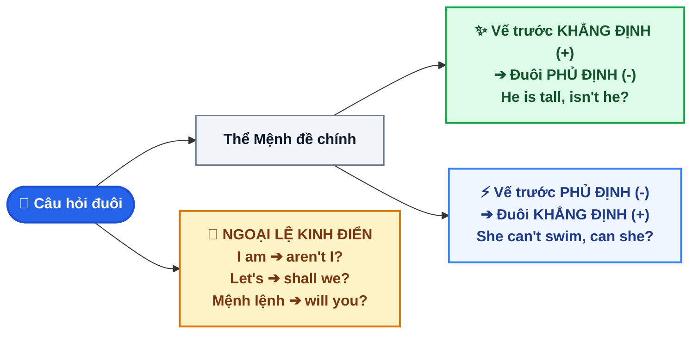

# CHUYÊN ĐỀ 2: CÂU HỎI ĐUÔI & TRỢ ĐỘNG TỪ (QUESTION TAGS MASTERY)

::: info BẢN CHẤT VÀ NGUYÊN TẮC CỐT LÕI
Câu hỏi đuôi (Tag Question) là một câu hỏi cực ngắn đính vào cuối câu trần thuật để **xác minh thông tin** hoặc **tìm kiếm sự đồng thuận**. Cấu trúc luôn tuân thủ nguyên tắc vàng **"Trái Dấu"**:
`Khẳng định (+) ➔ Đuôi Phủ định (-)`  |  `Phủ định (-) ➔ Đuôi Khẳng định (+)`
Công thức: `[Mệnh đề trần thuật], [Trợ động từ (+ not)] + [Đại từ nhân xưng]?`
:::

---

## I. SƠ ĐỒ THUẬT TOÁN 3 BƯỚC TẠO CÂU HỎI ĐUÔI

---

## II. MA TRẬN TRỢ ĐỘNG TỪ THEO CÁC THÌ TRONG TIẾNG ANH

| Thì của Mệnh đề chính | Trợ động từ trong câu hỏi đuôi | Ví dụ Khẳng định (+) ➔ Đuôi (-) | Ví dụ Phủ định (-) ➔ Đuôi (+) |
| :--- | :--- | :--- | :--- |
| **Động từ TO BE** (`am/is/are`, `was/were`) | Dùng chính động từ `TO BE` | *She **is** an English teacher, **isn't she**?* *They **were** happy, **weren't they**?* | *He **isn't** at home, **is he**?* *You **weren't** late, **were you**?* |
| **Hiện tại đơn** (Động từ thường) | Mượn trợ động từ **`DO / DOES`** | *You **live** in Quang Ngai, **don't you**?* *Nam **works** hard, **doesn't he**?* | *They **don't play** games, **do they**?* *She **doesn't like** tea, **does she**?* |
| **Quá khứ đơn** (Động từ thường) | Mượn trợ động từ **`DID`** | *You **visited** Da Lat last week, **didn't you**?* | *Tom **didn't call** you, **did he**?* |
| **Hiện tại hoàn thành** (`have/has + V3`) | Dùng chính **`HAVE / HAS`** | *We **have finished** the report, **haven't we**?* | *She **hasn't arrived** yet, **has she**?* |
| **Quá khứ hoàn thành** (`had + V3`) | Dùng chính **`HAD`** | *He **had left** before 8 p.m., **hadn't he**?* | *They **hadn't seen** it, **had they**?* |
| **Động từ khuyết thiếu** (`will, can, should, could...`) | Dùng chính **Modal Verb** | *You **can** swim, **can't you**?* *We **will** win the match, **won't we**?* | *She **cannot** drive, **can she**?* *They **won't** leave early, **will they**?* |

---

## III. 8 BẪY ĐẶC BIỆT CHẮC CHẮN GÀI TRONG ĐỀ THI VÀO 10

::: danger BẪY 1: CÂU CHỨA TỪ PHỦ ĐỊNH NGẦM (LỖI SAI THƯỜNG GẶP NHẤT)
Nếu mệnh đề chính chứa các từ phủ định hoặc bán phủ định: **`never, seldom, rarely, hardly, scarcely, little, few, neither, no, nobody, nothing`**, thì câu đó **MANG NGHĨA PHỦ ĐỊNH (-)**.
➔ Phần đuôi **BẮT BUỘC Ở DẠNG KHẲNG ĐỊNH (+)**!
- ❌ *Sai:* She **never** comes late, **doesn't she**?
- ✅ *Đúng:* She **never** comes late, **does she**?
- *Ví dụ 2:* There is **little** milk left in the fridge, **is there**?
:::

::: warning BẪY 2: CHỦ NGỮ LÀ ĐẠI TỪ BẤT ĐỊNH CHỈ NGƯỜI (EVERYONE, NOBODY...)
Khi chủ ngữ là `everyone, everybody, someone, somebody, anyone, anybody, no one, nobody`, đại từ ở câu hỏi đuôi **BẮT BUỘC LÀ `THEY`**.
*(Chú ý: Khi đổi sang `they`, trợ động từ phải chia ở số nhiều!)*
- *Ví dụ:* **Everyone** attended the meeting, **didn't they**?
- *Ví dụ gài bẫy:* **Nobody** came to the party, **did they**? *(Nobody mang nghĩa phủ định + đổi thành they ➔ đuôi khẳng định `did they`)*.
:::

::: tip BẢNG TỔNG HỢP CÁC TRƯỜNG HỢP NGOẠI LỆ ĐẶC BIỆT
:::

| Trường hợp | Mệnh đề chính | Quy tắc phần câu hỏi đuôi | Ví dụ chuẩn |
| :--- | :--- | :--- | :--- |
| **3. `I am...`** | `I am + Adj/N` | Đuôi bắt buộc là **`aren't I?`** *(nhưng `I am not` ➔ `am I?`)* | *I am right, **aren't I**?* *I am not late, **am I**?* |
| **4. Câu mệnh lệnh** | `V-inf...` hoặc `Don't + V-inf...` | Đuôi dùng **`will you?`** | *Open the door, **will you**?* *Don't make noise, **will you**?* |
| **5. Cấu trúc `Let's`** | `Let's + V-inf` (Lời rủ rê cùng làm) | Đuôi bắt buộc là **`shall we?`** | *Let's go swimming, **shall we**?* |
| **6. Cấu trúc `Let me / Let us`** | `Let us / Let me + V-inf` (Xin phép) | Đuôi dùng **`will you?`** | *Let us use your phone, **will you**?* |
| **7. Đại từ chỉ vật** | `Everything, something, anything, nothing` | Đại từ ở đuôi bắt buộc là **`it`** | *Everything is ready, **isn't it**?* *Nothing happened, **did it**?* |
| **8. Mệnh đề `I think / believe...`** | `I think / believe (that) + S2 + V2` | Chia đuôi theo **MỆNH ĐỀ PHỤ (S2 + V2)** | *I think he is honest, **isn't he**?* *I don't think she will come, **will she**?* |
| **9. `Had better` & `Would rather`** | `S + had better ('d better) + V-inf` `S + would rather ('d rather) + V-inf` | Đuôi dùng **`hadn't S?`** Đuôi dùng **`wouldn't S?`** | *You'd better study hard, **hadn't you**?* *She'd rather stay home, **wouldn't she**?* |

---

## IV. 10 CÂU THỰC CHIẾN (TRÍCH ĐỀ TUYỂN SINH VÀO 10 QUẢNG NGÃI)

<QuizItem
  :number="1"
  question="You haven't finished your math homework yet, ______?"
  options="A. have you | B. haven't you | C. do you | D. did you"
  correct="A"
  explanation=". Đáp án A (have you):** Mệnh đề chính ở thì Hiện tại hoàn thành phủ định `haven't finished` ➔ Đuôi ở dạng khẳng định `have you`."
/>

<QuizItem
  :number="2"
  question="Lan can speak three foreign languages fluently, ______?"
  options="A. can she | B. doesn't she | C. can't she | D. isn't she"
  correct="C"
  explanation=". Đáp án C (can't she):** Mệnh đề chính có động từ khuyết thiếu khẳng định `can speak` ➔ Đuôi phủ định `can't she`."
/>

<QuizItem
  :number="3"
  question="Let's plant more trees along the streets to protect our environment, ______?"
  options="A. will you | B. shall we | C. do we | D. won't you"
  correct="B"
  explanation=". Đáp án B (shall we):** Cấu trúc rủ rê `Let's + V-inf` ➔ Phần câu hỏi đuôi luôn là `shall we`."
/>

<QuizItem
  :number="4"
  question="She hardly ever travels abroad due to her fear of flying, ______?"
  options="A. does she | B. doesn't she | C. is she | D. isn't she"
  correct="A"
  explanation=". Đáp án A (does she):** Có trạng từ bán phủ định `hardly ever` (hầu như không bao giờ) ➔ Mệnh đề mang nghĩa phủ định, thì Hiện tại đơn của `travels` ➔ Đuôi khẳng định `does she`."
/>

<QuizItem
  :number="5"
  question="Nobody phoned me while I was taking an afternoon nap, ______?"
  options="A. did they | B. didn't they | C. did he | D. didn't he"
  correct="A"
  explanation=". Đáp án A (did they):** `Nobody` mang nghĩa phủ định và được quy đổi thành đại từ `they`. Động từ `phoned` ở quá khứ đơn ➔ Đuôi khẳng định `did they`."
/>

<QuizItem
  :number="6"
  question="I am invited to deliver the opening speech at the ceremony, ______?"
  options="A. am not I | B. aren't I | C. isn't I | D. don't I"
  correct="B"
  explanation=". Đáp án B (aren't I):** Ngoại lệ thông dụng: `I am...` đi kèm với câu hỏi đuôi phủ định bắt buộc là `aren't I?`."
/>

<QuizItem
  :number="7"
  question="Don't touch these chemical bottles in the laboratory, ______?"
  options="A. do you | B. won't you | C. will you | D. shall we"
  correct="C"
  explanation=". Đáp án C (will you):** Câu mệnh lệnh phủ định `Don't + V-inf` ➔ Câu hỏi đuôi luôn là `will you?`."
/>

<QuizItem
  :number="8"
  question="Nothing went wrong during the school trip to My Son sanctuary, ______?"
  options="A. didn't it | B. did it | C. did they | D. was it"
  correct="B"
  explanation=". Đáp án B (did it):** `Nothing` mang nghĩa phủ định và quy đổi thành đại từ `it`. Động từ `went` ở quá khứ đơn ➔ Đuôi khẳng định `did it`."
/>

<QuizItem
  :number="9"
  question="I don't think Tom will accept their job offer in Da Nang, ______?"
  options="A. do I | B. don't I | C. will he | D. won't he"
  correct="C"
  explanation=". Đáp án C (will he):** Cấu trúc `I don't think + S2 + will...`. Tính phủ định dồn vào mệnh đề sau `Tom will...` ➔ Đuôi chia theo Tom ở thể khẳng định `will he`."
/>

<QuizItem
  :number="10"
  question="The children enjoyed playing football in the schoolyard yesterday, ______?"
  options="A. don't they | B. didn't they | C. weren't they | D. did they"
  correct="B"
  explanation=". Đáp án B (didn't they):** Mệnh đề chính ở Quá khứ đơn khẳng định `enjoyed` ➔ Mượn trợ động từ quá khứ phủ định `didn't`, `The children` đổi thành `they` ➔ `didn't they`."
/>

📖 Bấm để xem Bảng tổng hợp đáp án & Giải thích chi tiết nhanh

**1. Đáp án A (have you):** Mệnh đề chính ở thì Hiện tại hoàn thành phủ định `haven't finished` ➔ Đuôi ở dạng khẳng định `have you`.
**2. Đáp án C (can't she):** Mệnh đề chính có động từ khuyết thiếu khẳng định `can speak` ➔ Đuôi phủ định `can't she`.
**3. Đáp án B (shall we):** Cấu trúc rủ rê `Let's + V-inf` ➔ Phần câu hỏi đuôi luôn là `shall we`.
**4. Đáp án A (does she):** Có trạng từ bán phủ định `hardly ever` (hầu như không bao giờ) ➔ Mệnh đề mang nghĩa phủ định, thì Hiện tại đơn của `travels` ➔ Đuôi khẳng định `does she`.
**5. Đáp án A (did they):** `Nobody` mang nghĩa phủ định và được quy đổi thành đại từ `they`. Động từ `phoned` ở quá khứ đơn ➔ Đuôi khẳng định `did they`.
**6. Đáp án B (aren't I):** Ngoại lệ thông dụng: `I am...` đi kèm với câu hỏi đuôi phủ định bắt buộc là `aren't I?`.
**7. Đáp án C (will you):** Câu mệnh lệnh phủ định `Don't + V-inf` ➔ Câu hỏi đuôi luôn là `will you?`.
**8. Đáp án B (did it):** `Nothing` mang nghĩa phủ định và quy đổi thành đại từ `it`. Động từ `went` ở quá khứ đơn ➔ Đuôi khẳng định `did it`.
**9. Đáp án C (will he):** Cấu trúc `I don't think + S2 + will...`. Tính phủ định dồn vào mệnh đề sau `Tom will...` ➔ Đuôi chia theo Tom ở thể khẳng định `will he`.
**10. Đáp án B (didn't they):** Mệnh đề chính ở Quá khứ đơn khẳng định `enjoyed` ➔ Mượn trợ động từ quá khứ phủ định `didn't`, `The children` đổi thành `they` ➔ `didn't they`.

