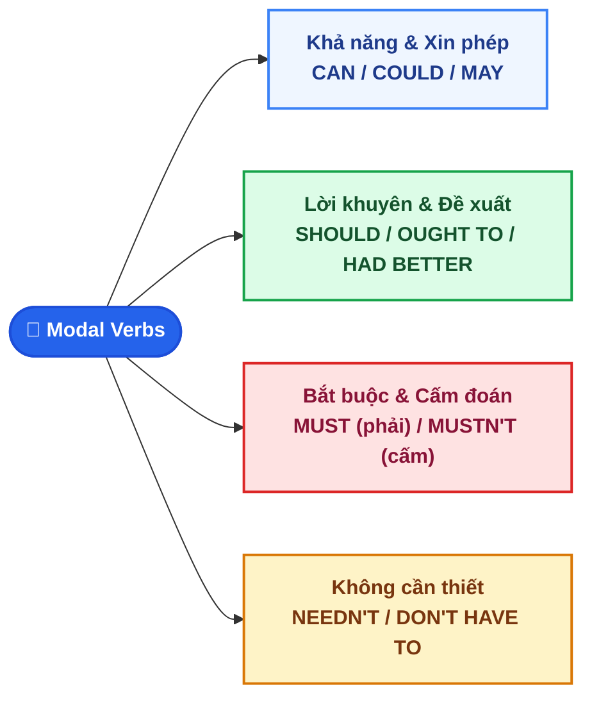

# CHUYÊN ĐỀ 2: ĐỘNG TỪ KHUYẾT THIẾU (MODAL VERBS MASTERY) ÔN THI VÀO 10

::: info BẢN CHẤT VÀ NGUYÊN TẮC CỐT LÕI
Động từ khuyết thiếu (Modal Verbs: *can, could, may, might, must, should, have to, needn't*) không diễn tả một hành động vật lý cụ thể, mà dùng để biểu thị **thái độ của người nói** đối với hành động đó: **Mức độ chắc chắn**, **Khả năng**, **Sự cho phép**, **Sự bắt buộc** hoặc **Lời khuyên**.
Nguyên tắc ngữ pháp bất biến: **`S + MODAL VERB + V-INF (nguyên mẫu không chia)`**.
:::

---

## I. SƠ ĐỒ PHÂN LOẠI CẤP ĐỘ NGHĨA CỦA MODAL VERBS

---

## II. MA TRẬN PHÂN BIỆT CÁC CẶP MODAL VERBS HAY GÀI BẪY NHẤT

| Nhóm chức năng | Động từ & Công thức | Bản chất khác biệt & Ngữ cảnh | Ví dụ minh họa thực chiến |
| :--- | :--- | :--- | :--- |
| **1. Khả năng & Xin phép** | **`CAN`** vs. **`COULD`** | `CAN`: Khả năng ở hiện tại. `COULD`: Khả năng trong quá khứ, hoặc lời nhờ vả lịch sự. | *She **can speak** three languages.* ***Could you please lend** me your pen?* |
| **2. Dự đoán có thể xảy ra** | **`MAY`** vs. **`MIGHT`** | Diễn tả việc có thể xảy ra ở hiện tại hoặc tương lai nhưng không chắc chắn (khoảng 30% - 50%). | *Take an umbrella; it **may / might rain** this afternoon.* |
| **3. Lời khuyên** | **`SHOULD / OUGHT TO / HAD BETTER`** | Khuyên ai đó nên làm gì vì có lợi hoặc đúng đắn. | *You **should review** your lessons before the exam.* *You'**d better not stay** up too late.* |
| **4. Bắt buộc** | **`MUST`** vs. **`HAVE TO`** | `MUST`: Bắt buộc mang tính chủ quan (người nói tự thấy cần thiết). `HAVE TO`: Bắt buộc mang tính khách quan (do luật pháp, quy định, nội quy). | *I **must study** harder to enter school 10.* *Motorcyclists **have to wear** helmets by law.* |
| **5. Cấm đoán tuyệt đối** | **`MUSTN'T`** | Tuyệt đối **KHÔNG ĐƯỢC PHÉP** làm (`= You are not allowed to...`). | *You **mustn't use** cellphones during the exam.* |
| **6. Không cần thiết** | **`NEEDN'T / DON'T HAVE TO`** | **Không bắt buộc phải làm** (thích làm thì làm, không làm cũng không sao). | *Tomorrow is Sunday, so you **needn't get** up early.* |

---

## III. 5 CÔNG THỨC VIẾT LẠI CÂU VỚI MODAL VERBS (CHẮC CHẮN RA THI)

::: danger BẢNG QUY ĐỔI CÂU TƯƠNG ĐƯƠNG VỚI MODAL VERBS
:::

| Dạng câu gốc trong đề | Công thức viết lại tương đương | Ví dụ chuẩn trong đề thi |
| :--- | :--- | :--- |
| **`It is not allowed to V` / `Don't V`** | `S + MUSTN'T + V-inf` *(Cấm đoán)* | *You are not allowed to smoke here.* ➔ *You **mustn't smoke** here.* |
| **`It is necessary for S to V`** | `S + MUST / HAVE TO / NEED TO + V-inf` | *It is necessary for you to wear a mask.* ➔ *You **must wear** a mask.* |
| **`It is not necessary for S to V`** | `S + NEEDN'T / DON'T HAVE TO + V-inf` | *It is not necessary for students to attend the rehearsal.* ➔ *Students **needn't attend** the rehearsal.* |
| **`If I were you, I would V` / `Why don't you V?`** | `S + SHOULD / OUGHT TO / 'D BETTER + V-inf` | *If I were you, I would consult a doctor.* ➔ *You **should consult** a doctor.* |
| **`Perhaps S will V` / `It is possible that S + V`** | `S + MAY / MIGHT + V-inf` | *Perhaps she will travel to Hue next week.* ➔ *She **may travel** to Hue next week.* |

---

## IV. 10 CÂU THỰC CHIẾN (TRÍCH ĐỀ THI TUYỂN SINH VÀO 10 QUẢNG NGÃI)

<QuizItem
  :number="1"
  question="You ______ drive on the left side of the road in Vietnam; it is strictly illegal."
  options="A. mustn't | B. needn't | C. shouldn't | D. may not"
  correct="A"
  explanation=". Đáp án A (mustn't):** Quy định luật pháp cấm đoán (`strictly illegal`) ➔ dùng `mustn't` (cấm)."
/>

<QuizItem
  :number="2"
  question="Tomorrow is a national holiday, so we ______ go to school."
  options="A. mustn't | B. don't have to | C. couldn't | D. shouldn't"
  correct="B"
  explanation=". Đáp án B (don't have to):** Ngày nghỉ lễ thì không cần thiết phải đi học (`don't have to` = `needn't`)."
/>

<QuizItem
  :number="3"
  question="Look at those dark clouds! It ______ rain in a few minutes."
  options="A. should | B. might | C. must | D. will"
  correct="B"
  explanation=". Đáp án B (might):** Dự đoán có thể xảy ra nhưng không chắc chắn ➔ dùng `might` (hoặc `may`)."
/>

<QuizItem
  :number="4"
  question="&quot;______ you please pass me the salt, Lan?&quot; asked Tom."
  options="A. Should | B. Must | C. Could | D. Shall"
  correct="C"
  explanation=". Đáp án C (Could):** Lời yêu cầu, nhờ vả lịch sự: `Could you please + V-inf?`."
/>

<QuizItem
  :number="5"
  question="If you want to improve your pronunciation, you ______ practice speaking English every day."
  options="A. had to | B. ought | C. should | D. might"
  correct="C"
  explanation=". Đáp án C (should):** Lời khuyên nên làm gì: `should + V-inf`."
/>

<QuizItem
  :number="6"
  question="You ______ touch that bare wire; it is extremely dangerous!"
  options="A. don't need to | B. mustn't | C. couldn't | D. wouldn't"
  correct="B"
  explanation=". Đáp án B (mustn't):** Nguy hiểm tính mạng ➔ cấm tuyệt đối chạm vào dây điện trần (`mustn't`)."
/>

<QuizItem
  :number="7"
  question="It's an informal party, so you ______ wear a suit and tie."
  options="A. mustn't | B. needn't | C. can't | D. couldn't"
  correct="B"
  explanation=". Đáp án B (needn't):** Bữa tiệc thân mật không trang trọng ➔ không cần thiết phải mặc comple cà vạt (`needn't wear`)."
/>

<QuizItem
  :number="8"
  question="All passengers ______ fasten their seat belts when the airplane is taking off."
  options="A. may | B. must | C. can | D. could"
  correct="B"
  explanation=". Đáp án B (must):** Quy định an toàn hàng không bắt buộc mọi hành khách phải thắt dây an toàn ➔ dùng `must`."
/>

<QuizItem
  :number="9"
  question="My grandfather ______ speak four foreign languages when he was young."
  options="A. can | B. could | C. might | D. should"
  correct="B"
  explanation=". Đáp án B (could):** Diễn tả năng lực, khả năng trong quá khứ (`when he was young`) ➔ dùng `could`."
/>

<QuizItem
  :number="10"
  type="transform"
  question="*Viết lại câu:* It is not necessary for you to complete this task today.
   ➔ *Viết lại:* `You don't...`"
  targetPrompt=""
  sampleAnswer="You don't have to complete this task today"
  explanation=". Đáp án:** `You don't have to complete this task today` (hoặc `You don't need to complete this task today`). Cấu trúc `It is not necessary for S to V` chuyển thành `S + don't have to / needn't + V-inf`."
/>

📖 Bấm để xem Bảng tổng hợp đáp án & Giải thích chi tiết nhanh

**1. Đáp án A (mustn't):** Quy định luật pháp cấm đoán (`strictly illegal`) ➔ dùng `mustn't` (cấm).
**2. Đáp án B (don't have to):** Ngày nghỉ lễ thì không cần thiết phải đi học (`don't have to` = `needn't`).
**3. Đáp án B (might):** Dự đoán có thể xảy ra nhưng không chắc chắn ➔ dùng `might` (hoặc `may`).
**4. Đáp án C (Could):** Lời yêu cầu, nhờ vả lịch sự: `Could you please + V-inf?`.
**5. Đáp án C (should):** Lời khuyên nên làm gì: `should + V-inf`.
**6. Đáp án B (mustn't):** Nguy hiểm tính mạng ➔ cấm tuyệt đối chạm vào dây điện trần (`mustn't`).
**7. Đáp án B (needn't):** Bữa tiệc thân mật không trang trọng ➔ không cần thiết phải mặc comple cà vạt (`needn't wear`).
**8. Đáp án B (must):** Quy định an toàn hàng không bắt buộc mọi hành khách phải thắt dây an toàn ➔ dùng `must`.
**9. Đáp án B (could):** Diễn tả năng lực, khả năng trong quá khứ (`when he was young`) ➔ dùng `could`.
**10. Đáp án:** `You don't have to complete this task today` (hoặc `You don't need to complete this task today`). Cấu trúc `It is not necessary for S to V` chuyển thành `S + don't have to / needn't + V-inf`.

