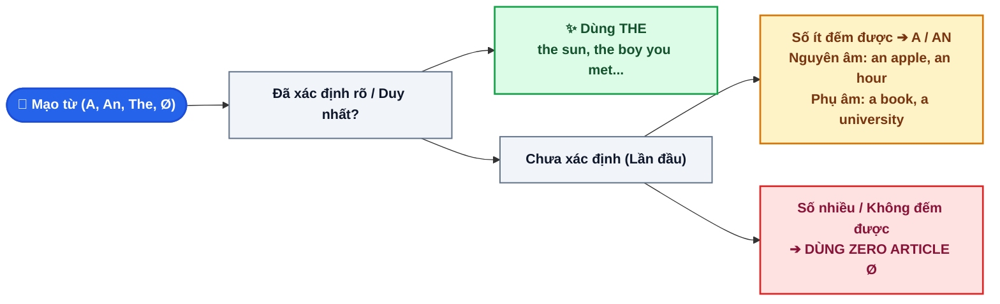

# CHUYÊN ĐỀ 2: CẨM NANG MẠO TỪ (ARTICLES: A, AN, THE & ZERO ARTICLE) ÔN THI VÀO 10

> [!BLUE] **BẢN CHẤT VÀ NGUYÊN TẮC CỐT LÕI:**
> Mạo từ (Articles) là chiếc **"nhãn dán xác định"** đặt trước danh từ để báo hiệu cho người nghe:
> - **`A / AN` (Mạo từ bất định):** Danh từ này là **chung chung**, người nghe **chưa hề biết** đó là ai/cái gì.
> - **`THE` (Mạo từ xác định):** Cả người nói và người nghe **đều biết rõ 100%** danh từ đó là gì.
> - **`Ø` (Không mạo từ - Zero Article):** Chỉ bản chất chung, sự vật số nhiều hoặc danh từ không đếm được nói chung.

---

## I. SƠ ĐỒ THUẬT TOÁN 3 BƯỚC CHỌN MẠO TỪ TRONG 3 GIÂY

---

## II. QUY TẮC SỬ DỤNG MẠO TỪ BẤT ĐỊNH (A / AN) & CÁC BẪY PHIÊN ÂM

> [!RED] **LƯU Ý QUAN TRỌNG KHI DÙNG "A" VÀ "AN": XÉT THEO ÂM THANH (IPA), KHÔNG XÉT THEO CHỮ CÁI!**
> - Dùng **`AN`** trước danh từ bắt đầu bằng một **NGUYÊN ÂM THEO PHIÊN ÂM IPA** (`/æ/, /e/, /ɪ/, /ɒ/, /ʌ/`...):
>   - *an hour* /ˈaʊ.ər/ *(chữ "h" câm, bắt đầu bằng nguyên âm /aʊ/)*.
>   - *an honest person* /ˈɒn.ɪst/ *(chữ "h" câm, bắt đầu bằng nguyên âm /ɒ/)*.
>   - *an MP3 player* /ˌem.piːˈθriː/ *(chữ M đọc là /em/, bắt đầu bằng nguyên âm /e/)*.
>   - *an SOS message* /ˌes.əʊˈes/ *(chữ S đọc là /es/, bắt đầu bằng nguyên âm /e/)*.
> - Dùng **`A`** trước danh từ bắt đầu bằng một **PHỤ ÂM HOẶC BÁN NGUYÊN ÂM (/j/, /w/)**:
>   - *a university* /ˌjuː.nɪˈvɜː.sə.ti/ *(bắt đầu bằng bán phụ âm /j/, KHÔNG dùng "an")*.
>   - *a uniform* /ˈjuː.nɪ.fɔːm/ *(bắt đầu bằng bán phụ âm /j/)*.
>   - *a European country* /ˌjʊə.rəˈpiː.ən/ *(chữ Eu đọc là /jʊə/, bắt đầu bằng phụ âm /j/)*.
>   - *a one-way ticket* /wʌn/ *(chữ "one" đọc là /wʌn/, bắt đầu bằng phụ âm /w/)*.

---

## III. 8 QUY TẮC BẮT BUỘC DÙNG "THE" (DEFINITE ARTICLE)

| STT | Trường hợp dùng `THE` | Ví dụ chuẩn |
| :--- | :--- | :--- |
| **1** | Vật thể **duy nhất trong tự nhiên** | *the Sun, the Moon, the Earth, the sky, the universe, the equator* |
| **2** | Danh từ được **nhắc lại lần thứ 2** trong ngữ cảnh | *I bought **a book** yesterday. **The book** is very exciting.* |
| **3** | Có mệnh đề quan hệ hoặc cụm giới từ làm rõ phía sau | *The girl **who is standing over there** is my classmate.* |
| **4** | Đi với **So sánh nhất** & **Số thứ tự** | *the highest mountain, the best student, the first time, the only person* |
| **5** | Đứng trước **Tên Nhạc cụ** (`play the + nhạc cụ`) | *play **the piano**, play **the guitar**, play **the violin*** *(khác thể thao: play football)* |
| **6** | `THE + TÍNH TỪ` chỉ một tập thể người | *the poor (người nghèo), the rich (người giàu), the elderly, the blind* |
| **7** | Tên **Sông ngòi, Đại dương, Dãy núi, Quần đảo** | *the Tra Khuc river, the Pacific Ocean, the Himalayas, the Philippines* |
| **8** | Tên Quốc gia có chữ `States, Kingdom, Republic` hoặc số nhiều | *the United States (USA), the United Kingdom (UK), the Netherlands* |

---

## IV. CÁC TRƯỜNG HỢP TUYỆT ĐỐI KHÔNG DÙNG MẠO TỪ (ZERO ARTICLE: Ø)

> [!YELLOW] **BẢNG TRA CỨU CÁC DANH TỪ KHÔNG ĐI VỚI MẠO TỪ:**
> 1. **Trước Bữa ăn hàng ngày:** `have breakfast, have lunch, have dinner`. *(Nhưng nếu có tính từ khen ngợi: have a delicious dinner)*.
> 2. **Trước Môn thể thao, Trò chơi:** `play football, play chess, play tennis, play badminton`.
> 3. **Trước Tên riêng, Quốc gia, Thành phố, Châu lục:** `Vietnam, Ha Noi, Quang Ngai, Asia, Europe`. *(Trừ the USA, the UK...)*.
> 4. **Trước Một đỉnh núi đơn lẻ, Một hòn đảo đơn lẻ:** `Mount Everest, Mount Fuji, Ly Son Island, Phu Quoc Island`.
> 5. **Trước Danh từ trừu tượng hoặc Danh từ số nhiều nói chung:** `Water is essential for life`; `Cats are cute animals`.
> 6. **Cấu trúc đi đến địa điểm đúng mục đích tự nhiên:**
>    - `go to school` *(đi học)* vs. `go to the school` *(đến trường gặp ai đó)*.
>    - `go to hospital` *(đi nằm viện)* vs. `go to the hospital` *(đến bệnh viện thăm người ốm)*.
>    - `go to bed` *(đi ngủ)* vs. `sit on the bed` *(ngồi trên giường)*.

---

## V. 10 CÂU THỰC CHIẾN (TRÍCH ĐỀ THI TUYỂN SINH VÀO 10 QUẢNG NGÃI)

<QuizItem
  :number="1"
  question="My uncle has been working as ______ engineer at Dung Quat refinery for over ten years."
  options="A. a | B. an | C. the | D. Ø"
  correct="B"
  explanation=". Đáp án B (an):** Danh từ đếm được số ít chỉ nghề nghiệp `engineer` bắt đầu bằng nguyên âm `/e/` ➔ dùng `an`."
/>

<QuizItem
  :number="2"
  question="Look at ______ sky! It looks like it is going to rain cats and dogs."
  options="A. a | B. an | C. the | D. Ø"
  correct="C"
  explanation=". Đáp án C (the):** `sky` (bầu trời) là vật thể duy nhất trong tự nhiên ➔ bắt buộc dùng `the`."
/>

<QuizItem
  :number="3"
  question="Yesterday my father bought me ______ guitar because I passed the entrance exam."
  options="A. a | B. an | C. the | D. Ø"
  correct="A"
  explanation=". Đáp án A (a):** Mua một cây đàn guitar (nhắc đến lần đầu như một đồ vật đếm được thông thường) ➔ dùng `a`."
/>

<QuizItem
  :number="4"
  question="Lan can play ______ piano very skillfully, but she doesn't like playing ______ volleyball."
  options="A. the / the | B. the / Ø | C. Ø / the | D. a / Ø"
  correct="B"
  explanation=". Đáp án B (the / Ø):** Chơi nhạc cụ dùng `the` (`play the piano`), chơi thể thao KHÔNG dùng mạo từ (`play volleyball`)."
/>

<QuizItem
  :number="5"
  question="It took us nearly ______ hour to drive from Quang Ngai city to Sa Huynh beach."
  options="A. a | B. an | C. the | D. Ø"
  correct="B"
  explanation=". Đáp án B (an):** `hour` có chữ &quot;h&quot; câm, bắt đầu bằng nguyên âm `/aʊ/` ➔ dùng `an hour`."
/>

<QuizItem
  :number="6"
  question="We are organizing a voluntary campaign to help ______ homeless in our district."
  options="A. a | B. an | C. the | D. Ø"
  correct="C"
  explanation=". Đáp án C (the):** `the + tính từ` (`the homeless`) chỉ một tập thể người (những người vô gia cư)."
/>

<QuizItem
  :number="7"
  question="Neil Armstrong was ______ first human to set foot on the moon."
  options="A. a | B. an | C. the | D. Ø"
  correct="C"
  explanation=". Đáp án C (the):** Đứng trước số thứ tự `first` bắt buộc dùng `the`."
/>

<QuizItem
  :number="8"
  question="Mr. Smith usually has ______ breakfast at 6:30 a.m. before going to work."
  options="A. a | B. an | C. the | D. Ø"
  correct="D"
  explanation=". Đáp án D (Ø):** Trước bữa ăn thông thường `have breakfast` không dùng mạo từ."
/>

<QuizItem
  :number="9"
  question="My brother wants to study at ______ university in the United Kingdom next year."
  options="A. a | B. an | C. the | D. Ø"
  correct="A"
  explanation=". Đáp án A (a):** `university` phát âm bắt đầu bằng bán phụ âm `/j/` (`/ˌjuː.nɪˈvɜː.sə.ti/`) ➔ dùng `a`, không dùng `an`."
/>

<QuizItem
  :number="10"
  question="Mount Everest is ______ highest peak in the world."
  options="A. a | B. an | C. the | D. Ø"
  correct="C"
  explanation=". Đáp án C (the):** Đứng trước tính từ so sánh nhất `highest` bắt buộc dùng `the`."
/>

📖 Bấm để xem Bảng tổng hợp đáp án & Giải thích chi tiết nhanh

**1. Đáp án B (an):** Danh từ đếm được số ít chỉ nghề nghiệp `engineer` bắt đầu bằng nguyên âm `/e/` ➔ dùng `an`.
**2. Đáp án C (the):** `sky` (bầu trời) là vật thể duy nhất trong tự nhiên ➔ bắt buộc dùng `the`.
**3. Đáp án A (a):** Mua một cây đàn guitar (nhắc đến lần đầu như một đồ vật đếm được thông thường) ➔ dùng `a`.
**4. Đáp án B (the / Ø):** Chơi nhạc cụ dùng `the` (`play the piano`), chơi thể thao KHÔNG dùng mạo từ (`play volleyball`).
**5. Đáp án B (an):** `hour` có chữ "h" câm, bắt đầu bằng nguyên âm `/aʊ/` ➔ dùng `an hour`.
**6. Đáp án C (the):** `the + tính từ` (`the homeless`) chỉ một tập thể người (những người vô gia cư).
**7. Đáp án C (the):** Đứng trước số thứ tự `first` bắt buộc dùng `the`.
**8. Đáp án D (Ø):** Trước bữa ăn thông thường `have breakfast` không dùng mạo từ.
**9. Đáp án A (a):** `university` phát âm bắt đầu bằng bán phụ âm `/j/` (`/ˌjuː.nɪˈvɜː.sə.ti/`) ➔ dùng `a`, không dùng `an`.
**10. Đáp án C (the):** Đứng trước tính từ so sánh nhất `highest` bắt buộc dùng `the`.

