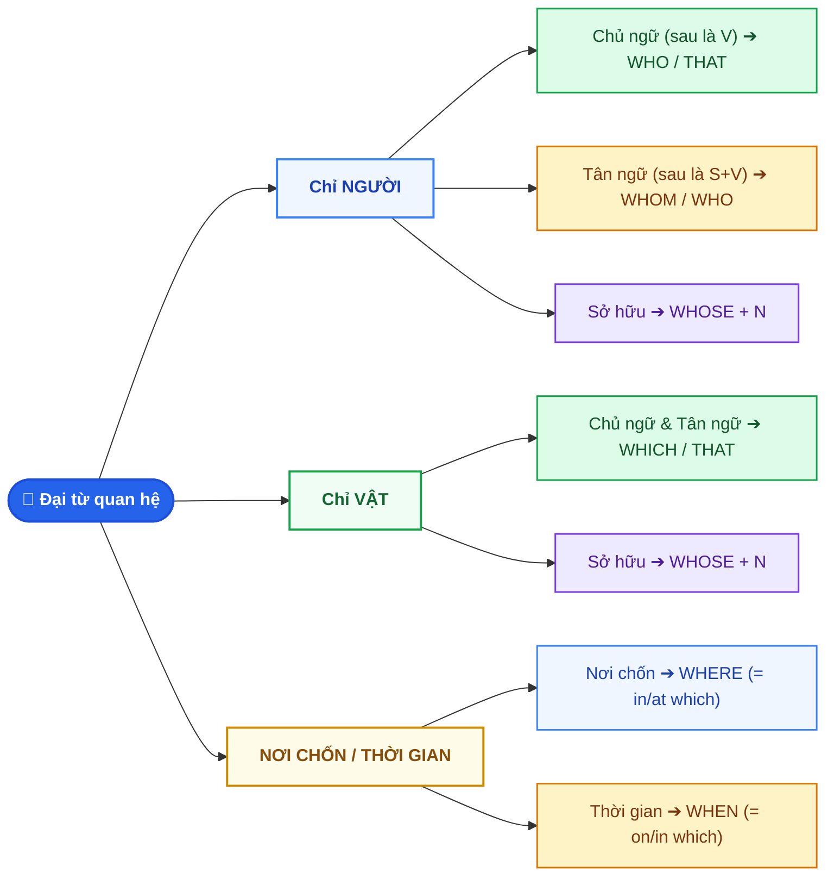

# CHUYÊN ĐỀ 2: MỆNH ĐỀ QUAN HỆ & RÚT GỌN MỆNH ĐỀ QUAN HỆ (RELATIVE CLAUSES MASTERY)

> [!BLUE] **BẢN CHẤT VÀ NGUYÊN TẮC CỐT LÕI:**
> Mệnh đề quan hệ (Relative Clause) bản chất là **một tính từ dài (Adjective Clause)** đứng ngay sau danh từ để miêu tả, làm rõ danh từ đó mà không cần phải ngắt thành hai câu cụt lủn. Mấu chốt ăn điểm nằm ở: **Xác định từ được thay thế (Người hay Vật? Chủ ngữ hay Tân ngữ?)** và **Kỹ thuật rút gọn 3 bước (V-ing / V3-ed / To V-inf)**.

---

## I. SƠ ĐỒ THUẬT TOÁN CHỌN ĐẠI TỪ QUAN HỆ TRONG 3 GIÂY



---

## II. MA TRẬN 8 ĐẠI TỪ & TRẠNG TỪ QUAN HỆ CỐT LÕI

| Từ quan hệ | Thay thế cho | Chức năng trong MĐQH | Công thức & Vị trí | Ví dụ thực chiến |
| :--- | :--- | :--- | :--- | :--- |
| **`WHO`** | Danh từ chỉ **Người** | Làm **Chủ ngữ (S)** hoặc Tân ngữ (O) | `... N (người) + WHO + V + O` | *The girl **who** is singing on stage is my sister.* |
| **`WHOM`** | Danh từ chỉ **Người** | Làm **Tân ngữ (O)** (Sau WHOM phải là S + V) | `... N (người) + WHOM + S + V` | *The teacher **whom** we respect most has just retired.* |
| **`WHICH`** | Danh từ chỉ **Vật / Sự việc** | Làm **Chủ ngữ (S)** hoặc Tân ngữ (O) | `... N (vật) + WHICH + V / S + V` | *The book **which** is on the desk is very interesting.* |
| **`THAT`** | Thay thế cho cả **Người & Vật** | Thay được cho *who, whom, which* trong MĐQH xác định | `... N (người/vật) + THAT + V / S + V` | *The smartphone **that** I bought yesterday works smoothly.* |
| **`WHOSE`** | Sở hữu của **Người & Vật** | Thay cho tính từ sở hữu (*his, her, its, their...*) | `... N + WHOSE + N(được sở hữu) + V / S + V` | *I met a boy **whose** father is a famous doctor.* |
| **`WHERE`** | Danh từ chỉ **Nơi chốn** | Trạng từ nơi chốn (`= in / at / on which`) | `... N (nơi chốn) + WHERE + S + V` *(Đầy đủ S + V!)* | *This is the school **where** I studied 5 years ago.* |
| **`WHEN`** | Danh từ chỉ **Thời gian** | Trạng từ thời gian (`= on / in / at which`) | `... N (thời gian) + WHEN + S + V` *(Đầy đủ S + V!)* | *I'll never forget the day **when** I first went to school.* |
| **`WHY`** | Danh từ chỉ **Lý do** | Trạng từ lý do (`= for which`) | `... the reason + WHY + S + V` | *Tell me the reason **why** you were absent yesterday.* |

---

## III. 2 QUY TẮC SỐNG CÒN: MỆNH ĐỀ QUAN HỆ XÁC ĐỊNH VS. KHÔNG XÁC ĐỊNH

> [!YELLOW] **BẢNG ĐỐI CHIẾU 2 LOẠI MỆNH ĐỀ QUAN HỆ:**
> - **Mệnh đề xác định (Defining):** Cần thiết cho nghĩa của câu, không thể bỏ được, **KHÔNG CÓ DẤU PHẨY**.
> - **Mệnh đề không xác định (Non-defining):** Chỉ cung cấp thêm thông tin phụ, **BẮT BUỘC KẸP GIỮA HAI DẤU PHẨY (,)**.

| Đặc điểm | Mệnh đề Xác định (Không có dấu phẩy) | Mệnh đề Không xác định (CÓ DẤU PHẨY `,`) |
| :--- | :--- | :--- |
| **Dấu hiệu nhận biết** | Danh từ đứng trước là danh từ chung chưa rõ ràng (*a man, the book, students...*). | Danh từ đứng trước đã **xác định 100%**: Danh từ riêng (*Ha Noi, Mr. Nam*), có `this/that/these/those`, hoặc có tính từ sở hữu (*my mother, his car*). |
| **Có được dùng `THAT`?** | **ĐƯỢC** (dùng rất phổ biến thay cho *who, whom, which*). | **TUYỆT ĐỐI CẤM DÙNG `THAT`!** (Sau dấu phẩy `,` chỉ dùng *who, whom, which, whose*). |
| **Có được lược bỏ đại từ?** | Khi làm tân ngữ (O) thì **được quyền lược bỏ**. | **TUYỆT ĐỐI KHÔNG ĐƯỢC LƯỢC BỎ** đại từ quan hệ! |
| **Ví dụ minh họa** | *The woman **(who/that)** you saw yesterday is my aunt.* | *Ba To, **which** is a mountainous district of Quang Ngai, is very peaceful.* |

> [!RED] **2 ĐIỀU CẤM KỴ CỦA TỪ `THAT` (100% GÀI BẪY TRONG ĐỀ THI):**
> 1. **KHÔNG BAO GIỜ dùng `THAT` sau dấu phẩy `,`**
>    - ❌ *Sai:* Quang Ngai, **that** is my hometown, has many scenic spots.
>    - ✅ *Đúng:* Quang Ngai, **which** is my hometown, has many scenic spots.
> 2. **KHÔNG BAO GIỜ dùng `THAT` ngay sau Giới từ (`in, on, at, with, about...`)**
>    - ❌ *Sai:* The house in **that** I was born is very old.
>    - ✅ *Đúng:* The house **in which** I was born is very old. *(hoặc: The house **that** I was born in...)*

---

## IV. BÍ KÍP 3 CÁCH RÚT GỌN MỆNH ĐỀ QUAN HỆ (REDUCED RELATIVE CLAUSES)

Trong phần thi trắc nghiệm và viết lại câu nâng cao, dạng rút gọn mệnh đề quan hệ xuất hiện liên tục:

```text
                  ┌── CHỦ ĐỘNG (Active)   ──► Rút gọn thành: V-ing
MĐQH CẦN RÚT GỌN ─┼── BỊ ĐỘNG (Passive)   ──► Rút gọn thành: V3/ed
                  └── CÓ THE FIRST / ONLY ──► Rút gọn thành: TO V-INF
```

### 1. Dạng Chủ động: Rút gọn thành cụm `V-ING`
- **Quy tắc:** Bỏ đại từ quan hệ (`who, which, that`), bỏ trợ động từ (nếu có), chuyển động từ chính về dạng **`V-ing`**.
- *Ví dụ 1:* The man **who is standing** next to the car is my uncle.
  ➔ The man **standing** next to the car is my uncle.
- *Ví dụ 2:* Students **who study** hard will pass the entrance exam.
  ➔ Students **studying** hard will pass the entrance exam.

### 2. Dạng Bị động: Rút gọn thành cụm `V3/ED` (Quá khứ phân từ)
- **Quy tắc:** Bỏ đại từ quan hệ (`who, which, that`), bỏ động từ `be`, giữ nguyên **`V3/ed`**.
- *Ví dụ 1:* The bridge **which was built** in 1990 is undergoing repairs.
  ➔ The bridge **built** in 1990 is undergoing repairs.
- *Ví dụ 2:* Most of the goods **that are exported** from Vietnam are agricultural products.
  ➔ Most of the goods **exported** from Vietnam are agricultural products.

### 3. Dạng có `The first / The second / The last / The only / So sánh nhất`: Rút gọn thành `TO V-INF`
- **Quy tắc:** Khi trước danh từ có các từ thứ tự (*the first, the second...*), *the last, the only*, hoặc tính từ so sánh nhất (*the tallest, the best*), ta rút gọn thành **`to V-inf`** (hoặc **`to be V3/ed`** nếu ở thể bị động).
- *Ví dụ 1 (Chủ động):* Yuri Gagarin was the first man **who flew** into space.
  ➔ Yuri Gagarin was the first man **to fly** into space.
- *Ví dụ 2 (Bị động):* Neil Armstrong was the first human **to set** foot on the moon.
- *Ví dụ 3 (Bị động có be):* He was the only person **who was rescued** from the fire.
  ➔ He was the only person **to be rescued** from the fire.

---

## V. 3 LỖI SAI PHỔ BIẾN CẦN TRÁNH TRONG ĐỀ THI VÀO 10 (VIETLISH TRAPS)

> [!RED] **BẪY 1: PHÂN BIỆT `WHERE` VS. `WHICH` KHI ĐỨNG SAU NƠI CHỐN**
> - Dùng **`WHERE`** khi nơi chốn đóng vai trò **trạng từ** (sau đó là mệnh đề hoàn chỉnh S + V, không thiếu tân ngữ).
> - Dùng **`WHICH`** khi nơi chốn đóng vai trò **Chủ ngữ (S)** hoặc **Tân ngữ (O)** của động từ phía sau!
> - *Ví dụ A:* This is the hotel **which** we visited last summer. *(visit sth -> thiếu tân ngữ -> dùng WHICH)*
> - *Ví dụ B:* This is the hotel **where** we stayed last summer. *(stay at a hotel -> nơi chốn -> dùng WHERE)*

> [!RED] **BẪY 2: PHÂN BIỆT `WHOSE` VS. `WHO'S`**
> - **`WHOSE + Danh từ`**: Đại từ quan hệ chỉ sở hữu (*whose car, whose parents*).
> - **`WHO'S`**: Dạng viết tắt của `Who is` hoặc `Who has`!
> - ❌ *Sai:* I have a friend **who's** dog won the contest.
> - ✅ *Đúng:* I have a friend **whose** dog won the contest.

> [!GREEN] **MẸO DÙNG `WHICH` THAY THẾ CHO CẢ MỆNH ĐỀ ĐỨNG TRƯỚC:**
> Khi muốn diễn tả ý *"điều đó / điều này"* thay cho toàn bộ sự việc ở mệnh đề trước, ta dùng **, WHICH** (bắt buộc có dấu phẩy):
> *He passed the exam with flying colors, **which** made his parents very proud.*

---

## VI. 10 CÂU THỰC CHIẾN (TRÍCH ĐỀ THI TUYỂN SINH VÀO 10)

### Phần A: Trắc nghiệm điền đại từ / Rút gọn (5 câu)

<QuizItem
  :number="1"
  question="The novel ______ my father bought for me on my birthday is very educational."
  options="A. who | B. which | C. whom | D. whose"
  correct="B"
  explanation=". Đáp án B (which):** `The novel` là danh từ chỉ vật, đóng vai trò tân ngữ cho `bought`, dùng `which` (hoặc `that`)."
/>

<QuizItem
  :number="2"
  question="Do you know the girl ______ bicycle was stolen yesterday afternoon?"
  options="A. whose | B. who | C. whom | D. that's"
  correct="A"
  explanation=". Đáp án A (whose):** Phía sau có danh từ `bicycle`, biểu thị sở hữu (*chiếc xe đạp của cô gái*), dùng `whose`."
/>

<QuizItem
  :number="3"
  question="Dr. Son, ______ gave an inspiring talk at our school yesterday, is a prominent scientist."
  options="A. that | B. whom | C. who | D. which"
  correct="C"
  explanation=". Đáp án C (who):** `Dr. Son` là danh từ riêng chỉ người, có dấu phẩy `,` (MĐQH không xác định), đóng vai trò chủ ngữ cho `gave` ➔ Dùng `who` (tuyệt đối không dùng `that` sau dấu phẩy)."
/>

<QuizItem
  :number="4"
  question="The smartphone ______ in Japan usually operates with high durability."
  options="A. making | B. made | C. was made | D. to make"
  correct="B"
  explanation=". Đáp án B (made):** Rút gọn MĐQH ở thể bị động: `The smartphone which was made in Japan...` ➔ Rút gọn thành `The smartphone made in Japan...`."
/>

<QuizItem
  :number="5"
  question="Lan was the last student ______ the computer lab before the electricity went out."
  options="A. leaving | B. left | C. to leave | D. was leaving"
  correct="C"
  explanation=". Đáp án C (to leave):** Có cụm từ chỉ thứ tự `the last student`, rút gọn MĐQH chủ động thành `to V-inf` ➔ `to leave`."
/>

<QuizItem
  :number="6"
  type="transform"
  question="The old woman is my grandmother. She is planting flowers in the garden.
   ➔ *Viết lại:* `The old woman who...`"
  targetPrompt=""
  sampleAnswer="The old woman who is planting flowers in the garden is my grandmother."
  explanation=". Đáp án:** `The old woman who is planting flowers in the garden is my grandmother.` — Thay `She` bằng `who` làm chủ ngữ."
/>

<QuizItem
  :number="7"
  type="transform"
  question="The car broke down on the expressway. Tom had just bought it two days ago.
   ➔ *Viết lại:* `The car which...`"
  targetPrompt=""
  sampleAnswer="The car which (hoặc that) Tom had just bought two days ago broke down on the expressway."
  explanation=". Đáp án:** `The car which (hoặc that) Tom had just bought two days ago broke down on the expressway.` — Thay `it` bằng `which/that`, bỏ `it` trong mệnh đề quan hệ."
/>

<QuizItem
  :number="8"
  type="transform"
  question="I met an architect yesterday. His design won the first prize in the national competition.
   ➔ *Viết lại:* `I met an architect whose...`"
  targetPrompt=""
  sampleAnswer="I met an architect whose design won the first prize in the national competition."
  explanation=". Đáp án:** `I met an architect whose design won the first prize in the national competition.` — Thay tính từ sở hữu `His` bằng `whose`."
/>

<QuizItem
  :number="9"
  type="transform"
  question="A high-tech stadium was built in our district. It can hold more than 30,000 spectators.
   ➔ *Viết lại (dùng rút gọn V3/ed):* `The high-tech stadium built...`"
  targetPrompt=""
  sampleAnswer="The high-tech stadium built in our district can hold more than 30,000 spectators."
  explanation=". Đáp án:** `The high-tech stadium built in our district can hold more than 30,000 spectators.` — Rút gọn bị động `which was built` thành `built`."
/>

<QuizItem
  :number="10"
  type="transform"
  question="John was the first astronaut. He stepped out of the lunar module onto the lunar surface.
   ➔ *Viết lại (dùng To-inf):* `John was the first astronaut to...`"
  targetPrompt=""
  sampleAnswer="John was the first astronaut to step out of the lunar module onto the lunar surface."
  explanation=". Đáp án:** `John was the first astronaut to step out of the lunar module onto the lunar surface.` — Rút gọn với `the first` thành `to step`."
/>


<details class="study-accordion">
<summary>📖 Bấm để xem Bảng tổng hợp đáp án & Giải thích chi tiết nhanh</summary>

**1. Đáp án B (which):** `The novel` là danh từ chỉ vật, đóng vai trò tân ngữ cho `bought`, dùng `which` (hoặc `that`).
**2. Đáp án A (whose):** Phía sau có danh từ `bicycle`, biểu thị sở hữu (*chiếc xe đạp của cô gái*), dùng `whose`.
**3. Đáp án C (who):** `Dr. Son` là danh từ riêng chỉ người, có dấu phẩy `,` (MĐQH không xác định), đóng vai trò chủ ngữ cho `gave` ➔ Dùng `who` (tuyệt đối không dùng `that` sau dấu phẩy).
**4. Đáp án B (made):** Rút gọn MĐQH ở thể bị động: `The smartphone which was made in Japan...` ➔ Rút gọn thành `The smartphone made in Japan...`.
**5. Đáp án C (to leave):** Có cụm từ chỉ thứ tự `the last student`, rút gọn MĐQH chủ động thành `to V-inf` ➔ `to leave`.
**6. Đáp án:** `The old woman who is planting flowers in the garden is my grandmother.` — Thay `She` bằng `who` làm chủ ngữ.
**7. Đáp án:** `The car which (hoặc that) Tom had just bought two days ago broke down on the expressway.` — Thay `it` bằng `which/that`, bỏ `it` trong mệnh đề quan hệ.
**8. Đáp án:** `I met an architect whose design won the first prize in the national competition.` — Thay tính từ sở hữu `His` bằng `whose`.
**9. Đáp án:** `The high-tech stadium built in our district can hold more than 30,000 spectators.` — Rút gọn bị động `which was built` thành `built`.
**10. Đáp án:** `John was the first astronaut to step out of the lunar module onto the lunar surface.` — Rút gọn với `the first` thành `to step`.

</details>
