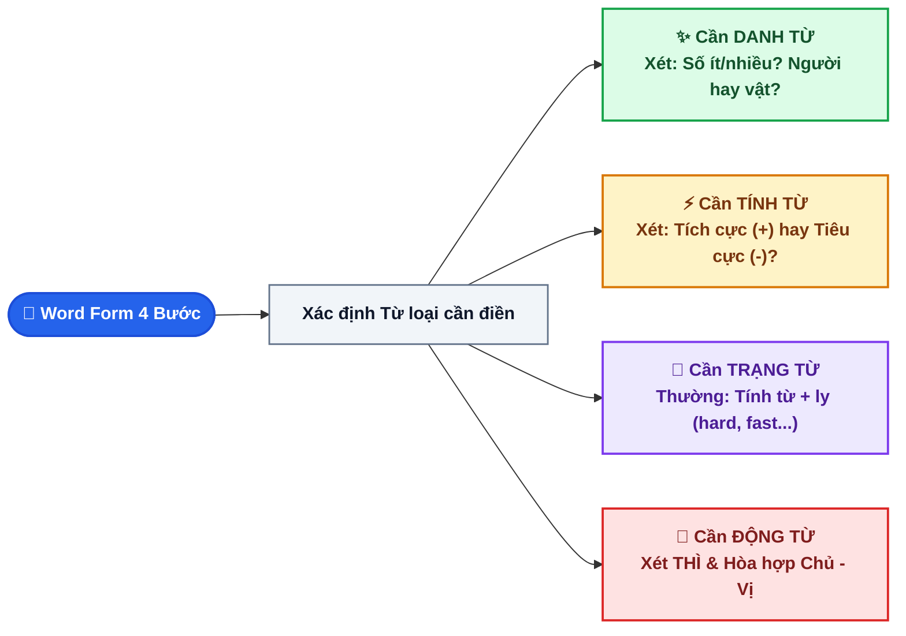

# CHUYÊN ĐỀ 2: CẤU TẠO TỪ (WORD FORM) & SỰ HÒA HỢP CHỦ - VỊ (SUBJECT-VERB AGREEMENT)

> [!BLUE] **BẢN CHẤT VÀ NGUYÊN TẮC CỐT LÕI:**
> - **Cấu tạo từ (Word Form):** Tiếng Anh xây dựng nghĩa từ gốc từ (Root) thông qua **Tiền tố (Prefix - đổi nghĩa)** và **Hậu tố (Suffix - đổi từ loại N/V/Adj/Adv)**. Muốn làm đúng dạng này, bạn không cần tra từ điển hết mọi từ mà phải dùng kỹ thuật **Bắt mạch cú pháp (Syntax Check)** để xác định ô trống cần loại từ nào trước khi biến đổi.
> - **Sự hòa hợp Chủ - Vị (Subject-Verb Agreement):** Động từ số ít hay số nhiều phụ thuộc vào **Chủ ngữ cốt lõi (Head Noun)**, tuyệt đối không bị đánh lừa bởi các thành phần phụ chêm xen (*along with, as well as, of...*).

---

## I. SƠ ĐỒ THUẬT TOÁN 3 BƯỚC BẮT MẠCH TỪ LOẠI (WORD FORM)



---

## II. 4 VỊ TRÍ VÀNG NHẬN DIỆN TỪ LOẠI TRONG CÂU

| Từ loại | Ký hiệu | Các vị trí xuất hiện đặc trưng trong câu | Ví dụ minh họa thực chiến |
| :--- | :--- | :--- | :--- |
| **DANH TỪ** | `(N)` | 1. Đứng đầu câu làm **Chủ ngữ (S)**.<br>2. Sau mạo từ: `a, an, the`.<br>3. Sau tính từ sở hữu: `my, his, her, their...`.<br>4. Sau từ chỉ số lượng: `many, much, some, any, few, a lot of...`.<br>5. Đứng sau **Tính từ** (`Adj + N`).<br>6. Đứng sau **Giới từ** (`in, on, at, about, with...`). | *The **development** (`develop`) of renewable energy is vital.*<br>*She has a wide **knowledge** (`know`) of English literature.* |
| **TÍNH TỪ** | `(Adj)` | 1. Đứng **trước Danh từ** để bổ nghĩa (`Adj + N`).<br>2. Đứng sau động từ liên kết (**Linking verbs**): `to be, seem, look, feel, become, taste, sound, smell, get`.<br>3. Cấu trúc đặc biệt: `make / find / keep + O + Adj`. | *It was a **successful** (`success`) presentation.*<br>*Online learning makes students more **independent** (`depend`).* |
| **TRẠNG TỪ** | `(Adv)` | 1. Bổ nghĩa cho **Động từ thường** (`V + Adv` hoặc `Adv + V`).<br>2. Bổ nghĩa cho **Tính từ** (`Adv + Adj`).<br>3. Bổ nghĩa cho **Trạng từ khác** (`Adv + Adv`).<br>4. Đứng đầu câu, ngăn cách bởi dấu phẩy `,` để bổ nghĩa cho cả câu. | *He answered all questions **fluently** (`fluent`).*<br>*The climate is **extremely** (`extreme`) hot in summer.*<br>***Fortunately** (`fortunate`), no one was injured in the accident.* |
| **ĐỘNG TỪ** | `(V)` | 1. Đứng ngay sau Chủ ngữ (`S + V`).<br>2. Đứng sau trợ động từ hoặc động từ khuyết thiếu (`modal verb + V-inf`).<br>3. Sau `to` trong cấu trúc chỉ mục đích (`in order to + V-inf`). | *We need to **widen** (`wide`) this road to reduce traffic jams.*<br>*Volunteers helped to **beautify** (`beauty`) the park.* |

---

## III. BẢNG TRA HẬU TỐ (SUFFIXES) & TIỀN TỐ (PREFIXES) TỦ ÔN VÀO 10

### 1. Các Hậu tố đổi từ loại thường gặp
- **Tạo Danh từ (Noun Suffixes):**
  - Chỉ người: `-er` (*teacher*), `-or` (*actor*), `-ist` (*scientist*), `-ant` (*assistant*).
  - Chỉ sự vật/khái niệm: `-tion/-sion` (*pollution, decision*), `-ment` (*environment, development*), `-ness` (*darkness, kindness*), `-ity` (*activity, creativity*), `-ance/-ence` (*importance, difference*), `-ship` (*friendship*).
- **Tạo Tính từ (Adjective Suffixes):**
  - `-ful` (nhiều, đầy): *careful, helpful, beautiful, peaceful*.
  - `-less` (không có): *careless, helpless, homeless, endless*.
  - `-able/-ible` (có thể): *enjoyable, renewable, flexible*.
  - `-ous` (tính chất): *dangerous, famous, poisonous*.
  - `-ive` (khuynh hướng): *active, creative, expensive*.
  - `-al` (thuộc về): *national, environmental, traditional*.
- **Tạo Động từ (Verb Suffixes):**
  - `-en`: *widen, shorten, sharpen, darken*.
  - `-ize/-ise`: *modernize, industrialize*.
  - `-ify`: *beautify, simplify, purify*.

### 2. Tiền tố mang nghĩa phủ định (Negative Prefixes)
> [!RED] **QUY TẮC GHÉP TIỀN TỐ PHỦ ĐỊNH CHÍNH XÁC:**
> - **`IM-`**: Đi trước từ bắt đầu bằng chữ **`m`** hoặc **`p`** (*impatient, impossible, impolite*).
> - **`IL-`**: Đi trước từ bắt đầu bằng chữ **`l`** (*illegal, illiterate, illogical*).
> - **`IR-`**: Đi trước từ bắt đầu bằng chữ **`r`** (*irresponsible, irregular, irrelevant*).
> - **`DIS-`**: Thường đi với động từ/tính từ (*disappear, disagree, dishonest, disable*).
> - **`UN-`**: Tiền tố phổ biến nhất (*unhappy, unfriendly, uncomfortable, unnecessary*).
> - **`IN-`**: Thường gặp trong các từ gốc Latinh (*inexpensive, convenient ➔ inconvenient, direct ➔ indirect*).

---

## IV. 10 NGUYÊN TẮC VÀNG VỀ SỰ HÒA HỢP CHỦ NGỮ & ĐỘNG TỪ (S-V AGREEMENT)

```text
CHỦ NGỮ SỐ ÍT  ──► ĐỘNG TỪ SỐ ÍT (is, was, has, V-s/es)
CHỦ NGỮ SỐ NHIỀU ──► ĐỘNG TỪ SỐ NHIỀU (are, were, have, V-inf)
```

| STT | Cấu trúc Chủ ngữ đặc biệt | Quy tắc chia Động từ | Ví dụ chuẩn |
| :--- | :--- | :--- | :--- |
| **1** | Nối bằng **`AND`** | Chia động từ **SỐ NHIỀU**.<br>*(Ngoại trừ chỉ 1 món/vật duy nhất: Bread and butter **is** my favorite breakfast).* | *Tom and Jerry **are** popular cartoon characters.* |
| **2** | Nối bằng **`AS WELL AS, TOGETHER WITH, ALONG WITH, WITH`** | Chia theo **CHỦ NGỮ ĐẦU TIÊN (S1)** (Bỏ qua thành phần chêm xen giữa 2 dấu phẩy). | *The teacher, together with his students, **is** (`be`) planting trees.* |
| **3** | Nối bằng **`EITHER...OR, NEITHER...NOR, NOT ONLY...BUT ALSO`** | Chia theo **CHỦ NGỮ GẦN ĐỘNG TỪ NHẤT (S2)**. | *Neither the teacher nor the students **were** (`be`) present.* |
| **4** | Đại từ bất định: **`EVERYONE, SOMEONE, NOBODY, ANYTHING, EACH, EVERY`** | Luôn luôn chia động từ ở dạng **SỐ ÍT**. | *Everyone in our class **loves** (`love`) English.*<br>*Each of the books **has** (`have`) a different color.* |
| **5** | Danh từ tận cùng bằng `-S` nhưng mang nghĩa số ít: **Môn học** (*physics, mathematics*), **Tin tức** (*news*), **Bệnh tật** (*measles*), **Quốc gia** (*the United States, the Philippines*) | Chia động từ **SỐ ÍT**. | *Physics **is** (`be`) my favorite subject at school.*<br>*No news **is** good news.* |
| **6** | Đo lường: **Thời gian, Khoảng cách, Tiền bạc, Cân nặng** | Coi như một thể thống nhất ➔ Chia **SỐ ÍT**. | *Ten kilometers **is** (`be`) too far to walk.*<br>*Five million dong **was** spent on the party.* |
| **7** | Cấu trúc **`THE + TÍNH TỪ`** (Chỉ một tập thể người: *the poor, the rich, the young, the blind, the homeless*) | Mang nghĩa số nhiều ➔ Chia **SỐ NHIỀU**. | *The poor in this rural village **need** (`need`) help.* |
| **8** | Cặp bài trùng: **`A NUMBER OF` vs. `THE NUMBER OF`** | - `A number of + N(số nhiều)` ➔ Động từ **SỐ NHIỀU** (= many).<br>- `The number of + N(số nhiều)` ➔ Động từ **SỐ ÍT** (chỉ con số). | *A number of students **are** absent today.*<br>*The number of cars in our city **is** increasing rapidly.* |
| **9** | Cụm danh từ có giới từ **`OF`**: `N1 + of + N2` | Chia theo **DANH TỪ CHÍNH ĐỨNG TRƯỚC (N1)**. | *The quality of these smart devices **is** (`be`) very reliable.* |
| **10** | Chủ ngữ là Danh động từ **`V-ING`** hoặc Mệnh đề | Chia động từ **SỐ ÍT**. | *Learning foreign languages **opens** (`open`) many opportunities.* |

---

## V. 10 CÂU BÀI TẬP THỰC CHIẾN (TRÍCH ĐỀ TUYỂN SINH VÀO 10 QUẢNG NGÃI)

### Phần 1: Biến đổi từ loại trong ngoặc (Word Form - 5 câu)

<QuizItem
  :number="1"
  type="transform"
  question="Solar energy is not only plentiful and clean but also completely ____________. (`RENEW`)"
  targetPrompt=""
  sampleAnswer="completely"
  explanation=". renewable:** Sau trạng từ `completely` và liên từ `not only... but also` cần một tính từ (`Adj`) song song với `clean`. `RENEW` ➔ Tính từ: `renewable` (*có thể tái tạo*)."
/>

<QuizItem
  :number="2"
  type="transform"
  question="The rapid growth of industrial zones has caused severe environmental ____________. (`POLLUTE`)"
  targetPrompt=""
  sampleAnswer="environmental"
  explanation=". pollution:** Sau tính từ `environmental` cần một danh từ (`N`). `POLLUTE` ➔ Danh từ: `pollution` (*sự ô nhiễm*)."
/>

<QuizItem
  :number="3"
  type="transform"
  question="My brother drives very ____________; he has never been involved in any accident. (`CARE`)"
  targetPrompt=""
  sampleAnswer="drives"
  explanation=". carefully:** Bổ nghĩa cho động từ thường `drives`, vế sau nói *&quot;chưa từng gặp tai nạn&quot;* ➔ Cần trạng từ tích cực `carefully` (*cẩn thận*)."
/>

<QuizItem
  :number="4"
  type="transform"
  question="Plastic bags are difficult to dissolve, so they are harmful to the ____________. (`ENVIRONMENT`)"
  targetPrompt=""
  sampleAnswer="the"
  explanation=". environment:** Sau mạo từ `the` cần một danh từ (`N`). `ENVIRONMENT` ➔ giữ nguyên dạng danh từ `environment` (*môi trường*)."
/>

<QuizItem
  :number="5"
  type="transform"
  question="We were deeply impressed by the warm ____________ of the local people in Quang Ngai. (`FRIEND`)"
  targetPrompt=""
  sampleAnswer="warm"
  explanation=". friendliness:** Sau tính từ `warm` cần một danh từ chỉ tính chất (`warm friendliness` = *sự thân thiện ấm áp*). Lưu ý không dùng `friendship` (*tình bạn*)."
/>

<QuizItem
  :number="6"
  type="transform"
  question="The news about the typhoon on television last night ____________ (`be`) very alarming."
  targetPrompt=""
  sampleAnswer="The news"
  explanation=". was:** `The news` là danh từ số ít (tin tức), kết hợp mốc thời gian quá khứ `last night` ➔ chia `was`."
/>

<QuizItem
  :number="7"
  type="transform"
  question="Neither the manager nor his assistants ____________ (`agree`) with the new proposal."
  targetPrompt=""
  sampleAnswer="Neither... nor..."
  explanation=". agrees:** Nối bằng `Neither... nor...`, động từ chia theo chủ ngữ gần nhất là `his assistants` (số nhiều) ➔ nếu hiện tại thì chia `agree` (hoặc `agreed` nếu quá khứ). Ở đây giả định thói quen/hiện tại: `agree` (trợ lý số nhiều)."
/>

<QuizItem
  :number="8"
  type="transform"
  question="The number of high school graduates applying for technical colleges ____________ (`be`) rising this year."
  targetPrompt=""
  sampleAnswer="The number of + N(số nhiều)"
  explanation=". is:** Cấu trúc `The number of + N(số nhiều)` biểu thị số lượng (con số) ➔ luôn chia động từ ở dạng số ít ➔ `is`."
/>

<QuizItem
  :number="9"
  type="transform"
  question="Reading English books every day ____________ (`help`) expand your vocabulary significantly."
  targetPrompt=""
  sampleAnswer="Reading..."
  explanation=". helps:** Chủ ngữ bắt đầu bằng danh động từ `Reading...` ➔ coi là số ít ➔ chia động từ thêm `-s`: `helps`."
/>

<QuizItem
  :number="10"
  type="transform"
  question="Mr. Ba, along with his two sons, ____________ (`have`) traveled to Da Nang for the seminar."
  targetPrompt=""
  sampleAnswer="along with his two sons"
  explanation=". has:** Chủ ngữ có thành phần chêm xen `along with his two sons`, động từ chia theo chủ ngữ số 1 là `Mr. Ba` (ngôi thứ 3 số ít) ➔ chia `has`."
/>


<details class="study-accordion">
<summary>📖 Bấm để xem Bảng tổng hợp đáp án & Giải thích chi tiết nhanh</summary>

**1. renewable:** Sau trạng từ `completely` và liên từ `not only... but also` cần một tính từ (`Adj`) song song với `clean`. `RENEW` ➔ Tính từ: `renewable` (*có thể tái tạo*).
**2. pollution:** Sau tính từ `environmental` cần một danh từ (`N`). `POLLUTE` ➔ Danh từ: `pollution` (*sự ô nhiễm*).
**3. carefully:** Bổ nghĩa cho động từ thường `drives`, vế sau nói *"chưa từng gặp tai nạn"* ➔ Cần trạng từ tích cực `carefully` (*cẩn thận*).
**4. environment:** Sau mạo từ `the` cần một danh từ (`N`). `ENVIRONMENT` ➔ giữ nguyên dạng danh từ `environment` (*môi trường*).
**5. friendliness:** Sau tính từ `warm` cần một danh từ chỉ tính chất (`warm friendliness` = *sự thân thiện ấm áp*). Lưu ý không dùng `friendship` (*tình bạn*).
**6. was:** `The news` là danh từ số ít (tin tức), kết hợp mốc thời gian quá khứ `last night` ➔ chia `was`.
**7. agrees:** Nối bằng `Neither... nor...`, động từ chia theo chủ ngữ gần nhất là `his assistants` (số nhiều) ➔ nếu hiện tại thì chia `agree` (hoặc `agreed` nếu quá khứ). Ở đây giả định thói quen/hiện tại: `agree` (trợ lý số nhiều).
**8. is:** Cấu trúc `The number of + N(số nhiều)` biểu thị số lượng (con số) ➔ luôn chia động từ ở dạng số ít ➔ `is`.
**9. helps:** Chủ ngữ bắt đầu bằng danh động từ `Reading...` ➔ coi là số ít ➔ chia động từ thêm `-s`: `helps`.
**10. has:** Chủ ngữ có thành phần chêm xen `along with his two sons`, động từ chia theo chủ ngữ số 1 là `Mr. Ba` (ngôi thứ 3 số ít) ➔ chia `has`.

</details>
