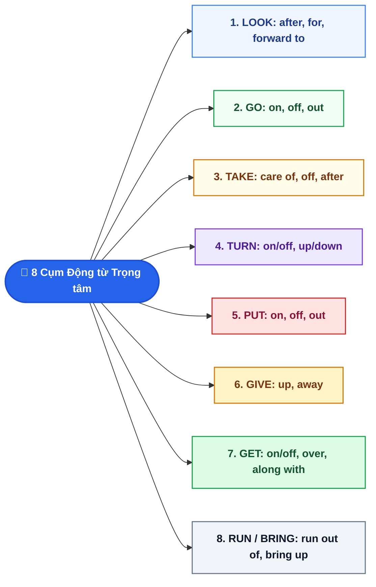

# CHUYÊN ĐỀ 3: CẨM NANG 50 CỤM ĐỘNG TỪ (PHRASAL VERBS) TỦ ÔN THI VÀO 10

> [!BLUE] **BẢN CHẤT VÀ NGUYÊN TẮC CỐT LÕI:**
> Cụm động từ (Phrasal Verb) là sự kết hợp giữa một **Động từ gốc (Verb)** với một hoặc hai **Tiểu từ / Giới từ (Particle/Preposition)** để tạo ra một **nghĩa hoàn toàn mới**, khác hẳn nghĩa đen của từng từ đơn lẻ.
> Thay vì học vẹt 2.300 cụm từ bất tận, 95% câu hỏi trong đề thi tuyển sinh vào 10 chỉ xoay quanh **9 động từ gốc quen thuộc**: `LOOK, GO, TAKE, TURN, GIVE, GET, PUT, RUN, BRING`.

---

## I. SƠ ĐỒ PHÂN NHÁNH 9 GỐC ĐỘNG TỪ TẠO NÊN 50 PHRASAL VERBS TỦ

---

## II. BẢNG 50 CỤM ĐỘNG TỪ PHẢI THUỘC LÒNG (KÈM TỪ ĐỒNG NGHĨA & VÍ DỤ ĐỀ THI)

| Động từ gốc | Cụm động từ (Phrasal Verb) | Phiên âm IPA | Nghĩa tiếng Việt & Từ đồng nghĩa | Ví dụ thực chiến trong đề thi |
| :--- | :--- | :--- | :--- | :--- |
| **LOOK** | **look after** | `/lʊk ˈɑːf.tər/` | Chăm sóc (`= take care of`) | *She has to **look after** her younger brother.* |
| | **look for** | `/lʊk fɔːr/` | Tìm kiếm (`= search for`) | *I am **looking for** my lost school bag.* |
| | **look forward to** | `/lʊk ˈfɔː.wəd tuː/` | Trông mong, háo hức (`+ V-ing`) | *We **look forward to hearing** from you soon.* |
| | **look up** | `/lʊk ʌp/` | Tra cứu (từ điển, danh bạ) | *You can **look up** new words in this app.* |
| | **look out** | `/lʊk aʊt/` | Coi chừng, cẩn thận (`= watch out`) | ***Look out**! The bus is approaching quickly.* |
| | **look into** | `/lʊk ˈɪn.tuː/` | Điều tra, xem xét kỹ (`= investigate`) | *The police are **looking into** the cause of the fire.* |
| **GO** | **go on** | `/ɡəʊ ɒn/` | Tiếp tục (`= continue`) | *Although it rained, they **went on** playing football.* |
| | **go off** | `/ɡəʊ ɒf/` | Reo (chuông); nổ (bom); ôi thiu (thức ăn) | *My alarm clock **goes off** at 5:30 every morning.* |
| | **go out** | `/ɡəʊ aʊt/` | Đi ra ngoài chơi; mất điện/dập tắt (lửa, đèn) | *Suddenly all the lights in our street **went out**.* |
| | **go over** | `/ɡəʊ ˈəʊ.vər/` | Ôn lại, xem kỹ (`= review, examine`) | *You must **go over** your test before submitting it.* |
| | **go through** | `/ɡəʊ θruː/` | Trải qua (khó khăn, thử thách) | *Our village **went through** a severe flood last year.* |
| **TAKE** | **take off** | `/teɪk ɒf/` | Cất cánh (máy bay); cởi (giày dép/quần áo) | *The flight to Da Nang will **take off** at 8 a.m.* |
| | **take care of** | `/teɪk keər əv/` | Chăm sóc, chu toàn (`= look after`) | *Please **take care of** yourself while traveling.* |
| | **take after** | `/teɪk ˈɑːf.tər/` | Giống ai đó trong nhà (`= resemble`) | *Tom **takes after** his father in both look and voice.* |
| | **take part in** | `/teɪk pɑːt ɪn/` | Tham gia (`= participate in, join`) | *Hundreds of students **took part in** the green club.* |
| | **take up** | `/teɪk ʌp/` | Bắt đầu một sở thích/thói quen mới | *I have recently **taken up** swimming in the morning.* |
| **TURN** | **turn on / off** | `/tɜːn ɒn / ɒf/` | Bật / Tắt thiết bị điện | *Remember to **turn off** the air-conditioner.* |
| | **turn up** | `/tɜːn ʌp/` | Vặn to âm lượng; xuất hiện/đến (`= arrive`) | *She waited for an hour, but he didn't **turn up**.* |
| | **turn down** | `/tɜːn daʊn/` | Vặn nhỏ lại; từ chối đề nghị (`= reject, refuse`) | *He **turned down** their invitation because he was busy.* |
| | **turn into** | `/tɜːn ˈɪn.tuː/` | Biến thành, trở thành | *The caterpillar eventually **turned into** a butterfly.* |
| **GIVE** | **give up** | `/ɡɪv ʌp/` | Bỏ cuộc, từ bỏ hẳn (`= stop, quit`) | *Never **give up** your dream of entering grade 10!* |
| | **give in** | `/ɡɪv ɪn/` | Nhượng bộ, chịu thua, đầu hàng | *After a long argument, he finally **gave in**.* |
| | **give back** | `/ɡɪv bæk/` | Trả lại đồ đã mượn | *Don't forget to **give back** the dictionary tomorrow.* |
| | **give out** | `/ɡɪv aʊt/` | Phân phát quà/tài liệu (`= distribute`) | *Volunteers **gave out** warm clothes to poor children.* |
| **GET** | **get over** | `/ɡet ˈəʊ.vər/` | Vượt qua (cơn bệnh, cú sốc = recover from) | *It took her two weeks to **get over** the heavy flu.* |
| | **get on with** | `/ɡet ɒn wɪð/` | Có mối quan hệ tốt với ai (`= get along with`) | *She is very friendly, so she **gets on with** everyone.* |
| | **get up** | `/ɡet ʌp/` | Thức dậy, rời khỏi giường | *I usually **get up** at 6 a.m. to review vocabulary.* |
| | **get in / out of** | `/ɡet ɪn / aʊt əv/` | Lên / Xuống (xe con, taxi, thuyền nhỏ) | *He **got in** the taxi and headed for the train station.* |
| | **get on / off** | `/ɡet ɒn / ɒf/` | Lên / Xuống (xe buýt, tàu hỏa, máy bay) | *We **got off** the bus at the Quang Ngai terminal.* |
| **PUT** | **put on** | `/pʊt ɒn/` | Mặc vào, đội vào (trái nghĩa `take off`) | *It's chilly outside; **put on** your warm jacket.* |
| | **put off** | `/pʊt ɒf/` | Hoãn lại sang ngày khác (`= postpone, delay`) | *The sports festival was **put off** due to the heavy rain.* |
| | **put out** | `/pʊt aʊt/` | Dập tắt (lửa, thuốc lá = extinguish) | *Firefighters took three hours to **put out** the blaze.* |
| | **put up with** | `/pʊt ʌp wɪð/` | Chịu đựng ai/cái gì (`= tolerate`) | *I cannot **put up with** this constant noise anymore.* |
| **RUN & OTHERS** | **run out of** | `/rʌn aʊt əv/` | Cạn kiệt, hết sạch (tiền, xăng, thời gian) | *We **ran out of** petrol in the middle of the highway.* |
| | **run into** | `/rʌn ˈɪn.tuː/` | Tình cờ gặp ai (`= bump into, meet by chance`) | *I **ran into** my primary school teacher at the market.* |
| | **bring up** | `/brɪŋ ʌp/` | Nuôi nấng, dạy dỗ (`= raise`) | *She was **brought up** by her loving grandparents.* |
| | **break down** | `/breɪk daʊn/` | Hỏng hóc (máy móc, xe cộ); suy sụp | *His motorbike **broke down** on his way to school.* |
| | **catch up with** | `/kætʃ ʌp wɪð/` | Bắt kịp, theo kịp ai (`= keep up with`) | *You have missed many lessons; study hard to **catch up**.* |
| | **carry out** | `/ˈkær.i aʊt/` | Tiến hành, thực thi (`= conduct, execute`) | *The scientists **carried out** an extensive experiment.* |
| | **call off** | `/kɔːl ɒf/` | Hủy bỏ hoàn toàn (`= cancel`) | *The football match was **called off** due to the storm.* |

---

## III. 4 BẪY NGƯỜI VIỆT HAY SAI (VIETLISH TRAPS)

> [!RED] **BẪY 1: ĐẠI TỪ TÂN NGỮ (`IT`, `THEM`) VỚI CỤM ĐỘNG TỪ TÁCH RỜI**
> Với cụm động từ có thể tách rời (*turn on, turn off, put on, take off*):
> - Khi tân ngữ là **Danh từ riêng/chung**: Đặt ở giữa hoặc ở cuối đều đúng (*turn on the light* ✅ hoặc *turn the light on* ✅).
> - Khi tân ngữ là **Đại từ (`it`, `them`, `him`, `her`)**: **BẮT BUỘC KẸP Ở GIỮA**!
>   - ❌ **Sai:** *Turn on it!* / *Take off them!*
>   - ✅ **Đúng:** *Turn **it** on!* / *Take **them** off!*

> [!RED] **BẪY 2: PHÂN BIỆT `CALL OFF` VS. `PUT OFF`**
> - **`CALL OFF`**: **Hủy bỏ hoàn toàn** (`= cancel`), không tổ chức lại nữa.
> - **`PUT OFF`**: **Hoãn lại** (`= postpone, delay`), sẽ tổ chức vào một ngày khác trong tương lai.

> [!YELLOW] **BẪY 3: PHÂN BIỆT `TAKE AFTER` VS. `LOOK AFTER`**
> - **`TAKE AFTER`**: Giống ai đó trong gia đình về tính cách, ngoại hình (`= resemble`).
> - **`LOOK AFTER`**: Chăm sóc, trông nom ai (`= take care of`).

---

## IV. 10 CÂU THỰC CHIẾN (TRÍCH ĐỀ THI TUYỂN SINH VÀO 10 QUẢNG NGÃI)

<QuizItem
  :number="1"
  question="Could you please ______ the television? I am trying to focus on reviewing my lessons."
  options="A. turn on | B. turn off | C. look after | D. take off"
  correct="B"
  explanation=". Đáp án B (turn off):** Ngữ cảnh *&quot;tôi đang tập trung ôn bài&quot;* ➔ đề nghị tắt tivi (`turn off`)."
/>

<QuizItem
  :number="2"
  question="Don't worry! My neighbor has promised to ______ our cats while we are on holiday."
  options="A. look for | B. look after | C. look up | D. look into"
  correct="B"
  explanation=". Đáp án B (look after):** Nhờ chăm sóc, trông nom đàn mèo (`look after` = `take care of`)."
/>

<QuizItem
  :number="3"
  question="Because of the torrential rain, the school sports festival had to be ______ until next Monday."
  options="A. called off | B. put off | C. turned down | D. gone on"
  correct="B"
  explanation=". Đáp án B (put off):** Có cụm từ *&quot;until next Monday&quot;* (hoãn đến thứ Hai tuần tới) ➔ dùng `put off` (hoãn lại), không dùng `called off` (hủy hẳn)."
/>

<QuizItem
  :number="4"
  question="Tom really ______ his grandfather; they both have curly black hair and love gardening."
  options="A. takes after | B. looks after | C. takes off | D. gives up"
  correct="A"
  explanation=". Đáp án A (takes after):** Giống ông nội về ngoại hình và sở thích (`take after` = `resemble`)."
/>

<QuizItem
  :number="5"
  question="My alarm didn't ______ this morning, so I arrived at the examination room late."
  options="A. go up | B. go on | C. go off | D. go through"
  correct="C"
  explanation=". Đáp án C (go off):** Chuông báo thức reo (`go off`)."
/>

<QuizItem
  :number="6"
  question="Lan was offered an attractive scholarship in Australia, but she ______ it down to stay with her parents."
  options="A. turned | B. put | C. took | D. looked"
  correct="A"
  explanation=". Đáp án A (turned):** Cụm từ `turn down` mang nghĩa từ chối (học bổng, lời mời)."
/>

<QuizItem
  :number="7"
  question="It took the young athlete several months to ______ the serious knee injury."
  options="A. get on with | B. get over | C. run out of | D. carry out"
  correct="B"
  explanation=". Đáp án B (get over):** Vượt qua, bình phục khỏi chấn thương (`get over` = `recover from`)."
/>

<QuizItem
  :number="8"
  question="We have ______ fresh water; we must find a clean stream immediately."
  options="A. put up with | B. caught up with | C. run out of | D. taken part in"
  correct="C"
  explanation=". Đáp án C (run out of):** Cạn kiệt, hết sạch nước sạch (`run out of`)."
/>

<QuizItem
  :number="9"
  question="If you encounter an unfamiliar English word, you can ______ in this online dictionary."
  options="A. look up it | B. look it up | C. take it off | D. turn it down"
  correct="B"
  explanation=". Đáp án B (look it up):** Tra cứu từ điển là `look up`. Với đại từ `it`, bắt buộc kẹp ở giữa (`look it up`)."
/>

<QuizItem
  :number="10"
  question="The government is planning to ______ an environmental campaign to clean up the Tra Khuc river."
  options="A. carry out | B. give up | C. look out | D. break down"
  correct="A"
  explanation=". Đáp án A (carry out):** Tiến hành, thực thi chiến dịch môi trường (`carry out a campaign` = `conduct a campaign`)."
/>

📖 Bấm để xem Bảng tổng hợp đáp án & Giải thích chi tiết nhanh

**1. Đáp án B (turn off):** Ngữ cảnh *"tôi đang tập trung ôn bài"* ➔ đề nghị tắt tivi (`turn off`).
**2. Đáp án B (look after):** Nhờ chăm sóc, trông nom đàn mèo (`look after` = `take care of`).
**3. Đáp án B (put off):** Có cụm từ *"until next Monday"* (hoãn đến thứ Hai tuần tới) ➔ dùng `put off` (hoãn lại), không dùng `called off` (hủy hẳn).
**4. Đáp án A (takes after):** Giống ông nội về ngoại hình và sở thích (`take after` = `resemble`).
**5. Đáp án C (go off):** Chuông báo thức reo (`go off`).
**6. Đáp án A (turned):** Cụm từ `turn down` mang nghĩa từ chối (học bổng, lời mời).
**7. Đáp án B (get over):** Vượt qua, bình phục khỏi chấn thương (`get over` = `recover from`).
**8. Đáp án C (run out of):** Cạn kiệt, hết sạch nước sạch (`run out of`).
**9. Đáp án B (look it up):** Tra cứu từ điển là `look up`. Với đại từ `it`, bắt buộc kẹp ở giữa (`look it up`).
**10. Đáp án A (carry out):** Tiến hành, thực thi chiến dịch môi trường (`carry out a campaign` = `conduct a campaign`).

