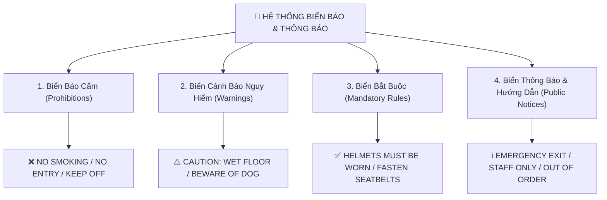
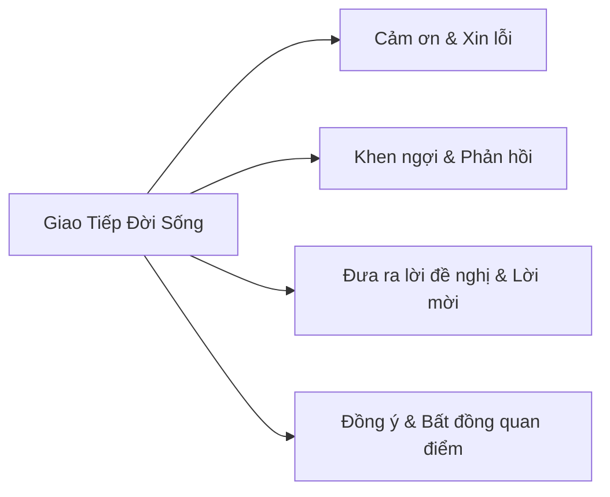

# Chuyên Đề 4: Biển Báo Công Cộng Và Tình Huống Giao Tiếp

::: info ĐẶC TRƯNG ĐỀ THI TUYỂN SINH ĐÀ NẴNG & GDPT 2018:
Trong cấu trúc đề thi tuyển sinh vào lớp 10 của Sở GD&ĐT Đà Nẵng và định hướng đổi mới theo chương trình GDPT 2018, phần **Biển báo thực tế (Public Signs & Notices)** và **Giao tiếp đời sống (Social Situational Communication)** chiếm từ **1.5 đến 2.0 điểm** (4 đến 6 câu hỏi). Dạng câu hỏi này đánh giá năng lực ngôn ngữ ứng dụng thực tế của học sinh.
:::
---

## I. MA TRẬN 4 NHÓM BIỂN BÁO CÔNG CỘNG THƯỜNG GẶP

### 1. Nhóm Biển Báo Cấm (Prohibition Signs)
Dấu hiệu nhận biết: Thường có hình tròn viền đỏ, gạch chéo đỏ, hoặc chứa các từ khóa cấm:

| Biển báo thực tế | Ý nghĩa ngữ pháp | Cụm từ giải thích tương đương |
| :--- | :--- | :--- |
| **NO SMOKING** | Cấm hút thuốc | *You must not smoke here / Smoking is strictly prohibited.* |
| **NO PARKING** | Cấm đỗ xe | *You are not allowed to leave your vehicle here.* |
| **DO NOT LITTER** | Cấm vứt rác | *You must not drop rubbish on the ground.* |
| **KEEP OFF THE GRASS** | Không dẫm lên cỏ | *You must not walk on the lawn.* |
| **NO OVERTAKING** | Cấm vượt | *Drivers must not overtake other vehicles here.* |
| **PEDESTRIANS PROHIBITED** | Cấm người đi bộ | *People walking on foot are not permitted.* |

### 2. Nhóm Biển Cảnh Báo Nguy Hiểm (Warning Signs)
Thường có hình tam giác viền đỏ nền vàng, bắt đầu bằng các từ cảnh báo:

| Biển báo thực tế | Ý nghĩa ngữ pháp | Cụm từ giải thích tương đương |
| :--- | :--- | :--- |
| **CAUTION: WET FLOOR** | Cẩn thận: Sàn ướt trơn trượt | *Be careful because the floor is slippery and you might fall.* |
| **WATCH YOUR STEP / MIND THE GAP** | Chú ý bước chân | *Be careful where you walk to avoid tripping.* |
| **DANGER: HIGH VOLTAGE** | Nguy hiểm điện cao thế | *Stay away because electricity can cause severe harm or death.* |
| **BEWARE OF DOG** | Coi chừng chó dữ | *Watch out for an aggressive dog on the premises.* |

### 3. Nhóm Biển Thông Báo Dịch Vụ & Chỉ Dẫn (Notices & Information)

| Biển báo thực tế | Ý nghĩa ngữ pháp | Cụm từ giải thích tương đương |
| :--- | :--- | :--- |
| **OUT OF ORDER** | Thiết bị đang hỏng | *The machine is not working currently.* |
| **STAFF ONLY** | Chỉ dành cho nhân viên | *Customers and public are not allowed to enter.* |
| **EMERGENCY EXIT** | Lối thoát hiểm khẩn cấp | *Use this door to leave quickly during a fire or disaster.* |
| **PLEASE QUEUE HERE** | Vui lòng xếp hàng tại đây | *Wait in line for your turn.* |

---

## II. CHIẾN THUẬT XỬ LÝ 5 TÌNH HUỐNG GIAO TIẾP ĐỜI SỐNG

### 1. Đưa Ra Lời Khen & Đáp Lại
- **Khen:**  
  - *"What a lovely dress you are wearing!"*  
  - *"You did a fantastic job on the presentation!"*
- **Đáp lại:**  
  - *"Thank you, that's very kind of you to say so."*  
  - *"I'm glad you like it."*  
  - ❌ *Tuyệt đối không chọn: "Of course", "Yes, I am the best", "No problem".*

### 2. Đưa Ra Lời Đề Nghị & Giúp Đỡ
- **Đề nghị:** *"Can I help you with those heavy bags?"* / *"Shall I carry this for you?"*
- **Đồng ý:** *"Yes, please. That would be very helpful."* / *"Thank you so much."*
- **Từ chối lịch sự:** *"No, thank you. I can manage it myself."*

### 3. Bày Tỏ Quan Điểm (Agreement & Disagreement)
- **Đồng ý 100%:** *"I couldn't agree more."* (Tôi hoàn toàn đồng ý - không thể đồng ý hơn được nữa) / *"You can say that again."* / *"Exactly!"*
- **Bất đồng lịch sự:** *"I see your point, but..."* / *"I'm not so sure about that."*

---

## III. BÀI TẬP TRẮC NGHIỆM LUYỆN TẬP (CHỌN ĐÁP ÁN ĐÚNG)

<QuizItem
  :number="1"
  question="What does this sign mean?  <strong>[ SIGN: NO PARKING BETWEEN 8 AM AND 5 PM ]</strong>"
  options="A. You can park here at 10 AM | B. You are not allowed to leave your car here during the daytime | C. Only buses can park here | D. Parking is free all day"
  correct="B"
  explanation="Biển báo cấm đỗ xe từ 8h sáng đến 5h chiều: 'You are not allowed to leave your car here during the daytime'."
/>

<QuizItem
  :number="2"
  question="What does this notice mean?  <strong>[ NOTICE: LIFT OUT OF ORDER. PLEASE USE STAIRS. ]</strong>"
  options="A. The elevator is operating normally | B. The elevator is broken and cannot be used | C. You must pay to use the stairs | D. The stairs are under construction"
  correct="B"
  explanation="'Out of order' có nghĩa là thiết bị đang bị hỏng hóc, không hoạt động."
/>

<QuizItem
  :number="3"
  question="What does this warning mean?  <strong>[ CAUTION: WET FLOOR ]</strong>"
  options="A. You can swim on this floor | B. Be careful because the ground is slippery and you might fall | C. The floor is clean and dry | D. Do not bring water inside"
  correct="B"
  explanation="'Caution: Wet floor' cảnh báo sàn nhà đang ướt và trơn trượt, dễ bị ngã."
/>

<QuizItem
  :number="4"
  question="What does this sign mean?  <strong>[ SIGN: HARD HATS MUST BE WORN ON THIS SITE ]</strong>"
  options="A. Workers can wear any hats they like | B. You are required to wear a protective helmet in this construction area | C. No hats are permitted here | D. Hard hats are sold at this site"
  correct="B"
  explanation="'Must be worn' chỉ sự bắt buộc phải đội mũ bảo hộ trong công trường xây dựng."
/>

<QuizItem
  :number="5"
  question="Peter: “Thank you very much for helping me repair my bicycle, Nam.”  Nam: “__________”"
  options="A. You're welcome. It was my pleasure. | B. Of course not. | C. Never mind, I was bored. | D. Yes, that's true."
  correct="A"
  explanation="Đáp lại lời cảm ơn một cách lịch sự chuẩn mực: 'You're welcome' hoặc 'It was my pleasure' (Rất hân hạnh được giúp bạn)."
/>

<QuizItem
  :number="6"
  question="Sarah: “What a gorgeous painting you have created, Lan!”  Lan: “__________”"
  options="A. Don't mention it. | B. Thank you, I'm glad you like it. | C. Yes, I am an artist. | D. No, it is ugly."
  correct="B"
  explanation="Đáp lại lời khen ngợi chân thành: 'Thank you, I'm glad you like it' (Cảm ơn bạn, mình rất vui vì bạn thích nó)."
/>

<QuizItem
  :number="7"
  question="David: “Shall I give you a ride home after school?”  Linda: “__________”"
  options="A. Yes, please. That would be wonderful! | B. Why do you ask me? | C. You must go home. | D. No, you can't."
  correct="A"
  explanation="Đáp lại lời đề nghị giúp đỡ: 'Yes, please. That would be wonderful!' (Vâng, thế thì tuyệt quá!)."
/>

<QuizItem
  :number="8"
  question="Tom: “I think participating in community clean-up projects makes our neighborhood much more liveable.”  Hoa: “__________. It also builds strong community spirit.”"
  options="A. I couldn't agree more | B. I don't think so | C. That's impossible | D. You are wrong"
  correct="A"
  explanation="'I couldn't agree more' (Tôi hoàn toàn đồng ý với bạn), vế sau giải thích thêm mặt tích cực."
/>

---

<strong>📋 Bảng Tra Cứu Đáp Án Chuyên Đề 4</strong>

| Câu | Đáp Án | Trọng Tâm Kiến Thức |
| :---: | :---: | :--- |
| **1** | `B` | Biển cấm đỗ xe (No parking) |
| **2** | `B` | Thông báo thiết bị hỏng (Out of order) |
| **3** | `B` | Biển cảnh báo trơn trượt (Caution: Wet floor) |
| **4** | `B` | Biển bắt buộc bảo hộ (Must be worn) |
| **5** | `A` | Đáp lại lời cảm ơn (You're welcome / My pleasure) |
| **6** | `B` | Đáp lại lời khen (Thank you, I'm glad you like it) |
| **7** | `A` | Nhận lời đề nghị giúp đỡ (Yes, please...) |
| **8** | `A` | Thể hiện sự đồng thuận tuyệt đối (I couldn't agree more) |

