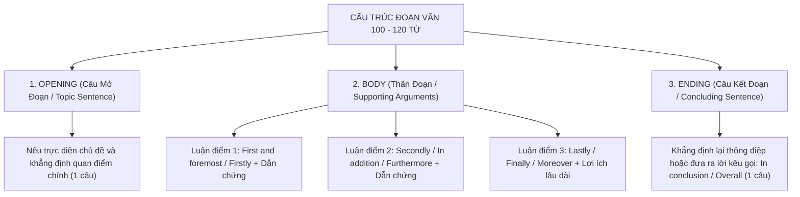

# Chuyên Đề 5: Hướng Dẫn Viết Đoạn Văn Nghị Luận 100 - 120 Từ

::: info ĐẶC TRƯNG ĐỀ THI QUẢNG NGÃI 2026 - 2027 & GDPT 2018:
Trong cấu trúc đề thi tuyển sinh mới của Sở GD&ĐT Quảng Ngãi, bài viết đoạn văn ngắn chiếm **1.0 đến 1.5 điểm** (10% - 15% tổng số điểm toàn bài thi). Học sinh được yêu cầu viết một đoạn văn mạch lạc từ **100 đến 120 từ** dựa trên các câu hỏi gợi ý (cues).
:::
---

## I. CẤU TRÚC ĐOẠN VĂN CHUẨN 3 PHẦN (PEEL / O-B-E MODEL)



### 1. Barem Chấm Điểm Tuyệt Đối Của Giám Khảo (1.0 - 1.5 điểm)
- **Task Achievement (0.25 - 0.5 đ):** Trả lời đầy đủ 100% các câu hỏi gợi ý trong đề bài; dung lượng đúng quy định (100 - 120 từ).
- **Coherence & Cohesion (0.25 - 0.5 đ):** Đoạn văn liền mạch, sử dụng các từ nối linh hoạt (`Firstly, Secondly, Furthermore, However, Therefore, As a result`).
- **Lexical Resource (0.25 đ):** Sử dụng các cụm từ (Collocations) và tính từ miêu tả phong phú, không lặp từ đơn điệu.
- **Grammatical Accuracy (0.25 đ):** Đúng thì, chuẩn sự hòa hợp chủ - vị, không sai chính tả dấu câu.

---

## II. BỘ TỪ NỐI HỌC THUẬT GHI ĐIỂM (DISCOURSE MARKERS)

| Chức năng diễn đạt | Các từ nối ăn điểm cao (Band 9.0) | Ví dụ minh họa |
| :--- | :--- | :--- |
| **Mở đầu luận điểm 1** | *First and foremost, To begin with, Firstly* | *First and foremost, learning English broadens our worldview.* |
| **Bổ sung luận điểm 2** | *In addition, Furthermore, Moreover, Secondly* | *Furthermore, regular exercise strengthens mental resilience.* |
| **Luận điểm cuối cùng** | *Lastly, Finally, Most importantly* | *Lastly, community service fosters mutual empathy.* |
| **Chỉ nguyên nhân - kết quả** | *Consequently, As a result, Therefore* | *As a result, teenagers become far more independent.* |
| **Kết đoạn tổng kết** | *In conclusion, All in all, Overall* | *In conclusion, keeping a balanced life guarantees future happiness.* |

---

## III. TUYỂN TẬP 6 BÀI LUẬN MẪU ĐẠT ĐIỂM CAO THEO CHỦ ĐỀ GDPT 2018

### Bài Mẫu 1: Nghề Nghiệp Ước Mơ (My Dream Job)
> **Đề bài:** In about 100 - 120 words, describe your dream job. Use the cues: What is the job? What will you do? What skills are needed? Why do you want to do it?

```text
My future favorite job is to become an English teacher because I am deeply passionate about sharing knowledge and inspiring the next generation. As a teacher, I will design interactive lessons, guide students through linguistic challenges, and organize lively communication workshops. To succeed in this profession, I need strong bilingual communication skills, endless patience, and creative problem-solving abilities. Being a teacher offers immense rewards: I can make a meaningful difference in young learners' lives, gain respect from the community, and continually broaden my own academic horizons. In conclusion, teaching is not merely a career, but a lifelong mission to empower students with global citizenship skills.
```

### Bài Mẫu 2: Cân Bằng Cuộc Sống Cho Học Sinh Lớp 9 (A Well-Balanced Life)
> **Đề bài:** In about 100 - 120 words, write a paragraph about how teenagers can maintain a well-balanced lifestyle amidst exam stress.

```text
Maintaining a well-balanced lifestyle is crucial for teenagers in today's demanding academic environment. First and foremost, students should establish a structured daily timetable that balances focused study sessions with adequate relaxation. Secondly, incorporating at least thirty minutes of physical exercise every morning, eating nutritious meals, and ensuring eight hours of sleep will rejuvenate both mental and physical health. Furthermore, engaging in relaxing hobbies such as reading, listening to music, or conversing with family members effectively alleviates examination anxiety. In conclusion, developing healthy daily routines empowers teenagers to minimize stress, enhance academic performance, and cultivate a happy, productive future.
```

### Bài Mẫu 3: Lợi Ích Của Hoạt Động Tình Nguyện Địa Phương (Community Service)
> **Đề bài:** In about 100 - 120 words, write a paragraph about the benefits of participating in local community projects for teenagers.

```text
Participating in local community projects offers invaluable benefits for teenagers. Firstly, it allows young volunteers to cultivate vital lifelong competencies, including teamwork, public communication, and crisis management. When students collaborate on green campaigns like cleaning public beaches or tutoring disadvantaged children, they develop profound social empathy and responsibility. In addition, volunteering provides practical real-world experience beyond textbooks, significantly boosting self-confidence and enriching future scholarship applications. Lastly, community engagement enables teens to forge meaningful friendships with like-minded peers. Overall, volunteering transforms teenagers into proactive, caring, and responsible citizens.
```

### Bài Mẫu 4: Bảo Tồn Làng Nghề Truyền Thống (Preserving Traditional Craft Villages)
> **Đề bài:** In about 100 - 120 words, write a paragraph on how young people can help preserve traditional craft villages in Vietnam.

```text
Preserving traditional craft villages is an urgent responsibility for the younger generation. Firstly, teenagers should take an active interest in traditional artistry by visiting ancient craft centers such as Bat Trang pottery village or Hoi An lantern workshops. By participating in hands-on crafting sessions, young learners can appreciate the tireless dedication of veteran artisans. Secondly, tech-savvy youths can leverage modern social media platforms like TikTok and YouTube to promote Vietnamese handcrafted masterpieces to global audiences. Lastly, choosing locally made souvenirs over mass-produced plastics directly supports artisan livelihoods. In conclusion, youth engagement is the vital bridge keeping our ancestral cultural heritage thriving.
```

### Bài Mẫu 5: Lợi Ích Của Việc Học Tiếng Anh Đối Với Tuổi Teen (Learning English)
> **Đề bài:** In about 100 - 120 words, explain why mastering the English language is essential for high school students.

```text
In today's interconnected global community, mastering the English language is an essential prerequisite for every teenager. First and foremost, English proficiency unlocks limitless educational horizons, enabling students to access prestigious international academic databases, enroll in online global courses, and earn overseas scholarships. Furthermore, English is the primary language of modern computing, artificial intelligence, and international commerce; therefore, being bilingual offers young job seekers an unparalleled competitive advantage. Lastly, communicating comfortably in English allows teenagers to make international friendships, explore diverse world cultures, and build immense self-confidence. In short, English is a powerful passport to personal growth and future prosperity.
```

### Bài Mẫu 6: Thay Đổi Thói Quen Lành Mạnh (Lifestyle Transformation)
> **Đề bài:** In about 100 - 120 words, describe a positive change in your lifestyle over the past year.

```text
Over the past year, transitioning from a sedentary lifestyle to an active, disciplined routine has profoundly transformed my health. Previously, I used to stay up late browsing social media, skip breakfast, and constantly feel lethargic during school lectures. Recognizing these detrimental effects, I resolved to wake up at 5:30 AM, drink warm lemon water, and jog around the park daily. Additionally, I strictly limited my non-academic screen time to one hour each evening and read inspiring books before bedtime. Consequently, I now feel energetic, mentally sharp, and academically motivated. In conclusion, adopting mindful habits has made me far more confident and resilient.
```
