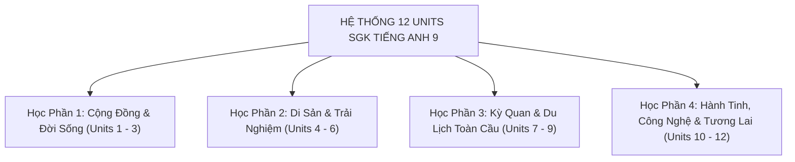

# 📚 CHUYÊN ĐỀ 6: TỔNG ÔN TOÀN DIỆN 12 UNITS SGK KẾT NỐI TRI THỨC

> [!IMPORTANT] **ĐỊNH HƯỚNG MA TRẬN ĐỀ THI VÀO 10 THEO CHƯƠNG TRÌNH 2018:**
> Đề thi tuyển sinh vào 10 tại Quảng Ngãi, Đà Nẵng và các tỉnh thành lớn khai thác **100% chủ đề ngữ liệu** từ 12 Units của bộ SGK mới (*Tiếng Anh 9 Global Success - Kết nối tri thức với cuộc sống*). Nắm vững từ vựng và ngữ pháp của 12 bài học này sẽ giúp học sinh tự tin giải quyết toàn bộ bài đọc hiểu, điền từ và viết lại câu.

---

## I. TỔNG HỢP KIẾN THỨC THEO 4 HỌC PHẦN (12 UNITS)

### 1. Học Phần 1: Cộng Đồng & Đời Sống (Units 1 - 3)

| Unit & Chủ đề | Từ vựng trọng tâm (Keywords) | Ngữ pháp chìa khóa |
| :--- | :--- | :--- |
| **Unit 1: Local community** | *artisan, craft village, pottery, souvenir, preserve, look round, pass down, hand down, community helper* | Câu phức với liên từ chỉ nhượng bộ (*although/though*), nguyên nhân (*because*), mục đích (*so that*) |
| **Unit 2: City life** | *bustling, liveable, concrete jungle, traffic congestion, commuter, metro, run out of, get on with, cut down on* | So sánh kép (*The more... the more...* / *The busier... the more stressful...*) |
| **Unit 3: Healthy living for teens** | *well-balanced, physical/mental health, cope with, anxious, anxiety, fattening food, nutritious, stay up late* | Từ để hỏi kết hợp động từ nguyên mẫu có to (*Wh- + to V*: *how to deal with*, *where to go*) |

### 2. Học Phần 2: Di Sản & Trải Nghiệm (Units 4 - 6)

| Unit & Chủ đề | Từ vựng trọng tâm (Keywords) | Ngữ pháp chìa khóa |
| :--- | :--- | :--- |
| **Unit 4: Remembering the past** | *deep-rooted, preserve, take pride in, seniority, generation gap, thatched house, barefoot, extended family* | Cấu trúc *used to / didn't use to + V-inf* và sự kết hợp thì Quá khứ đơn & Quá khứ tiếp diễn (*When/While*) |
| **Unit 5: Our experiences** | *breathtaking, once in a lifetime, adventurous, spectacular, overcome fear, challenge, memorable* | Thì Hiện tại hoàn thành với *since, for, already, yet, ever, never* |
| **Unit 6: Viet Nam: Then and now** | *dramatic changes, infrastructure, tram system, agricultural, facilities, modern conveniences* | Quá khứ hoàn thành (*had + V3/ed*) diễn tả hành động xảy ra trước một hành động khác trong quá khứ |

### 3. Học Phần 3: Kỳ Quan & Du Lịch Toàn Cầu (Units 7 - 9)

| Unit & Chủ đề | Từ vựng trọng tâm (Keywords) | Ngữ pháp chìa khóa |
| :--- | :--- | :--- |
| **Unit 7: Natural wonders of the world** | *limestone karsts, subterranean caves, coral reef, flora and fauna, UNESCO World Heritage, majestic* | Bị động khách quan: *It is said/believed/reported that...* $\leftrightarrow$ *S + is said/believed to V-inf* |
| **Unit 8: Tourism** | *ecotourism, sustainable travel, itinerary, homestay, domestic/international tourists, scenic spots* | Quy tắc sử dụng mạo từ xác định (*the*), không xác định (*a/an*) và mạo từ rỗng (*zero article ∅*) |
| **Unit 9: World Englishes** | *bilingual, official language, mother tongue, accent, dialect, imitate, pick up, global communication* | Mệnh đề quan hệ xác định và không xác định (*who, whom, which, that, whose, where, when*) |

### 4. Học Phần 4: Hành Tinh, Công Nghệ & Tương Lai (Units 10 - 12)

| Unit & Chủ đề | Từ vựng trọng tâm (Keywords) | Ngữ pháp chìa khóa |
| :--- | :--- | :--- |
| **Unit 10: Planet Earth** | *deforestation, greenhouse gas emissions, carbon footprint, renewable energy, climate change, extinction* | Câu điều kiện loại 1 & loại 2 (*If + S + V-ed, S + would/could + V-inf*) |
| **Unit 11: Electronic devices** | *artificial intelligence (AI), virtual reality, user-friendly, portable gadgets, state-of-the-art, revolution* | Mệnh đề chỉ kết quả với *so... that* và *such... that* |
| **Unit 12: Career choices** | *vocational training, job prospects, interview skills, apprentice, passionate, qualification, salary* | Câu gián tiếp với câu hỏi Yes/No (*if/whether*) và câu hỏi có từ để hỏi (*Wh-questions*) |

---

## II. BÀI TẬP CỦNG CỐ TRỌNG TÂM 12 UNITS (INTERACTIVE QUIZ)

<QuizItem
  :number="1"
  question="The village elder taught the young artisans how __________ delicate conical hats. (Unit 1)"
  options="A. make | B. to make | C. making | D. made"
  correct="B"
  explanation="Cấu trúc: how + to V-inf (cách làm cái gì)."
/>

<QuizItem
  :number="2"
  question="The more congested the city traffic becomes, __________ commuters feel. (Unit 2)"
  options="A. more stressful | B. the more stressful | C. the most stressful | D. stressful"
  correct="B"
  explanation="Cấu trúc so sánh kép: The + comparative..., the + comparative... -> the more stressful."
/>

<QuizItem
  :number="3"
  question="She didn't know __________ to consult about her anxiety before the entrance exam. (Unit 3)"
  options="A. who | B. which | C. whose | D. what"
  correct="A"
  explanation="'who to consult' (tìm ai để xin tư vấn)."
/>

<QuizItem
  :number="4"
  question="My grandfather __________ walk barefoot to school when he was a boy in the village. (Unit 4)"
  options="A. used to | B. is used to | C. was using | D. uses to"
  correct="A"
  explanation="'used to + V-inf' diễn tả thói quen trong quá khứ nay không còn nữa."
/>

<QuizItem
  :number="5"
  question="This is the most breathtaking natural wonder that I __________ in my life. (Unit 5)"
  options="A. ever saw | B. have ever seen | C. had seen | D. will see"
  correct="B"
  explanation="Cấu trúc so sánh nhất đi kèm thì hiện tại hoàn thành: 'have ever seen'."
/>

<QuizItem
  :number="6"
  question="By the time we arrived at the ancient station, the train __________. (Unit 6)"
  options="A. left | B. had already left | C. has left | D. leaves"
  correct="B"
  explanation="'By the time + quá khứ đơn' đi với mệnh đề quá khứ hoàn thành (had already left)."
/>

<QuizItem
  :number="7"
  question="Ha Long Bay is believed __________ one of the most magnificent geological wonders. (Unit 7)"
  options="A. be | B. to be | C. being | D. was"
  correct="B"
  explanation="Cấu trúc bị động khách quan: S + is believed + to V-inf (to be)."
/>

<QuizItem
  :number="8"
  question="Ecotourists are advised to minimize their impact on __________ environment. (Unit 8)"
  options="A. a | B. an | C. the | D. ∅"
  correct="C"
  explanation="Danh từ duy nhất chỉ môi trường tự nhiên dùng mạo từ xác định 'the environment'."
/>

<QuizItem
  :number="9"
  question="The foreign volunteer __________ taught us spoken English was very humorous. (Unit 9)"
  options="A. who | B. which | C. whom | D. whose"
  correct="A"
  explanation="Đại từ quan hệ 'who' thay thế cho danh từ chỉ người 'The foreign volunteer' làm chủ ngữ."
/>

<QuizItem
  :number="10"
  question="If everyone used renewable electricity, we __________ atmospheric pollution. (Unit 10)"
  options="A. will reduce | B. would reduce | C. reduced | D. can reduce"
  correct="B"
  explanation="Câu điều kiện loại 2: If + S + V-ed, S + would + V-inf."
/>

<QuizItem
  :number="11"
  question="This electronic device is __________ portable that it easily fits into a pocket. (Unit 11)"
  options="A. so | B. such | C. too | D. enough"
  correct="A"
  explanation="Cấu trúc: so + adj + that (quá... đến nỗi mà)."
/>

<QuizItem
  :number="12"
  question="My mother asked me what career I __________ after graduation. (Unit 12)"
  options="A. pursue | B. will pursue | C. would pursue | D. am pursuing"
  correct="C"
  explanation="Câu gián tiếp lùi thì từ 'will pursue' sang 'would pursue'."
/>

---

<strong>📋 Bảng Tra Cứu Toàn Bộ 12 Đáp Án Chuyên Đề 6</strong>

| Câu | Đáp Án | Trọng Tâm Kiến Thức (Unit) |
| :---: | :---: | :--- |
| **1** | `B` | Unit 1: Wh- + to V (how to make) |
| **2** | `B` | Unit 2: So sánh kép (the more stressful) |
| **3** | `A` | Unit 3: Từ để hỏi (who to consult) |
| **4** | `A` | Unit 4: Thói quen quá khứ (used to walk) |
| **5** | `B` | Unit 5: So sánh nhất & HTHT (have ever seen) |
| **6** | `B` | Unit 6: Quá khứ hoàn thành (had already left) |
| **7** | `B` | Unit 7: Bị động khách quan (to be) |
| **8** | `C` | Unit 8: Mạo từ xác định (the environment) |
| **9** | `A` | Unit 9: Đại từ quan hệ (who) |
| **10** | `B` | Unit 10: Điều kiện loại 2 (would reduce) |
| **11** | `A` | Unit 11: So... that (so portable that) |
| **12** | `C` | Unit 12: Câu gián tiếp (would pursue) |

