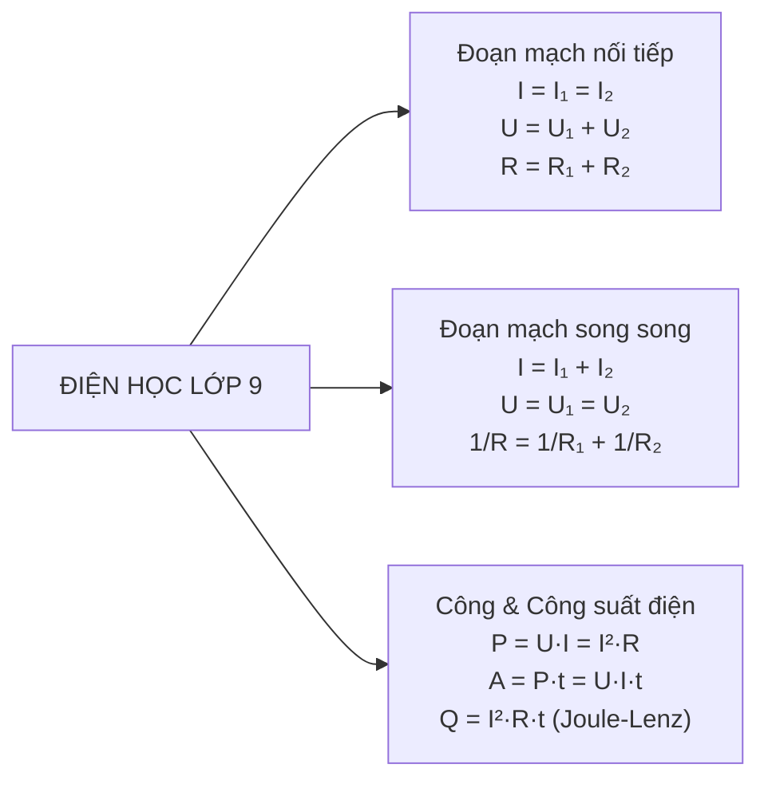

# ⚡ Sổ Tay Công Thức & Lý Thuyết Vật Lí 9 (Kết Nối Tri Thức)

::: info Định hướng ôn tập phân môn Vật lí lớp 9
Phân môn Vật lí trong bộ sách KHTN 9 Kết nối tri thức bao gồm 4 mảng kiến thức trụ cột:
1. **Cơ học & Năng lượng:** Động lượng, Động năng, Thế năng và Định luật bảo toàn cơ năng.
2. **Quang học:** Hiện tượng khúc xạ ánh sáng, Phản xạ toàn phần, Thấu kính hội tụ & Thấu kính phân kỳ.
3. **Điện học:** Định luật Ohm cho toàn mạch, Đoạn mạch nối tiếp và song song, Điện năng tiêu thụ và Công suất điện.
4. **Từ học & Năng lượng điện:** Cảm ứng điện từ, Dòng điện xoay chiều, Máy biến áp và Bài toán hao phí truyền tải điện năng.
:::

---

## I. CƠ HỌC: ĐỘNG LƯỢNG & NĂNG LƯỢNG CƠ HỌC

### 1. Động lượng (Momentum)
- **Định nghĩa:** Động lượng $\vec{p}$ của một vật khối lượng $m$ chuyển động với vận tốc $\vec{v}$ là đại lượng vectơ cùng hướng với vận tốc:
  $$\vec{p} = m \cdot \vec{v} \implies p = m \cdot v$$
  *(Đơn vị: $\text{kg}\cdot\text{m/s}$)*
- **Định luật bảo toàn động lượng:** Trong một hệ kín (không chịu ngoại lực tác dụng), tổng động lượng của hệ trước và sau va chạm luôn được bảo toàn:
  $$\vec{p}_1 + \vec{p}_2 = \vec{p}'_1 + \vec{p}'_2$$

### 2. Cơ năng (Mechanical Energy)
- **Động năng ($W_đ$):** Năng lượng do vật chuyển động mà có:
  $$W_đ = \dfrac{1}{2}m v^2$$
- **Thế năng trọng trường ($W_t$):** Năng lượng tương tác giữa Trái Đất và vật ở độ cao $h$:
  $$W_t = m \cdot g \cdot h$$
  *(với $g \approx 9.8 \text{ m/s}^2$ hoặc $10 \text{ m/s}^2$)*
- **Cơ năng toàn phần ($W$):**
  $$W = W_đ + W_t = \dfrac{1}{2}m v^2 + mgh$$
- **Định luật bảo toàn cơ năng:** Khi một vật chỉ chịu tác dụng của trọng lực, cơ năng của vật là một đại lượng bảo toàn:
  $$W = \text{const} \Longleftrightarrow W_{đ1} + W_{t1} = W_{đ2} + W_{t2}$$

---

## II. QUANG HỌC: KHÚC XẠ ÁNH SÁNG & THẤU KÍNH

### 1. Hiện tượng khúc xạ ánh sáng & Định luật khúc xạ
- **Định luật khúc xạ ánh sáng:**
  - Tia khúc xạ nằm trong mặt phẳng tới và ở bên kia pháp tuyến so với tia tới.
  - Tỉ số giữa $\sin$ góc tới ($i$) và $\sin$ góc khúc xạ ($r$) luôn không đổi đối với hai môi trường trong suốt nhất định:
    $$n_1 \sin i = n_2 \sin r \quad \text{hay} \quad \dfrac{\sin i}{\sin r} = \dfrac{n_2}{n_1} = n_{21}$$

### 2. Hiện tượng phản xạ toàn phần
- **Điều kiện để xảy ra hiện tượng phản xạ toàn phần:**
  1. Ánh sáng truyền từ môi trường chiết quang hơn sang môi trường chiết quang kém hơn ($n_1 > n_2$).
  2. Góc tới $i \ge i_{gh}$ (với góc giới hạn $\sin i_{gh} = \dfrac{n_2}{n_1}$).

### 3. Thấu kính hội tụ (TKHT) và Thấu kính phân kỳ (TKPK)

| Đặc điểm | Thấu kính hội tụ (Rìa mỏng) | Thấu kính phân kỳ (Rìa dày) |
| :--- | :--- | :--- |
| **Ký hiệu** | Mũi tên hướng ra ngoài ($\updownarrow$) | Mũi tên hướng vào trong ($\downleftrightarrow$) |
| **Chùm tia tới song song**| Cho chùm tia ló hội tụ tại tiêu điểm $F'$ | Cho chùm tia ló phân kỳ loe rộng ra |
| **Đặc điểm ảnh tạo bởi vật thật**| - $d > 2f$: Ảnh **thật, ngược chiều, nhỏ hơn vật** - $d = 2f$: Ảnh **thật, ngược chiều, bằng vật** - $f < d < 2f$: Ảnh **thật, ngược chiều, lớn hơn vật** - $d < f$: Ảnh **ảo, cùng chiều, lớn hơn vật** | Luôn cho **ảnh ảo, cùng chiều và nhỏ hơn vật**, nằm trong khoảng tiêu cự. |

#### Công thức Thấu kính dùng giải bài toán hình học:
$$\dfrac{1}{f} = \dfrac{1}{d} + \dfrac{1}{d'} \quad \text{và} \quad k = \dfrac{A'B'}{AB} = \dfrac{d'}{d}$$
> *Quy ước dấu:*
> - Ảnh thật: $d' > 0$; Ảnh ảo: $d' < 0$.
> - Thấu kính hội tụ: $f > 0$; Thấu kính phân kỳ: $f < 0$.

---

## III. ĐIỆN HỌC: ĐỊNH LUẬT OHM & ĐOẠN MẠCH

### 1. Định luật Ohm cho đoạn mạch
$$I = \dfrac{U}{R} \implies U = I \cdot R, \quad R = \dfrac{U}{I}$$

### 2. Bảng so sánh Đoạn mạch nối tiếp và Đoạn mạch song song

| Đại lượng | Đoạn mạch gồm $R_1$ nối tiếp $R_2$ | Đoạn mạch gồm $R_1$ song song $R_2$ |
| :--- | :--- | :--- |
| **Cường độ dòng điện ($I$)** | $I = I_1 = I_2$ | $I = I_1 + I_2$ |
| **Hiệu điện thế ($U$)** | $U = U_1 + U_2$ | $U = U_1 = U_2$ |
| **Điện trở tương đương ($R_{tđ}$)**| $R_{tđ} = R_1 + R_2$ | $\dfrac{1}{R_{tđ}} = \dfrac{1}{R_1} + \dfrac{1}{R_2} \implies R_{tđ} = \dfrac{R_1 \cdot R_2}{R_1 + R_2}$ |
| **Tỉ lệ dòng / áp** | $\dfrac{U_1}{U_2} = \dfrac{R_1}{R_2}$ (tỉ lệ thuận) | $\dfrac{I_1}{I_2} = \dfrac{R_2}{R_1}$ (tỉ lệ nghịch) |

### 3. Điện trở của dây dẫn
$$R = \rho \cdot \dfrac{l}{S}$$
- $\rho$: Điện trở suất của chất liệu làm dây dẫn ($\Omega \cdot \text{m}$).
- $l$: Chiều dài dây dẫn ($\text{m}$).
- $S$: Tiết diện dây dẫn ($\text{m}^2$). Với dây tiết diện tròn: $S = \pi \cdot r^2 = \pi \cdot \dfrac{d^2}{4}$.

### 4. Công suất điện & Điện năng tiêu thụ
- **Công suất điện:** $P = U \cdot I = I^2 \cdot R = \dfrac{U^2}{R}$ *(Đơn vị: Oát - W)*.
- **Công của dòng điện (Điện năng tiêu thụ):**
  $$A = P \cdot t = U \cdot I \cdot t = I^2 \cdot R \cdot t$$
  *(Đơn vị: Jun - $\text{J}$; hoặc kilôoát giờ - $\text{kW}\cdot\text{h}$, với $1 \text{ kW}\cdot\text{h} = 3\,600\,000 \text{ J}$)*.
- **Định luật Joule - Lenz (Nhiệt lượng tỏa ra trên dây dẫn):**
  $$Q = I^2 \cdot R \cdot t$$

---

## IV. CẢM ỨNG ĐIỆN TỪ & MÁY BIẾN ÁP

### 1. Hiện tượng cảm ứng điện từ
- Dòng điện cảm ứng xuất hiện trong cuộn dây dẫn kín khi **số đường sức từ xuyên qua tiết diện $S$ của cuộn dây dẫn đó biến thiên** (tăng lên hoặc giảm đi).

### 2. Máy biến áp (Máy biến thế)
- Cấu tạo: Gồm cuộn sơ cấp ($N_1$ vòng) nối với nguồn điện và cuộn thứ cấp ($N_2$ vòng) lấy điện ra.
- **Công thức máy biến áp:**
  $$\dfrac{U_1}{U_2} = \dfrac{N_1}{N_2}$$
  - Nếu $N_2 > N_1 \implies U_2 > U_1$: **Máy tăng áp**.
  - Nếu $N_2 < N_1 \implies U_2 < U_1$: **Máy hạ áp**.

### 3. Công suất hao phí do tỏa nhiệt trên đường dây truyền tải điện
$$P_{hp} = \dfrac{R \cdot P^2}{U^2}$$
- $P$: Công suất điện cần truyền tải ($\text{W}$).
- $U$: Hiệu điện thế ở hai đầu đường dây truyền tải ($\text{V}$).
- $R$: Điện trở tổng cộng của đường dây tải điện ($\Omega$).

::: tip KẾT LUẬN QUAN TRỌNG ĐỀ THI:
Để giảm hao phí trên đường dây tải điện, biện pháp hiệu quả và kinh tế nhất là **tăng hiệu điện thế $U$** đặt vào hai đầu đường dây truyền tải (dùng máy tăng áp). Vì $P_{hp}$ tỉ lệ nghịch với $U^2$, nên khi **$U$ tăng lên $n$ lần thì công suất hao phí giảm đi $n^2$ lần**.
:::
