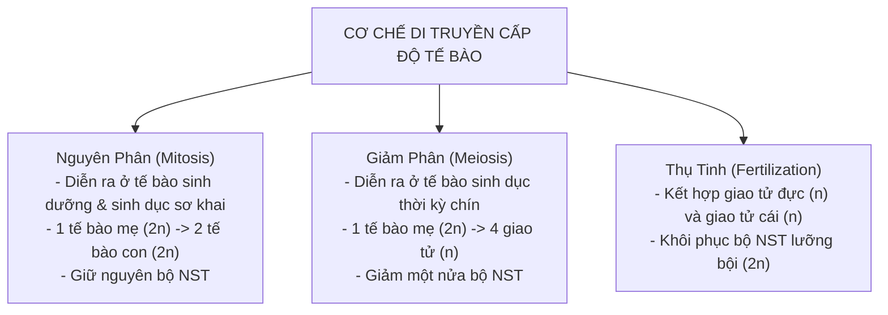

# 🧬 Sổ Tay Di Truyền & Sinh Thái Học Sinh Học 9 (Kết Nối Tri Thức)

::: info Định hướng ôn tập phân môn Sinh học lớp 9
Phân môn Sinh học trong bộ sách KHTN 9 Kết nối tri thức gồm 2 mảng kiến thức lớn:
1. **Di truyền và Biến dị:** Quy luật Mendel, Nhiễm sắc thể & Các hình thức phân bào, Cơ sở phân tử của sự di truyền (ADN, ARN, mã di truyền, tổng hợp Protein) và Các dạng đột biến.
2. **Sinh vật và Môi trường:** Các nhân tố sinh thái, Quần thể sinh vật, Quần xã sinh vật, Hệ sinh thái (chuỗi và lưới thức ăn) và Ý thức bảo vệ sinh quyển.
:::

---

## I. QUY LUẬT DI TRUYỀN MENDEL

### 1. Các thuật ngữ cơ bản cần nắm vững
- **Tính trạng:** Những đặc điểm về hình thái, cấu tạo, sinh lí của cơ thể sinh vật (ví dụ: hạt vàng, thân cao).
- **Cặp tính trạng tương phản:** Hai trạng thái biểu hiện trái ngược nhau của cùng một loại tính trạng (ví dụ: hạt trơn - hạt nhăn).
- **Gen (Alen):** Nhân tố di truyền quy định tính trạng. Alen trội ký hiệu bằng chữ in hoa ($A$), alen lặn ký hiệu bằng chữ in thường ($a$).
- **Kiểu gen:** Toàn bộ các gen trong tế bào cơ thể ($AA$: đồng hợp trội, $Aa$: dị hợp, $aa$: đồng hợp lặn).
- **Kiểu hình:** Tập hợp toàn bộ các tính trạng của cơ thể được biểu hiện ra bên ngoài.

### 2. Quy luật phân li (Lai một cặp tính trạng)
Khi lai hai cơ thể bố mẹ thuần chủng khác nhau về một cặp tính trạng tương phản:
- Đời con $F_1$ đồng tính biểu hiện tính trạng của một bên (tính trạng trội).
- Đời con $F_2$ phân li tính trạng theo tỉ lệ trung bình: **3 Trội : 1 Lặn** (Về kiểu gen: $1 AA : 2 Aa : 1 aa$).

$$\mathbf{P: \quad AA \text{ (hạt vàng)} \times aa \text{ (hạt xanh)} \implies F_1: 100\% Aa \text{ (hạt vàng)}}$$
$$\mathbf{F_1 \times F_1: \quad Aa \times Aa \implies F_2: 1 AA : 2 Aa : 1 aa \quad (3 \text{ vàng} : 1 \text{ xanh})}$$

### 3. Phép lai phân tích
- Là phép lai giữa cá thể mang tính trạng trội cần xác định kiểu gen với cá thể mang tính trạng lặn:
  - Nếu đời con **đồng tính** $\implies$ Cá thể mang tính trạng trội có kiểu gen **đồng hợp ($AA$)**.
  - Nếu đời con **phân tính theo tỉ lệ $1 : 1$** $\implies$ Cá thể mang tính trạng trội có kiểu gen **dị hợp ($Aa$)**.

---

## II. NHIỄM SẮC THỂ & CÁC CƠ CHẾ PHÂN BÀO

### So sánh bản chất giữa Nguyên phân và Giảm phân

| Tiêu chí | Nguyên phân | Giảm phân |
| :--- | :--- | :--- |
| **Loại tế bào diễn ra** | Tế bào sinh dưỡng và tế bào sinh dục sơ khai | Tế bào sinh dục chín (tạo tinh trùng, trứng) |
| **Số lần phân bào** | 1 lần phân bào duy nhất | 2 lần phân bào liên tiếp |
| **Kỳ đầu** | Không có sự tiếp hợp và trao đổi chéo giữa các NST | Có thể xảy ra tiếp hợp và trao đổi chéo ở kỳ đầu I |
| **Kết quả tạo thành** | **Từ 1 tế bào mẹ ($2n$) tạo ra 2 tế bào con có bộ NST giống hệt mẹ ($2n$)** | **Từ 1 tế bào mẹ ($2n$) tạo ra 4 tế bào con có bộ NST giảm đi một nửa ($n$)** |
| **Ý nghĩa sinh học** | Giúp cơ thể lớn lên, thay thế tế bào già; duy trì ổn định bộ NST qua các thế hệ tế bào. | Tạo ra các giao tử mang bộ NST đơn bội ($n$); kết hợp với thụ tinh tạo nhiều biến dị tổ hợp. |

---

## III. CƠ SỞ PHÂN TỬ CỦA DI TRUYỀN: ADN - ARN - PROTEIN

### 1. Cấu trúc và chức năng của ADN (Axit đêôxiribônuclêic)
- Cấu tạo theo **nguyên tắc đa phân**, đơn phân là 4 loại nuclêôtit: **A (Ađênin), T (Timin), G (Guanin), X (Xitôzin)**.
- Gồm hai chuỗi pôlinuclêôtit xoắn kép ngược chiều nhau liên kết theo **nguyên tắc bổ sung (NTBS)**:
  $$\mathbf{A \text{ liên kết với } T \text{ bằng 2 liên kết hiđrô} \quad (A = T)}$$
  $$\mathbf{G \text{ liên kết với } X \text{ bằng 3 liên kết hiđrô} \quad (G \equiv X)}$$

#### Các công thức tính toán toán học ADN:
- Tổng số nuclêôtit của ADN: $N = 2A + 2G = 2T + 2X$.
- Chiều dài phân tử ADN: $L = \dfrac{N}{2} \times 3.4 \text{ Å}$ *(với $1 \text{ nm} = 10 \text{ Å}$)*.
- Khối lượng phân tử ADN: $M = N \times 300 \text{ đvC}$.
- Tổng số liên kết hiđrô: $H = 2A + 3G$.

### 2. Mối quan hệ giữa Gen và Tính trạng
$$\mathbf{\text{Gen (ADN)} \xrightarrow{\text{Phiên mã}} \text{mARN} \xrightarrow{\text{Dịch mã}} \text{Prôtêin} \longrightarrow \text{Tính trạng}}$$

- **Phiên mã:** Tổng hợp mARN dựa trên một mạch khuôn của gen theo nguyên tắc bổ sung:
  $$A_{\text{khuôn}} - U, \quad T_{\text{khuôn}} - A, \quad G_{\text{khuôn}} - X, \quad X_{\text{khuôn}} - G$$
- **Dịch mã:** Các ribôxôm dịch chuyển trên mARN, mỗi bộ ba mã sao (codon) khớp với bộ ba đối mã (anticodon) trên tARN để sắp xếp các axit amin thành chuỗi pôlipeptit hoàn chỉnh.

---

## IV. BIẾN DỊ: ĐỘT BIẾN GEN VÀ ĐỘT BIẾN NHIỄM SẮC THỂ

| Loại đột biến | Các dạng thường gặp | Nguyên nhân & Hậu quả |
| :--- | :--- | :--- |
| **Đột biến gen** | - Mất một cặp nuclêôtit - Thêm một cặp nuclêôtit - Thay thế một cặp nuclêôtit | Do tác nhân vật lí, hóa học môi trường làm sai hỏng sao chép ADN; có thể gây hại, trung tính hoặc tạo nguồn nguyên liệu cho chọn giống. |
| **Đột biến cấu trúc NST**| - Mất đoạn - Lặp đoạn - Đảo đoạn - Chuyển đoạn | Làm thay đổi trật tự hoặc số lượng gen trên NST; thường gây chết hoặc giảm sức sống của sinh vật (ví dụ: mất đoạn đầu NST 21 gây bệnh ung thư máu). |
| **Đột biến số lượng NST**| - Thể dị bội ($2n+1, 2n-1$) - Thể đa bội ($3n, 4n$)| Rối loạn phân li NST trong phân bào. *Ví dụ dị bội:* Thừa 1 NST số 21 ($2n+1=47$) gây **Hội chứng Đao (Down)**. |

---

## V. SINH THÁI HỌC & BẢO VỆ MÔI TRƯỜNG

### 1. Chuỗi thức ăn và Lưới thức ăn
- **Chuỗi thức ăn:** Là một dãy gồm nhiều loài sinh vật có quan hệ dinh dưỡng với nhau, mỗi loài là một mắt xích tiêu thụ mắt xích phía trước và bị mắt xích phía sau tiêu thụ.
  - *Ví dụ:* $\text{Cỏ} \longrightarrow \text{Châu chấu} \longrightarrow \text{Ếch} \longrightarrow \text{Rắn} \longrightarrow \text{Đại bàng}$.
- **Lưới thức ăn:** Tập hợp các chuỗi thức ăn có các mắt xích chung trong một hệ sinh thái.
- **Thành phần của một hệ sinh thái hoàn chỉnh:**
  1. Thành phần vô sinh (đất, nước, ánh sáng, nhiệt độ).
  2. Sinh vật sản xuất (thực vật quang hợp, tảo).
  3. Sinh vật tiêu thụ (động vật ăn thực vật, động vật ăn thịt).
  4. Sinh vật phân giải (vi khuẩn, nấm, giun đất).
